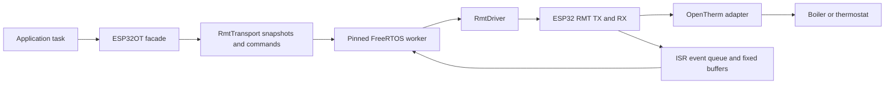

# ESP32OT: complete API and implementation reference

[Русский](API.ru.md) · [Project overview](../README.md) · [Examples](../examples/README.md)

This reference describes the declarations and behavior of this checkout. It covers
the application facade, every message wrapper, protocol data types, configuration,
callbacks, transport/driver methods, and internal helper types. Internal and private
members are documented for maintainers; applications normally include only
`<ESP32OT.h>` and use `ESP32OT::ESP32OT` and `ESP32OT::Messages`.

ESP32OT is an independent OpenTherm master/slave library for ESP32, developed during
work on [OTGateway](https://github.com/Laxilef/OTGateway), based on
[Ihor Melnyk's OpenTherm library](https://github.com/ihormelnyk/opentherm_library).
The library is licensed under GPL-3.0-only; see [LICENSE](../LICENSE). The documentation
retains credit to the original work. The implementation requires Arduino-ESP32 with the
ESP-IDF 6 RMT APIs and C++17 or later. Board profiles cover ESP32, S2, S3, C3 and C6;
GPIO choices and external OpenTherm adapters depend on the board/application.

## Contents

- [How to read this reference](#how-to-read-this-reference)
- [Architecture and ownership](#architecture-and-ownership)
- [A complete master example](#a-complete-master-example)
- [Asynchronous completion and callback ownership](#asynchronous-completion-and-callback-ownership)
- [Completion, retries and timing](#completion-retries-and-timing)
- [Values, raw frames and routing](#values-raw-frames-and-routing)
- [Examples and practical selection](#examples-and-practical-selection)
- [Controller facade: `ESP32OT::ESP32OT`](#controller-facade-esp32otesp32ot)
  - [Facade type aliases](#facade-type-aliases)
  - [Methods and special members](#methods-and-special-members)
  - [Private storage](#private-storage)
- [Message model and complete wrapper reference](#message-model-and-complete-wrapper-reference)
  - [Messages::Message](#messagesmessage)
  - [Messages::BrandCharacter](#messagesbrandcharacter)
  - [Messages::Capacity](#messagescapacity)
  - [Messages::Date](#messagesdate)
  - [Messages::DayTime](#messagesdaytime)
  - [Messages::FanSpeed](#messagesfanspeed)
  - [Messages::Fault](#messagesfault)
  - [Messages::Float](#messagesfloat)
  - [Messages::IndexedValue](#messagesindexedvalue)
  - [Messages::Int16](#messagesint16)
  - [Messages::MasterConfig](#messagesmasterconfig)
  - [Messages::NominalVentilation](#messagesnominalventilation)
  - [Messages::ParameterCount](#messagesparametercount)
  - [Messages::ProductVersion](#messagesproductversion)
  - [Messages::RFSensorStatus](#messagesrfsensorstatus)
  - [Messages::RemoteOverrideFunction](#messagesremoteoverridefunction)
  - [Messages::RemoteOverrideMode](#messagesremoteoverridemode)
  - [Messages::RemoteParameters](#messagesremoteparameters)
  - [Messages::RemoteRequest](#messagesremoterequest)
  - [Messages::SlaveConfig](#messagesslaveconfig)
  - [Messages::SolarStorageConfig](#messagessolarstorageconfig)
  - [Messages::SolarStorageFault](#messagessolarstoragefault)
  - [Messages::SolarStorageStatus](#messagessolarstoragestatus)
  - [Messages::Status](#messagesstatus)
  - [Messages::TemperatureBounds](#messagestemperaturebounds)
  - [Messages::UInt16](#messagesuint16)
  - [Messages::UInt8](#messagesuint8)
  - [Messages::VentilationConfig](#messagesventilationconfig)
  - [Messages::VentilationFault](#messagesventilationfault)
  - [Messages::VentilationRemoteParameters](#messagesventilationremoteparameters)
  - [Messages::VentilationStatus](#messagesventilationstatus)
- [Protocol types and raw frames](#protocol-types-and-raw-frames)
  - [`ESP32OT::Protocol::MessageType`](#esp32otprotocolmessagetype)
  - [`ESP32OT::Protocol::MessageID`](#esp32otprotocolmessageid)
  - [`ESP32OT::Protocol::OperationStatus`](#esp32otprotocoloperationstatus)
  - [`ESP32OT::MessageID / MessageType / OperationStatus`](#esp32otmessageid--messagetype--operationstatus)
  - [`ESP32OT::Protocol::MessageData`](#esp32otprotocolmessagedata)
  - [`ESP32OT::Protocol::Frame`](#esp32otprotocolframe)
- [Transport configuration and callbacks](#transport-configuration-and-callbacks)
  - [`ESP32OT::Transport::Config`](#esp32ottransportconfig)
  - [`ESP32OT::Transport::StatusEvent`](#esp32ottransportstatusevent)
  - [`ESP32OT::Transport::StatusCallback / MessageCallback`](#esp32ottransportstatuscallback--messagecallback)
  - [`ESP32OT::Transport::LegacyStatusCallback / LegacyMessageCallback`](#esp32ottransportlegacystatuscallback--legacymessagecallback)
  - [`ESP32OT::Transport::RmtTransport`](#esp32ottransportrmttransport)
  - [RmtTransport implementation details](#rmttransport-implementation-details)
  - [`ESP32OT::Transport::RmtTransport::ActiveOperation`](#esp32ottransportrmttransportactiveoperation)
  - [RmtTransport private methods](#rmttransport-private-methods)
- [RMT driver implementation reference](#rmt-driver-implementation-reference)
  - [`ESP32OT::Transport::RmtDriver`](#esp32ottransportrmtdriver)
  - [`ESP32OT::Transport::RmtDriver::State`](#esp32ottransportrmtdriverstate)
  - [`ESP32OT::Transport::RmtDriver::ResultStatus`](#esp32ottransportrmtdriverresultstatus)
  - [RmtDriver public lower-level methods](#rmtdriver-public-lower-level-methods)
  - [RmtDriver private methods](#rmtdriver-private-methods)
  - [CPP-local transport types, constants and decoding functions](#cpp-local-transport-types-constants-and-decoding-functions)
  - [`ESP32OT::Transport::RmtEventType`](#esp32ottransportrmteventtype)
  - [`ESP32OT::Transport::RmtEvent`](#esp32ottransportrmtevent)
  - [`ESP32OT::Transport::RmtDriver::RmtContext`](#esp32ottransportrmtdriverrmtcontext)
  - [`ESP32OT::Transport::RmtDecodedFrame`](#esp32ottransportrmtdecodedframe)
  - [`ESP32OT::Transport::RmtPulse`](#esp32ottransportrmtpulse)
  - [`ESP32OT::Transport::RmtPhaseCandidate`](#esp32ottransportrmtphasecandidate)

## How to read this reference

- **Application API:** the facade and message classes. A method's access level is
  stated when it is not public. Constructors/factories create value snapshots.
- **Protocol API:** enum values, raw-frame helpers and metadata. Use these for
  unknown IDs, vendor fields, logging and exact forwarding.
- **Transport implementation:** the worker and RMT driver. Its public C++ methods
  are lower-level interfaces, not an additional application polling obligation.
- **Internal example:** a call shown inside an owning class or helper is contextual
  pseudocode. It does not make a private member callable by an application.
- Each explicitly declared overload has its own entry. Inherited methods are
  described once at their declaring class and apply to derived wrappers. Implicit
  wrapper copy construction/assignment uses ordinary value-copy semantics.

The header `<ESP32OT.h>` includes the facade and all message wrappers. Namespace
`ESP32OT` exposes `MessageID`, `MessageType` and `OperationStatus` aliases for the
corresponding `ESP32OT::Protocol` enums. The nested facade aliases refer to the same
types; they do not allocate or define separate wire formats.

## Architecture and ownership



Each controller owns one small worker, its own transport state and RMT resources.
The worker is pinned to `Config::core`, owns allocation/cleanup on that core,
processes complete capture events before timeouts and invokes callbacks outside
interrupt context and internal locks. There is one pending/running operation per
instance. Application tasks do not call a `process()` loop. Two controllers can
implement a gateway; each interface retains independent GPIOs, role and timing.

Synchronous calls wait while yielding; the worker continues independently.
Asynchronous calls report acceptance immediately and complete later through
snapshots/callbacks. Neither successful acceptance nor `isReady()` establishes that
a peer is connected. `isInitialized()`, bus readiness, terminal completion, a full
frame and acknowledged data are separate conditions.

## A complete master example

```cpp
#include <ESP32OT.h>

static ESP32OT::ESP32OT controller;

void setup() {
  Serial.begin(115200);
  ESP32OT::ESP32OT::Config config;
  config.rxGpio = GPIO_NUM_35;
  config.txGpio = GPIO_NUM_36;
  config.maxAttempts = 5;
  controller.setConfig(config);
}

void loop() {
  if (!controller.isInitialized()) {
    if (!controller.end() || !controller.begin()) {
      Serial.printf("begin error=%ld\n", static_cast<long>(controller.getLastError()));
      delay(1000);
      return;
    }
  }

  const auto result = controller.sendRequest(
    ESP32OT::Messages::Float::read(ESP32OT::MessageID::Tboiler)
  );
  Serial.println(ESP32OT::Protocol::Frame::statusToString(result.getStatus()));
  if (result.isSuccess()) {
    Serial.printf("boiler temperature=%.2f C\n", result.get());
  }

  if (result.hasFrame()) {
    Serial.printf("raw=%08lX\n", static_cast<unsigned long>(result.getRaw()));
  }

  delay(150);
}
```

Select GPIOs appropriate to the adapter and ESP32 board. The GPIO35/36 pair above
is an example, not a portable board default. `Float::read(Tboiler)` returns a typed
wrapper, and typed `sendRequest` retains that wrapper in its result. Only
`isSuccess()` permits using its payload as acknowledged data. `hasFrame()` is
necessary for terminal timeout/error results because they may have no received
frame; it does not replace validity/success checks.

For Status reads, construct `Messages::Status` and set the desired master flags.
Its requested CH/DHW flags are distinct from reported slave activity. A zero
temperature is not a universal heating-off command. ReadAll performs diagnostic
reads, including Status with clear master enable flags; select those flags according
to the application. The library does not impose an ID polling schedule.

## Asynchronous completion and callback ownership

Message/status observers accept single-argument `std::function` handlers,
including capturing lambdas. This master example observes outgoing requests and
incoming responses with independent hooks; the captured label points to a string
literal that remains valid after setup returns.

```cpp
using Controller = ESP32OT::ESP32OT;
using Message = ESP32OT::Messages::Message;

static Controller controller(GPIO_NUM_4, GPIO_NUM_5);

void setup() {
  Serial.begin(115200);
  const char* label = "boiler ";

  controller.onRequest([label](const Message& request) {
    Serial.print(label);
    Serial.print("TX start: ");
    Serial.println(request.getRaw(), HEX);
  });
  controller.onResponse([label](const Message& response) {
    Serial.print(label);
    Serial.print("RX: ");
    Serial.println(response.getRaw(), HEX);
  });
  controller.onStatusChange([label](const Controller::StatusEvent& event) {
    if (event.message.isComplete() && !event.message.hasFrame()) {
      Serial.print(label);
      Serial.println(ESP32OT::Protocol::Frame::statusToString(event.current));
    }
  });
  controller.begin();
}

void loop() {
  if (controller.isReady()) {
    controller.sendRequestAsync(ESP32OT::Messages::Status());
  }

  delay(750);
}
```

In master role, `onRequest` runs before each local transmission attempt with
`TRANSMITTING` and `hasFrame() == false`; later cancellation or failure can
prevent transmission. It does not confirm TX completion. `onResponse` receives
complete RX frames, including invalid ones.
In slave role, `onRequest` receives full RX requests and `onResponse` observes
outgoing responses before TX. The two hooks can be registered independently in
either role. Only RX notifications guarantee `hasFrame()`; they need no redundant
frame guard. A timeout without a full frame is a status event.

Existing function/context registrations remain available through
`LegacyMessageCallback` and `LegacyStatusCallback`. For example:

```cpp
static void responseReceived(const Message& response, void* context) {
  Serial.print(static_cast<const char*>(context));
  Serial.println(response.getRaw(), HEX);
}

static char responseLabel[] = "boiler RX ";
// In setup(), as an alternative to the response lambda:
// controller.onResponse(responseReceived, responseLabel);
```

The `MessageCallback` and `StatusCallback` aliases now describe the one-argument
owned functions; explicitly typed old function pointers use the `Legacy` aliases.
An empty callback or a setter called without arguments clears that hook.

Callback message references are temporary: retain value copies for later use.
Handlers run on the worker outside ISR/internal locks. Keep them short and
nonblocking; a TX observer delays the start of transmission. The same-instance
synchronous send/begin/end is rejected from the worker. Forward between instances
asynchronously and avoid cycles of blocking workers.

Nonempty registration allocates shared callable storage; captures may allocate
more. Dispatch copies shared ownership rather than the function object. An owned
closure does not own objects referenced through captures, `this` or legacy
context. Replacing/clearing a hook does not wait for a snapshotted/running call.
Keep borrowed storage alive until those calls finish; successful `end()` provides
shutdown before its destruction. Select the role before registering message
hooks: a stopped role change clears both request/response hooks, while the status
hook remains registered.

`DelayCallback` remains a function pointer plus borrowed context. Set/clear it
only while fully stopped. It must yield and must not reenter a synchronous
operation on the same instance.

## Completion, retries and timing

`SUCCESS` means acknowledged data or successful slave TX. `DATA_INVALID` and
`UNKNOWN_DATA_ID` are valid negative responses: terminal, not `isSuccess()`, and
their payload is not an acknowledged reading. `INVALID` means damaged timing,
parity/type failure or a response ID mismatching the active master request.
Unsolicited passive reception is not compared with an old request ID.

`Config::maxAttempts` counts all synchronous master attempts, including the first;
default 5, zero means one. Success, valid negative replies, cancellation and shutdown
stop retries. Invalid responses, timeouts and recoverable errors can be retried
while attempts remain. Async operations and slave TX have one attempt. Attempt
callbacks preserve individual failures; a final successful retry does not erase
what happened on the wire. The retry counter supports 255 attempts without wrapping.

After successful hardware setup, `begin()` holds TX at idle level 1 for 1150 ms
before entering READY.

TX uses 500 us half-bits: start, 32 data bits MSB-first and stop. RX accepts timing
variation and asymmetric half-bits; a complete phase-recovery interpretation must
be unique from timing before parity/type/ID validation. Raw parity is never repaired.
Receive inactivity allows 1 s plus 40 ms frame grace and 2.5 ms capture idle; this is a
deadline budget, not a measured response latency. The TX watchdog is 1 s. The
driver enforces master 100 ms / slave 20 ms waits from RX_DONE, with upward tick
rounding. Application intervals determine polling frequency and application-level
connection/reinitialization policy. For continuous control, OpenTherm §4.3.1
requires communication at least once per 1 s (+15% tolerance), MCI 1.15 s; schedule
requests accordingly. Diagnostic long pauses and explicit end/begin cycles do not
maintain a continuous control session. Printing from worker callbacks consumes worker
time; see [TransparentProxy](../examples/TransparentProxy/TransparentProxy.ino)
before using callback logging in a latency-sensitive gateway.

## Values, raw frames and routing

`Message` contains a raw frame and operation metadata. Wrappers decode the same
16-bit payload on demand; they do not add payload caches or allocate dynamically.
`as<T>()` explicitly copies into the caller-selected wrapper without RTTI or an
automatic ID check. Use the correct wrapper for the actual ID/format.

`build()` and raw send methods retain raw bits, including invalid parity and
vendor fields. Named setters rebuild the changed field/header/parity and preserve
unrelated payload bits and received routing metadata. Use exact raw forwarding
when changes are unwanted. `reply()` retains ID and request sequence, supplies a
new response frame and starts fresh operation metadata. A stale sequence cannot
reply to a newer request or a request from before end()/begin().

Simple numeric formats use Float/UInt16/Int16/UInt8. Structured IDs use their named
wrappers and flags. ID30 retains the existing f8.8 interpretation despite the
specification's s16/f8.8 ambiguity. ID100 uses its detailed LB priority flags.
ID103's contradictory system-type bit position is not guessed. See each wrapper
and the full MessageID table below for units and supported field names.

## Examples and practical selection

| Task | Example / method family |
| --- | --- |
| Straight-line master polling | [Master](../examples/Master/Master.ino), `sendRequest` in `loop()` |
| Synchronous requests with per-attempt callbacks | [MasterCallbacks](../examples/MasterCallbacks/MasterCallbacks.ino) |
| Nonblocking master operations | [MasterAsync](../examples/MasterAsync/MasterAsync.ino), `isReady` and async sends |
| All readable IDs and indexed TSP/FHB | [ReadAll](../examples/ReadAll/README.md) |
| ID tests, optional configured writes, observed access map and status totals | [TestAllIDs](../examples/TestAllIDs/README.md) |
| Simulated slave and explicit unsupported replies | [Slave](../examples/Slave/Slave.ino), `onRequest` and async response |
| Two independent OpenTherm buses | [TransparentProxy](../examples/TransparentProxy/TransparentProxy.ino) |
| Heap, largest-block minima, lifecycle and stack measurements | [MasterHeap](../examples/MasterHeap/README.md) |

Heap measurements must use compatible allocation capability pools. Track both
free heap and the largest allocatable block, their observed minima, and the maximum
`100*(1-largest/free)` using a single matching snapshot; handle free=0 explicitly.
This ratio describes concentration of free space, not a complete allocator health
proof. Heap, static RAM, IRAM, task-stack margins and flash are separate budgets.
Periodic observations can miss shorter allocation dips.
## Controller facade: `ESP32OT::ESP32OT`

Sources: [ESP32OT.h](../src/ESP32OT.h), [ESP32OT.cpp](../src/ESP32OT.cpp).
This noncopyable controller owns one independent pinned FreeRTOS worker and one
OpenTherm RMT interface. Application code uses this facade for master polling,
slave replies, passive observation and two-instance forwarding. It does not need
an application `process()` loop. The namespace and class deliberately share a name;
use fully qualified types or the following local aliases.

```cpp
#include <ESP32OT.h>
using Controller = ESP32OT::ESP32OT;
using Message = ESP32OT::Messages::Message;
using Status = ESP32OT::Messages::Status;
```

The independent snippets below assume `boiler` is a configured master and `slave`
is a configured slave. Sending snippets require successful `begin()`. `received`
denotes a copied, current accepted slave request, not an arbitrary new Message;
`rawReply` and `currentSequence` denote a prepared reply and that request's sequence.
Named callback function definitions belong at file scope; lambdas can be registered
inline. Examples marked intentionally
rejected demonstrate deleted operations; internal examples are implementation
context, not application calls. GPIOs in these examples must match the board.

The facade has no public data fields. All configuration fields, StatusEvent members,
enum values and payload-wrapper methods are documented in their own type sections.

### Facade type aliases

Aliases introduce no additional storage or conversion. The following are all eleven
aliases declared inside the facade.

#### `MessageID`

```cpp
using MessageID = ::ESP32OT::MessageID;
```

Data identifier enum; select the payload's ID.

```cpp
Controller::MessageID id = ESP32OT::MessageID::Tboiler;
```

#### `MessageType`

```cpp
using MessageType = ::ESP32OT::MessageType;
```

Wire operation/type enum; select READ_DATA, WRITE_DATA or reply type.

```cpp
Controller::MessageType type = ESP32OT::MessageType::READ_ACK;
```

#### `OperationStatus`

```cpp
using OperationStatus = ::ESP32OT::OperationStatus;
```

Local operation state, distinct from wire MessageType.

```cpp
Controller::OperationStatus state = boiler.getResult().getStatus();
```

#### `Message`

```cpp
using Message = ::ESP32OT::Messages::Message;
```

Value-owned raw frame and operation metadata; base of every payload wrapper.

```cpp
Controller::Message read = Message::read(ESP32OT::MessageID::Tboiler);
```

#### `Config`

```cpp
using Config = ::ESP32OT::Transport::Config;
```

Full GPIO, role, retry and worker configuration; use a stopped-only replacement.

```cpp
Controller::Config cfg = boiler.getConfig();
```

#### `StatusEvent`

```cpp
using StatusEvent = ::ESP32OT::Transport::StatusEvent;
```

Callback view with previous/current status and a temporary const Message&.

```cpp
// Callback argument:
const Controller::StatusEvent& event = callbackEvent;
```

#### `StatusCallback`

```cpp
using StatusCallback = ::ESP32OT::Transport::StatusCallback;
```

std::function<void(const StatusEvent&)>; owned single-argument worker status handler, including capturing lambdas.

```cpp
Controller::StatusCallback hook = [](const Controller::StatusEvent& event) {
  Serial.println(ESP32OT::Protocol::Frame::statusToString(event.current));
};
```

#### `MessageCallback`

```cpp
using MessageCallback = ::ESP32OT::Transport::MessageCallback;
```

std::function<void(const Messages::Message&)>; owned single-argument request/response observer for RX and pre-TX notifications in either role.

```cpp
Controller::MessageCallback hook = [](const Message& message) {
  Serial.println(message.getRaw(), HEX);
};
```

#### `LegacyStatusCallback`

```cpp
using LegacyStatusCallback = ::ESP32OT::Transport::LegacyStatusCallback;
```

void (*)(const StatusEvent&, void*); compatibility function pointer for an explicitly borrowed context.

```cpp
Controller::LegacyStatusCallback hook = statusChanged;
```

#### `LegacyMessageCallback`

```cpp
using LegacyMessageCallback = ::ESP32OT::Transport::LegacyMessageCallback;
```

void (*)(const Messages::Message&, void*); compatibility request/response function pointer with borrowed context.

```cpp
Controller::LegacyMessageCallback hook = responseReceived;
```

#### `DelayCallback`

```cpp
using DelayCallback = void (*)(unsigned int milliseconds, void* context);
```

Synchronous caller wait/yield hook; milliseconds are the requested wait, context is caller-owned.

```cpp
Controller::DelayCallback hook = yieldCaller;
```

### Methods and special members

#### `ESP32OT`

```cpp
ESP32OT();
```

Construct a master controller with the default Config; use when GPIOs will be assigned later.

Delegates to the Config constructor. No worker or RMT channels are started. Default GPIO_NUM_NC requires setConfig or begin(rxGpio, txGpio) before use.

```cpp
Controller boiler;
```

#### `explicit ESP32OT`

```cpp
explicit ESP32OT(const Config& config);
```

Construct a controller from a complete application configuration, for master, slave or proxy interfaces.

Copies the configuration by value and constructs the transport with its role. The caller's Config can be destroyed afterwards. Hardware validation and resource creation occur in begin(), not in this constructor.

```cpp
Controller::Config cfg;
cfg.rxGpio = GPIO_NUM_35;
cfg.txGpio = GPIO_NUM_36;
cfg.maxAttempts = 1;
Controller boiler(cfg);
```

#### `explicit ESP32OT`

```cpp
explicit ESP32OT(gpio_num_t rxGpio, gpio_num_t txGpio, bool isSlave = false, bool alwaysReceive = false);
```

Construct a controller with board GPIOs and optional slave/passive receive settings.

Builds Config{rxGpio, txGpio, isSlave, alwaysReceive}; all remaining configuration fields retain their defaults. RX is the adapter input into ESP32, TX its output. This does not start communication.

```cpp
Controller boiler(GPIO_NUM_35, GPIO_NUM_36);
Controller thermostatSide(GPIO_NUM_4, GPIO_NUM_5, true, false);
```

#### `~ESP32OT`

```cpp
~ESP32OT();
```

Stop the owned transport before a controller object's storage is destroyed; useful for scoped instances.

Calls transport.end(), then clears all three owned observer hooks while the facade configuration still exists. Captured objects are released before facade members are destroyed. Cleanup failure triggers ESP_ERROR_CHECK(ESP_ERR_INVALID_STATE), since silently freeing live worker storage is unsafe. Call end() explicitly if cleanup errors must be handled; do not destroy an instance inside its own worker callback.

```cpp
{
  Controller scoped(cfg);
  if (scoped.begin()) {
    auto result = scoped.sendRequest(Status());
    (void)result;
  }
} // Destructor stops the scoped transport.
```

#### `ESP32OT`

```cpp
ESP32OT(const ESP32OT&) = delete;
```

Prohibit copying ownership of a worker, synchronization objects and RMT resources.

A compile-time restriction; it performs no runtime work. Pass Controller& or Controller* to helpers. The following is an intentionally rejected example.

```cpp
Controller copied(boiler); // Does not compile: copying is deleted.
```

#### `ESP32OT& operator=`

```cpp
ESP32OT& operator=(const ESP32OT&) = delete;
```

Prohibit replacing one live controller's ownership by a copied controller.

Compile-time rejection. To change settings, stop the instance, copy its Config and call setConfig. This rejected assignment is not a configuration update.

```cpp
other = boiler; // Does not compile: copy assignment is deleted.
```

#### `ESP32OT`

```cpp
ESP32OT(ESP32OT&&) = delete;
```

Keep the controller address stable for worker/ISR routing and callback ownership.

Moving is forbidden even when stopped. Construct the final object in its final storage, or pass a reference. The example is intentionally rejected.

```cpp
Controller moved(static_cast<Controller&&>(boiler)); // Does not compile.
```

#### `ESP32OT& operator=`

```cpp
ESP32OT& operator=(ESP32OT&&) = delete;
```

Prohibit moving resource ownership between controller objects.

Compile-time restriction with no runtime action. Reconfigure an existing stopped instance instead of assigning another controller.

```cpp
other = static_cast<Controller&&>(boiler); // Does not compile.
```

#### `bool begin`

```cpp
bool begin();
```

Start the worker and RMT resources using the saved configuration; use at startup or after a successful end().

Waits for the worker's startup acknowledgment, including a 1150 ms hold of TX at idle level 1 after successful hardware setup, and returns whether initialization succeeded. Rejects an already-running instance and invalid hardware/task settings. A false result can coexist with resources that need end(); it does not prove full cleanup. Initialization is not confirmation of a responding boiler. Not callable from ISR or this instance's worker callback.

```cpp
if (!boiler.begin()) {
  Serial.printf("begin error: %ld\n", static_cast<long>(boiler.getLastError()));
}
```

#### `bool begin`

```cpp
bool begin(gpio_num_t rxGpio, gpio_num_t txGpio);
```

Start using a new GPIO pair while retaining the other saved settings.

Copies Config temporarily, substitutes RX/TX, then starts the transport. Saves those GPIOs to the facade Config only on successful startup; failure retains its previous GPIO pair. Lifecycle restrictions and error reporting match begin().

```cpp
Controller boiler;
if (boiler.begin(GPIO_NUM_35, GPIO_NUM_36)) {
  auto savedRx = boiler.getConfig().rxGpio;
  (void)savedRx;
}
```

#### `bool end`

```cpp
bool end();
```

Cooperatively stop callbacks, active/pending operations and owned hardware before reconfiguration or destruction.

Requests worker shutdown and waits for cleanup acknowledgment. Active/pending operations complete as CANCELLED. Already stopped is true. A false result means cleanup did not fully succeed and can be retried; do not assume the worker is gone. Rejected in ISR and the same instance's worker callback. Existing callbacks finish as part of successful shutdown, unlike merely clearing a hook.

```cpp
if (boiler.end()) {
  auto cfg = boiler.getConfig();
  cfg.maxAttempts = 1;
  boiler.setConfig(cfg);
}
```

#### `bool isInitialized`

```cpp
bool isInitialized() const;
```

Check whether the transport currently reports initialized, non-stopping hardware.

Returns a synchronized transport snapshot. It is not peer connectivity, successful reception or proof that a false/fatal instance has released all resources. Use end() to establish stopped ownership before reconfiguration.

```cpp
if (!boiler.isInitialized()) {
  // Initialization/recovery policy belongs to the application.
}
```

#### `bool isReady`

```cpp
bool isReady() const;
```

Check whether another asynchronous operation may be submitted without an outstanding operation or protocol wait.

Requires initialized, not stopping, not busy, and the driver's READY state. Includes the inter-frame gap; completion can precede readiness. It says nothing about a connected boiler. Concurrent callers can change the state after this snapshot, so still check the async submission's bool result.

```cpp
if (boiler.isReady()) {
  const bool accepted = boiler.sendRequestAsync(Status());
  (void)accepted;
}
```

#### `esp_err_t getLastError`

```cpp
esp_err_t getLastError() const;
```

Read the most recently published transport/SDK error, for lifecycle and submission diagnostics.

Returns esp_err_t, not an OperationStatus. A normal receive TIMEOUT or valid negative reply can have ESP_OK; inspect the Message status separately. Later operations may replace this instance-wide error, so retain per-result getError() when correlating an exchange.

```cpp
esp_err_t error = boiler.getLastError();
Serial.printf("transport error: %ld\n", static_cast<long>(error));
```

#### `uint32_t getWorkerStackHighWaterMark`

```cpp
uint32_t getWorkerStackHighWaterMark() const;
```

Measure the smallest observed unused worker-stack space while tuning callback and task stack budgets.

Returns bytes reported by this ESP-IDF FreeRTOS port, or zero when no worker exists. This is stack, not heap; it is an observed watermark for executed paths rather than a worst-case guarantee. Query while the worker still exists, before successful end().

```cpp
uint32_t unusedBytes = boiler.getWorkerStackHighWaterMark();
Serial.printf("worker unused stack: %lu B\n", static_cast<unsigned long>(unusedBytes));
```

#### `const Config& getConfig`

```cpp
const Config& getConfig() const;
```

Inspect saved settings or obtain a copy for stopped-only reconfiguration.

Returns a const reference owned by the facade, not a mutable configuration handle or peer state. Copy it before changing fields. Its lifetime is limited by the controller; avoid holding it through controller destruction.

```cpp
auto cfg = boiler.getConfig();
cfg.maxAttempts = 3;
```

#### `bool setConfig`

```cpp
bool setConfig(const Config& config);
```

Replace the entire saved configuration while fully stopped, including role selection.

Takes the session and calls stopped-only role configuration; success copies the complete Config. Does not merge only non-default fields. A role change clears both request and response hooks but retains the status hook. Register message hooks after selecting the role. Hardware/task argument validity is checked at begin(). Returns false if session/role configuration cannot be acquired or the worker still exists.

```cpp
if (boiler.end()) {
  auto cfg = boiler.getConfig();
  cfg.maxAttempts = 3;
  const bool updated = boiler.setConfig(cfg);
  (void)updated;
}
```

#### `ESP32OT& setDelayCallback`

```cpp
ESP32OT& setDelayCallback(DelayCallback callback = nullptr, void* context = nullptr);
```

Customize how the synchronous caller yields while waiting, for integration with an application scheduler.

Stores only function/context pointers and returns *this for chaining. Set or clear only while fully stopped; an attempted change while running is silently ignored. nullptr restores vTaskDelay with at least one tick. The callback must yield and must not reenter a same-instance synchronous operation, which can replace its completion snapshot. It is not the protocol inter-frame-delay policy. Context must outlive all uses.

```cpp
static void yieldCaller(unsigned int ms, void*) {
  const TickType_t ticks = pdMS_TO_TICKS(ms);
  vTaskDelay(ticks > 0 ? ticks : 1);
}
// Before begin():
boiler.setDelayCallback(yieldCaller, nullptr);
// After a successful end():
boiler.setDelayCallback();
```

#### `ESP32OT& onStatusChange`

```cpp
ESP32OT& onStatusChange(StatusCallback callback = nullptr);
```

Observe public status transitions, including failures without a complete frame.

Returns *this. An empty callback clears the hook. The owned std::function accepts capturing lambdas. The worker invokes it outside internal locks/ISR once for an actual status change. StatusEvent and its Message reference are temporary. Nonempty registration allocates shared callable storage; dispatch retains shared ownership without copying the callable. Captured references/pointers remain borrowed. Keep handlers short/nonblocking; clearing/replacing is not a completion barrier. Successful end() finishes worker calls before captured objects are destroyed.

```cpp
const char* label = "boiler ";
boiler.onStatusChange([label](const Controller::StatusEvent& event) {
  Serial.print(label);
  Serial.println(ESP32OT::Protocol::Frame::statusToString(event.current));
});
```

#### `ESP32OT& onStatusChange`

```cpp
ESP32OT& onStatusChange(LegacyStatusCallback callback, void* context = nullptr);
```

Keep existing status function-pointer/context registrations source-compatible.

Adapts the two-argument function/context pair to the owned single-argument status handler and returns *this. nullptr clears the hook. Context is borrowed and must outlive running/snapshotted calls. Other callback, threading and replacement rules match the primary overload.

```cpp
static void statusChanged(const Controller::StatusEvent& event, void*) {
  Serial.println(ESP32OT::Protocol::Frame::statusToString(event.current));
}
boiler.onStatusChange(statusChanged, nullptr);
```

#### `bool onResponse`

```cpp
bool onResponse(MessageCallback callback = nullptr);
```

Observe received responses in master role and outgoing responses in slave role.

Installs/clears the independent response hook and returns true in either role. Master RX includes complete invalid, negative and unsolicited passive frames; hasFrame is true but success is not guaranteed. Slave TX invokes the hook once before each local transmission attempt with TRANSMITTING and hasFrame=false. Later cancellation or failure can prevent TX; the hook confirms neither completion nor delivery. An empty callback clears the hook. The std::function may capture state; allocation/ownership, temporary references and replacement rules match onStatusChange. A long outgoing observer delays TX start.

```cpp
const char* label = "boiler RX ";
const bool installed = boiler.onResponse([label](const Message& response) {
  Serial.print(label);
  Serial.println(response.getRaw(), HEX);
});
```

#### `bool onResponse`

```cpp
bool onResponse(LegacyMessageCallback callback, void* context = nullptr);
```

Keep existing response function-pointer/context registrations in either role.

Adapts the old two-argument function and borrowed context to the response observer. Returns true, including when nullptr clears it. Callback timing and RX/TX metadata match the primary overload; changing the MessageCallback alias does not require changing these registration calls. For an explicitly typed old function pointer, use LegacyMessageCallback.

```cpp
static void responseReceived(const Message& response, void*) {
  Serial.println(response.getRaw(), HEX);
}
boiler.onResponse(responseReceived, nullptr);
```

#### `bool onRequest`

```cpp
bool onRequest(MessageCallback callback = nullptr);
```

Observe outgoing master requests or complete received slave requests.

Installs/clears the independent request hook and returns true in either role. Master TX calls it once before each local transmission attempt with TRANSMITTING and hasFrame=false; later cancellation or failure can prevent TX. Slave RX provides full frames, including invalid ones; normal accepted requests have REQUEST_RECEIVED. Invalid noise does not supersede a saved valid request by default. Check status/type/ID before an asynchronous reply. Same-instance synchronous send/begin/end remain rejected in the worker. Owned capture/replacement rules match onStatusChange; an empty callback clears the hook.

```cpp
const char* label = "boiler TX ";
boiler.onRequest([label](const Message& request) {
  Serial.print(label);
  Serial.println(request.getRaw(), HEX);
});
```

#### `bool onRequest`

```cpp
bool onRequest(LegacyMessageCallback callback, void* context = nullptr);
```

Use a function/context request handler, including an asynchronous slave reply.

The compatibility adapter retains the function and borrowed context, not the pointed-to object. It follows the same both-role semantics and returns true; nullptr clears registration. Preserve context until running/snapshotted calls finish, or successfully end the instance before destroying it.

```cpp
static void requestReceived(const Message& request, void* context) {
  auto& slave = *static_cast<Controller*>(context);
  if (request.getStatus() != ESP32OT::OperationStatus::REQUEST_RECEIVED) {
    return;
  }

  if (request.getId() == ESP32OT::MessageID::Status) {
    if (request.getType() == ESP32OT::MessageType::READ_DATA) {
      slave.sendResponseAsync(request.as<Status>().reply(0));

    } else {
      slave.sendResponseAsync(request.reply(ESP32OT::MessageType::DATA_INVALID, 0));
    }

  } else {
    slave.sendResponseAsync(request.reply(ESP32OT::MessageType::UNKNOWN_DATA_ID, 0));
  }
}
slave.onRequest(requestReceived, &slave);
```

#### `bool sendRequestAsync`

```cpp
bool sendRequestAsync(const Message& request);
```

Submit a single master request without blocking the caller.

Returns whether the command was accepted, not whether the boiler replied. Requires initialized master role and no other pending/running operation. The worker handles TX, RX and protocol waits; no external process() is needed. Exactly one attempt, independent of Config::maxAttempts. Inspect getResult or callbacks for completion; retain value copies, not temporary references.

```cpp
if (boiler.isReady() && boiler.sendRequestAsync(Status())) {
  // Continue application work; observe completion later.
}
```

#### `bool sendResponseAsync`

```cpp
bool sendResponseAsync(const Message& response);
```

Submit a slave reply, particularly from onRequest, without blocking its worker.

Requires slave role and a response carrying the current nonzero saved-request sequence. Use request.reply to retain ID/routing. Returns acceptance; completion SUCCESS means TX completed, because masters do not acknowledge slave replies. One attempt. An old sequence or another active operation is rejected. Worker waits for the slave response gap before transmitting.

```cpp
const auto response = received.reply(ESP32OT::MessageType::UNKNOWN_DATA_ID, 0);
const bool accepted = slave.sendResponseAsync(response);
```

#### `Message sendRequest`

```cpp
Message sendRequest(const Message& request);
```

Send a generic master request and synchronously obtain a value snapshot of its final result.

Waits by yielding while the independent worker runs. May wait for an earlier accepted async operation. Master retries INVALID, TIMEOUT and recoverable errors up to maxAttempts total (zero means one), stopping for success, valid negatives, cancellation or shutdown. Returns Message preserving request/operation metadata; check isSuccess before using data and hasFrame before treating getRaw as received frame. Same-worker/ISR calls are rejected as ERROR.

```cpp
auto result = boiler.sendRequest(Message::read(ESP32OT::MessageID::Tboiler));
if (result.isSuccess()) {
  const float value = result.as<ESP32OT::Messages::Float>().get();
  Serial.println(value);
}
```

#### `Message sendResponse`

```cpp
Message sendResponse(const Message& response);
```

Send a generic slave reply from an application task and wait for its transmission result.

Uses one attempt and validates current request sequence/role. SUCCESS confirms slave TX, not a further acknowledgment from the master. Blocking sendResponse is rejected inside this same instance's worker callback; use sendResponseAsync there. Build the response from the still-current received request; an obsolete routing snapshot is rejected.

```cpp
// Application task, after obtaining a current accepted request:
auto response = received.reply(ESP32OT::MessageType::UNKNOWN_DATA_ID, 0);
auto sent = slave.sendResponse(response);
```

#### `T sendRequest`

```cpp
template<class T, typename std::enable_if<std::is_base_of<Message, T>::value, int>::type = 0> T sendRequest(const T& request);
```

Send a typed master request and retain the same wrapper type in the returned result.

Enabled only for Message-derived T. Copies the supplied T, then parses the final metadata snapshot into that copy. It does not select a wrapper from the received ID and does not guarantee that a complete payload is successful. Retry/yield/role restrictions match the generic overload; getter units and meaning belong to T.

```cpp
auto result = boiler.sendRequest(ESP32OT::Messages::Float(ESP32OT::MessageID::Tboiler));
if (result.isSuccess()) {
  Serial.printf("Flow: %.2f C\n", result.get());
}
```

#### `T sendResponse`

```cpp
template<class T, typename std::enable_if<std::is_base_of<Message, T>::value, int>::type = 0> T sendResponse(const T& response);
```

Transmit a typed slave reply while keeping its wrapper type for inspecting the TX result.

Copies T, calls the same synchronous response engine, and parses the result into the copy. Sequence, single-attempt and callback restrictions are identical to the generic response method; wrapper construction alone is not sufficient request routing.

```cpp
// Application task; received is a current ID25 read request.
auto typed = received.as<ESP32OT::Messages::Float>();
auto response = typed.reply(ESP32OT::MessageType::READ_ACK, 35.5f);
auto sent = slave.sendResponse(response);
```

#### `Message getResult`

```cpp
Message getResult() const;
```

Copy the latest public transport result or in-progress state for asynchronous polling and diagnostics.

Returns a synchronized value snapshot, without waiting. It may be QUEUED/TRANSMITTING/WAITING or a terminal result; check isComplete and correlate getOperation when necessary. Readiness and peer connectivity are separate. Unsolicited passive RX can be reported independently; a later operation may replace the instance's latest result.

```cpp
auto result = boiler.getResult();
if (result.isComplete()) {
  Serial.println(ESP32OT::Protocol::Frame::statusToString(result.getStatus()));
}
```

#### `Message getRequest`

```cpp
Message getRequest() const;
```

Copy the latest accepted slave-side request, for deferred asynchronous reply or routing checks.

Returns the saved request snapshot, including nonzero sequence for an accepted slave request. A master instance starts with an empty request snapshot; this method is not the outgoing master request (that is result.getRequest()). end/begin clears the saved request, and a newer request supersedes it.

```cpp
auto request = slave.getRequest();
if (request.getSequence() != 0) {
  auto id = request.getId();
  (void)id;
}
```

#### `void getResult`

```cpp
void getResult(Message& destination) const;
```

Refresh an existing Message or derived wrapper with the latest result snapshot.

Calls destination.parse with the synchronized transport snapshot, preserving the destination's C++ type; no runtime ID-to-wrapper conversion occurs. Has no return value and does not wait. Payload meaning must be chosen by the caller from status/ID.

```cpp
ESP32OT::Messages::Float result;
boiler.getResult(result);
if (result.isSuccess() && result.getId() == ESP32OT::MessageID::Tboiler) {
  Serial.println(result.get());
}
```

#### `void getRequest`

```cpp
void getRequest(Message& destination) const;
```

Refresh an existing wrapper with the latest saved slave request without creating a generic local snapshot first.

Calls destination.parse on the saved request. It does not validate that destination's expected format matches the ID. The request can become stale before reply; current-sequence validation still occurs at submission. No return value and no waiting.

```cpp
Status request;
slave.getRequest(request);
if (request.getSequence() != 0 && request.getId() == ESP32OT::MessageID::Status) {
  const bool heating = request.isCentralHeatingEnabled();
  (void)heating;
}
```

#### `T getResult`

```cpp
template<class T> T getResult() const;
```

Obtain the latest result directly as a caller-selected default-constructible wrapper.

Default-constructs T and calls parse with the transport snapshot. T must support those operations; unlike typed send, this declaration has no explicit enable_if constraint. It performs neither ID validation nor a wait. There is no corresponding getRequest<T>(); use getRequest().as<T>() or the destination overload.

```cpp
auto result = boiler.getResult<ESP32OT::Messages::Float>();
if (result.isSuccess() && result.getId() == ESP32OT::MessageID::Tboiler) {
  Serial.println(result.get());
}
```

#### `Message sendRawRequest`

```cpp
Message sendRawRequest(uint32_t frame);
```

Synchronously send a complete raw master frame for vendor IDs, unknown IDs or transparent forwarding.

Wraps all 32 supplied bits in Message and uses the normal master synchronous/retry engine. Does not rebuild parity or sanitize reserved/vendor bits. The return is generic Message; all complete invalid response bits remain available. It is not safe to use response-type bits as a substitute for selecting slave role.

```cpp
const uint32_t rawRequest = ESP32OT::Protocol::Frame::build(
  ESP32OT::MessageType::READ_DATA, ESP32OT::MessageID::Tboiler, 0
);
auto result = boiler.sendRawRequest(rawRequest);
```

#### `Message sendRawResponse`

```cpp
Message sendRawResponse(uint32_t frame, uint32_t requestSequence);
```

Synchronously transmit an exact raw slave reply tied to the current saved request.

Builds a MessageData with frame and requestSequence, then uses sendResponse. The nonzero sequence must match the latest accepted request and cannot survive end/begin. Does not repair parity or change raw ID. One attempt; SUCCESS means TX completed. Use outside this worker's callback, where the asynchronous variant is required.

```cpp
// Application task; received is the current accepted request.
const auto reply = received.reply(ESP32OT::MessageType::UNKNOWN_DATA_ID, 0);
auto sent = slave.sendRawResponse(reply.build(), received.getSequence());
```

#### `bool sendRawRequestAsync`

```cpp
bool sendRawRequestAsync(uint32_t frame);
```

Submit an exact raw master frame without waiting, as used for transparent proxy forwarding.

Preserves all 32 bits and uses single-attempt sendRequestAsync. bool is command acceptance, not response validity or connectivity. Do not lose the routing context kept by the application when forwarding between independent instances. Worker handles timing; application should not block one worker waiting synchronously on another.

```cpp
const bool accepted = boiler.sendRawRequestAsync(rawRequest);
```

#### `bool sendRawResponseAsync`

```cpp
bool sendRawResponseAsync(uint32_t frame, uint32_t requestSequence);
```

Forward an exact raw slave reply asynchronously using the matching current request sequence.

Copies raw frame and requestSequence into a value command, preserving even incorrect parity when explicitly forwarding raw data. It still enforces role, initialization, one-operation ownership and sequence freshness. Returns acceptance, not completion; the master sends no ACK for this reply.

```cpp
const bool accepted = slave.sendRawResponseAsync(rawReply, currentSequence);
```

#### `::ESP32OT::Protocol::MessageData sendMessage`

```cpp
::ESP32OT::Protocol::MessageData sendMessage(const Message& message, bool response);
```

**Private implementation detail.** Internal synchronous orchestration used by both generic and typed request/response wrappers.

Private: application code cannot call this method. response=false selects master request, true slave response. Retains a session across attempts, yields through wait, consumes the dedicated synchronous completion snapshot, enforces total attempt limits and returns final metadata including total elapsed microseconds. It differs from Transport::RmtTransport::sendMessage, which accepts one command for the worker and returns bool immediately. Rejects ISR/same-worker calls before waiting.

```cpp
// Implementation context only; not an application-callable API:
result.parse(sendMessage(request, false));
```

#### `void wait`

```cpp
void wait(unsigned int milliseconds);
```

**Private implementation detail.** Internal caller-yield primitive for synchronous polling; used while a prior operation or the current attempt progresses.

Private: calls the installed DelayCallback(milliseconds, delayContext), or vTaskDelay with pdMS_TO_TICKS and at least one tick. It neither drives RX parsing nor configures protocol deadlines. The worker progresses independently. Custom callbacks must preserve yielding and cannot recursively send synchronously on this same facade.

```cpp
// Implementation context only:
while (transport.isBusy() && isInitialized()) {
  wait(10);
}
```

### Private storage

These fields are listed for maintainers; use the public methods from applications.

#### `::ESP32OT::Transport::RmtTransport transport`

Owns worker/driver/synchronization, receives commands and exposes snapshots. Constructed with Config::isSlave.

```cpp
// Class implementation only:
return transport.isInitialized();
```

#### `Config config`

Saved complete configuration copied by constructors/setConfig. Public access is const getConfig().

```cpp
// Application equivalent:
auto copy = boiler.getConfig();
```

#### `DelayCallback delayCallback = nullptr`

Optional non-owning caller wait function, modifiable only while fully stopped.

```cpp
// Public setter:
boiler.setDelayCallback(yieldCaller);
```

#### `void* delayContext = nullptr`

Non-owning context passed to delayCallback; facade never allocates or frees it.

```cpp
// Public setter; waitContext must outlive callback use:
boiler.setDelayCallback(yieldCaller, &waitContext);
```
## Message model and complete wrapper reference

All classes in this section are in ESP32OT::Messages. Message is a concrete polymorphic base; the other 30 classes are final and derive from Message. They own one Protocol::MessageData, with no second payload cache or dynamic wrapper selection.

Snapshot/Message constructors and as<T>() retain raw bits and all metadata without checking the ID. build() returns raw without repairing parity. Named setters recalculate parity and retain unrelated payload bits, but are not raw forwarding of reserved header bits. A fresh NONE/sequence0 request follows edits; a received snapshot retains its original request.

reply() retains source ID and sequence, records source frame as request, and starts fresh operation/status/attempt/timing fields. Reply to a received request with reply(), not a standalone value constructor. Constructing/editing a wrapper performs no I/O, checks no device support and does not itself enable heating.

Tables list every explicitly declared overload, including constructors and internal helpers. All 30 derived classes also inherit Message public methods; specialized read/write/reply overloads may hide base names, which can be explicitly qualified when needed. Ordinary object copying retains the snapshot value.

Call examples assume the aliases below and an already obtained result. In a table m is an object of the current class, usually result.as<M::Class>(); snapshot is used by constructors/parse. Private/protected calls show code inside the implementation, not application API. WRITE examples construct objects and require an appropriate writable ID before actual transmission; ID200 in Int16 is a placeholder vendor ID, not a standard parameter.

```cpp
namespace M = ESP32OT::Messages;
using ID = ESP32OT::MessageID;
using MT = ESP32OT::MessageType;
// result is an ESP32OT::Messages::Message returned by a real operation.
const auto snapshot = result.getMessageData();
```

### Messages::Message

Concrete raw-frame and operation-snapshot base. Use for arbitrary/vendor IDs, raw logging, routing replies and explicit conversion to a known payload format.

Source: [Message.h](../src/Messages/Message.h).

Protected field data: Protocol::MessageData; the single owned raw-frame/metadata snapshot. Used by the base and derived classes, not an application-managed second payload.

| Signature and access | Purpose, behavior and application | Call example |
| --- | --- | --- |
| `explicit Message(uint32_t frame = 0)` (public) | Store frame and request=frame; status=NONE, hasFrame=false, other fields default. Use to hold a raw request/snapshot; construction does not mean a frame was received. | `M::Message m{result.getRaw()};` |
| `explicit Message(const Protocol::MessageData& snapshot)` (public) | Copy the complete snapshot, including raw/bad parity, request and operation metadata; no ID check. Use to view a transport result in this payload format. | `M::Message m{snapshot};` |
| `virtual ~Message()` (public) | Virtual default base destructor permits correct destruction through Message*; it owns no dynamic payload/transport resource. Normally invoked automatically. | `{ M::Message local; } // scope exit` |
| `virtual uint32_t build() const` (public) | Return the exact stored 32-bit frame, including reserved/vendor bits and bad parity; no transmission, validation or parity repair. Used for raw forwarding and logging. | `auto value = m.build();` |
| `virtual void parse(const Protocol::MessageData& snapshot)` (public) | Replace the entire snapshot with the supplied MessageData, without changing raw bits or validating the ID. Used to refresh a reusable message object from a transport result. | `m.parse(snapshot);` |
| `template<class T> T as() const` (public) | Return a value of caller-selected T by constructing T from this message; T must derive from Message. Copies raw bits and metadata, performs no ID/format check, heap allocation or RTTI. Used only after the caller has selected the correct wrapper. | `auto typed = m.as<M::Float>();` |
| `const Protocol::MessageData& getMessageData() const` (public) | Return a const reference to the complete owned snapshot; its lifetime is bounded by this object and its values change on parse/edits. Copy the value to retain it beyond a callback. | `auto value = m.getMessageData();` |
| `uint32_t getRaw() const` (public) | Return the stored frame unchanged. Check hasFrame before treating it as a complete received frame. A successful slave TX instead retains the transmitted response even when hasFrame is false; a hand-constructed request also carries raw bits independently of that flag. Used for direction-aware raw logging/forwarding. | `auto value = m.getRaw();` |
| `uint32_t getRequest() const` (public) | Return the retained request frame. A master result records its outgoing request; a reply builder records the source request frame. Used for request/response correlation and indexed text queries. | `auto value = m.getRequest();` |
| `uint16_t getData() const` (public) | Return payload bits15..0 without checking validity or interpreting format. Used for raw diagnostic fields or building a known custom wrapper. | `auto value = m.getData();` |
| `uint8_t getHighByte() const` (public) | Return payload bits15..8, 0..255. Interpretation depends on the ID; this is not necessarily a value or a flag byte. | `auto value = m.getHighByte();` |
| `uint8_t getLowByte() const` (public) | Return payload bits7..0, 0..255. Interpretation depends on the ID. | `auto value = m.getLowByte();` |
| `Protocol::MessageID getId() const` (public) | Extract MessageID from frame bits23..16 without checking whether that ID is supported or matches this wrapper. Used to select the correct explicit as<T>() conversion. | `auto value = m.getId();` |
| `Protocol::MessageType getType() const` (public) | Extract the 3-bit MessageType from the frame. Used to distinguish read/write requests, ACKs and valid negative replies. | `auto value = m.getType();` |
| `Protocol::OperationStatus getStatus() const` (public) | Return the operation status, not merely the on-wire message type. Use together with hasFrame/isSuccess/isComplete to distinguish data, negative replies and transport failures. | `auto value = m.getStatus();` |
| `uint32_t getOperation() const` (public) | Return the transport operation counter used to correlate accepted outgoing work and completion snapshots; not a boiler device/session identity. | `auto value = m.getOperation();` |
| `uint32_t getSequence() const` (public) | Return the received-request routing sequence retained in replies. Used to reject stale slave/proxy replies; do not fabricate or replace it when replying to a received request. | `auto value = m.getSequence();` |
| `uint32_t getElapsedUs() const` (public) | Return elapsed microseconds for the attempt from transport acceptance, including queue/minimum-wait time. Unsolicited received frames report zero. This is not pure boiler response latency. | `auto value = m.getElapsedUs();` |
| `uint32_t getTotalElapsedUs() const` (public) | Return total synchronous facade-call duration in the returned final result, including attempts/waits. Per-attempt callbacks/async snapshots instead carry the attempt elapsed duration; use the returned result for whole-call profiling. | `auto value = m.getTotalElapsedUs();` |
| `uint8_t getAttempt() const` (public) | Return the 1-based outgoing attempt number; synchronous master retries increment it, async/slave TX use1, and fresh/unsolicited snapshots use0. Used to distinguish a first-attempt reply from retry recovery. | `auto value = m.getAttempt();` |
| `esp_err_t getError() const` (public) | Return the ESP-IDF esp_err_t from the snapshot. ESP_OK does not by itself imply a successful data ACK; inspect getStatus(). Used to diagnose resource/API failures. | `auto value = m.getError();` |
| `bool hasFrame() const` (public) | Return whether a complete received frame accompanies this result; true can coexist with INVALID or valid negative statuses. A timeout/cancellation can complete with no received frame. Slave TX may retain the outgoing frame with this flag false. Guard received-frame decoding/logging with this flag, not outgoing-frame logging. | `auto value = m.hasFrame();` |
| `bool isSuccess() const` (public) | True only for OperationStatus::SUCCESS: acknowledged data or completed slave TX. False for DATA_INVALID/UNKNOWN_DATA_ID, even though those are valid responses. Used before interpreting successful data. | `auto value = m.isSuccess();` |
| `bool isComplete() const` (public) | True for SUCCESS, INVALID, TIMEOUT, ERROR, CANCELLED, DATA_INVALID or UNKNOWN_DATA_ID. False for NONE/QUEUED/TRANSMITTING/WAITING/REQUEST_RECEIVED. Used for terminal-result handling, not data-validity checks. | `auto value = m.isComplete();` |
| `static Message read(Protocol::MessageID id, uint16_t payload = 0)` (public) | Build READ_DATA for id and the complete 16-bit payload (default0), with fresh NONE metadata and request equal to the new frame. Use nonzero payload for indexed/vendor read requests. | `auto value = M::Message::read(ID::TSPindexTSPvalue, 0x0300);` |
| `static Message write(Protocol::MessageID id, uint16_t payload)` (public) | Build WRITE_DATA for id and the complete 16-bit payload, with fresh NONE metadata. The caller is responsible for support/permissions and the meaning of the write. | `auto value = M::Message::write(ID::TSet, 0x3700);` |
| `Message reply(Protocol::MessageType type, uint16_t payload) const` (public) | Build a new typed response for the source ID and supplied payload/type; retain source sequence and set request to source frame. Other operation/status/timing metadata is fresh. Used in slave/proxy request callbacks. | `auto value = m.reply(MT::READ_ACK, 0x3700);` |
| `void setData(uint16_t payload)` (protected) | Protected implementation helper. Rebuild frame with current type/ID, supplied payload and calculated parity. Retain received operation metadata and original request; only a fresh NONE/sequence0 request follows payload edits. | `Inside the implementation: setData(0x3700);` |
| `void setFlag(uint16_t mask, bool value)` (protected) | Protected implementation helper. Set/clear the supplied 16-bit payload mask via setData, retaining all other payload bits. Used by derived named boolean setters. | `Inside the implementation: setFlag(0x0100, true);` |
| `static Protocol::MessageData createData(Protocol::MessageType type, Protocol::MessageID id, uint16_t payload)` (protected) | Protected static implementation helper. Build a frame and initial request from type/id/payload; all other MessageData fields keep defaults. Used by wrapper constructors/factories. | `Inside the implementation: createData(MT::READ_ACK, ID::Tboiler, 0x3700);` |
| `Protocol::MessageData createReply(Protocol::MessageType type, uint16_t payload) const` (protected) | Protected implementation helper. Start fresh MessageData for current ID and supplied response, copy source sequence, set request=source frame. Used by all typed reply builders to keep slave routing context. | `Inside the implementation: createReply(MT::READ_ACK, 0x3700);` |

### Messages::BrandCharacter

ID93/94/95: a read selects a text character index in HB; response HB gives the maximum index and LB the character. The selected request index is obtained from saved request metadata, not from response HB. Use to assemble brand/version/serial strings one character at a time.

Source: [BrandCharacter.h](../src/Messages/BrandCharacter.h).

Inherits [Messages::Message](#messagesmessage) public methods documented above: raw/metadata/status access, build/parse and as<T>(). The application selects the correct format and ID.

| Signature and access | Purpose, behavior and application | Call example |
| --- | --- | --- |
| `BrandCharacter()` (public) | Default zero raw object, status=NONE, hasFrame=false; no specific ID is selected. Use before parse/assignment, not as an already prepared typed read. | `M::BrandCharacter m{};` |
| `explicit BrandCharacter(const Protocol::MessageData& snapshot)` (public) | Copy the complete snapshot, including raw/bad parity, request and operation metadata; no ID check. Use to view a transport result in this payload format. | `M::BrandCharacter m{snapshot};` |
| `explicit BrandCharacter(const Message& message)` (public) | Copy getMessageData() from a base message, retaining metadata/raw without format/ID validation. Also used by as<T>(). | `M::BrandCharacter m{result};` |
| `explicit BrandCharacter(Protocol::MessageID id, uint8_t index = 0)` (public) | Prepare READ_DATA: index in HB, LB=0, fresh metadata. Use for character/indexed reads; id selects the supported group. | `M::BrandCharacter m{ID::Brand, 0};` |
| `uint8_t getRequestIndex() const` (public) | Read character index from the retained original request HB; only inspect the payload, without ID/success validation. Use to decode/display this field. | `auto value = m.getRequestIndex();` |
| `uint8_t getMaxIndex() const` (public) | Read maximum character index from response HB; only inspect the payload, without ID/success validation. Use to decode/display this field. | `auto value = m.getMaxIndex();` |
| `char getCharacter() const` (public) | Read character from response LB; no string allocation; only inspect the payload, without ID/success validation. Use to decode/display this field. | `auto value = m.getCharacter();` |
| `BrandCharacter reply(Protocol::MessageType type, uint8_t maxIndex, char character) const` (public) | Type is explicit. Response HB=maxIndex, LB=character; selected request index stays in request metadata. Return a new wrapper with source ID/sequence and request=source frame; other metadata is fresh. Use to answer a retained slave/proxy request. | `auto value = m.reply(MT::READ_ACK, 4, 'A');` |

### Messages::Capacity

ID15: HB maximum boiler capacity in kW, LB minimum modulation in percent. Useful for UI limits and interpreting available modulation range; no unit conversion or 0..100 validation is performed.

Source: [Capacity.h](../src/Messages/Capacity.h).

Inherits [Messages::Message](#messagesmessage) public methods documented above: raw/metadata/status access, build/parse and as<T>(). The application selects the correct format and ID.

| Signature and access | Purpose, behavior and application | Call example |
| --- | --- | --- |
| `Capacity()` (public) | Prepare READ_DATA for the fixed ID with zero payload, fresh NONE metadata. Use to prepare this ID; transmission is separate. | `M::Capacity m{};` |
| `explicit Capacity(const Protocol::MessageData& snapshot)` (public) | Copy the complete snapshot, including raw/bad parity, request and operation metadata; no ID check. Use to view a transport result in this payload format. | `M::Capacity m{snapshot};` |
| `explicit Capacity(const Message& message)` (public) | Copy getMessageData() from a base message, retaining metadata/raw without format/ID validation. Also used by as<T>(). | `M::Capacity m{result};` |
| `Capacity( uint8_t maxCapacity, uint8_t minModulation, Protocol::MessageType type = Protocol::MessageType::READ_ACK )` (public) | Construct a new frame from maxCapacity, minModulation, type; field layout/units are defined above, default type is in the signature. Fresh metadata has no received-request routing; use for a message with specified fields. | `M::Capacity m{24, 20, MT::READ_ACK};` |
| `uint8_t getMaxCapacity() const` (public) | Read maximum boiler capacity, HB, kW; only inspect the payload, without ID/success validation. Use to decode/display this field. | `auto value = m.getMaxCapacity();` |
| `uint8_t getMinModulation() const` (public) | Read minimum boiler modulation, LB, percent; only inspect the payload, without ID/success validation. Use to decode/display this field. | `auto value = m.getMinModulation();` |
| `Capacity reply(Protocol::MessageType type, uint8_t maxCapacity, uint8_t minModulation) const` (public) | Type is explicit. Encode the supplied named fields using the layout/units above. Return a new wrapper with source ID/sequence and request=source frame; other metadata is fresh. Use to answer a retained slave/proxy request. | `auto value = m.reply(MT::READ_ACK, 24, 20);` |
| `static uint16_t encode(uint8_t maxCapacity, uint8_t minModulation)` (private) | Private implementation helper. Pack the named fields into the HB/LB layout above, without semantic range checking. Return uint16_t; used by constructors/reply or custom payload assembly. | `Inside the implementation: encode(24, 20);` |

### Messages::Date

ID21: HB month, LB day-of-month. Used together with DayTime and a UInt16 Year message; no calendar/date validation is performed.

Source: [Date.h](../src/Messages/Date.h).

Inherits [Messages::Message](#messagesmessage) public methods documented above: raw/metadata/status access, build/parse and as<T>(). The application selects the correct format and ID.

| Signature and access | Purpose, behavior and application | Call example |
| --- | --- | --- |
| `Date()` (public) | Prepare READ_DATA for the fixed ID with zero payload, fresh NONE metadata. Use to prepare this ID; transmission is separate. | `M::Date m{};` |
| `explicit Date(const Protocol::MessageData& snapshot)` (public) | Copy the complete snapshot, including raw/bad parity, request and operation metadata; no ID check. Use to view a transport result in this payload format. | `M::Date m{snapshot};` |
| `explicit Date(const Message& message)` (public) | Copy getMessageData() from a base message, retaining metadata/raw without format/ID validation. Also used by as<T>(). | `M::Date m{result};` |
| `Date( uint8_t month, uint8_t day, Protocol::MessageType type = Protocol::MessageType::WRITE_DATA )` (public) | Construct a new frame from month, day, type; field layout/units are defined above, default type is in the signature. Fresh metadata has no received-request routing; use for a message with specified fields. | `M::Date m{11, 1, MT::WRITE_DATA};` |
| `uint8_t getMonth() const` (public) | Read month, HB; application should supply 1..12; only inspect the payload, without ID/success validation. Use to decode/display this field. | `auto value = m.getMonth();` |
| `uint8_t getDay() const` (public) | Read day of month, LB; application validates the selected month/year; only inspect the payload, without ID/success validation. Use to decode/display this field. | `auto value = m.getDay();` |
| `Date reply(Protocol::MessageType type, uint8_t month, uint8_t day) const` (public) | Type is explicit. Encode the supplied named fields using the layout/units above. Return a new wrapper with source ID/sequence and request=source frame; other metadata is fresh. Use to answer a retained slave/proxy request. | `auto value = m.reply(MT::READ_ACK, 11, 1);` |
| `static uint16_t encode(uint8_t month, uint8_t day)` (private) | Private implementation helper. Pack the named fields into the HB/LB layout above, without semantic range checking. Return uint16_t; used by constructors/reply or custom payload assembly. | `Inside the implementation: encode(11, 1);` |

### Messages::DayTime

ID20: HB bits7..5 day-of-week (1 Monday..7 Sunday, 0 unknown), HB bits4..0 hours, LB minutes. Used to publish or inspect a device clock. Encoding masks field widths but does not validate civil time ranges.

Source: [DayTime.h](../src/Messages/DayTime.h).

Inherits [Messages::Message](#messagesmessage) public methods documented above: raw/metadata/status access, build/parse and as<T>(). The application selects the correct format and ID.

| Signature and access | Purpose, behavior and application | Call example |
| --- | --- | --- |
| `DayTime()` (public) | Prepare READ_DATA for the fixed ID with zero payload, fresh NONE metadata. Use to prepare this ID; transmission is separate. | `M::DayTime m{};` |
| `explicit DayTime(const Protocol::MessageData& snapshot)` (public) | Copy the complete snapshot, including raw/bad parity, request and operation metadata; no ID check. Use to view a transport result in this payload format. | `M::DayTime m{snapshot};` |
| `explicit DayTime(const Message& message)` (public) | Copy getMessageData() from a base message, retaining metadata/raw without format/ID validation. Also used by as<T>(). | `M::DayTime m{result};` |
| `DayTime( uint8_t dayOfWeek, uint8_t hours, uint8_t minutes, Protocol::MessageType type = Protocol::MessageType::WRITE_DATA )` (public) | Construct a new frame from dayOfWeek, hours, minutes, type; field layout/units are defined above, default type is in the signature. Fresh metadata has no received-request routing; use for a message with specified fields. | `M::DayTime m{1, 12, 30, MT::WRITE_DATA};` |
| `uint8_t getDayOfWeek() const` (public) | Read day of week, HB bits7..5: 0 unknown, 1 Monday..7 Sunday; only inspect the payload, without ID/success validation. Use to decode/display this field. | `auto value = m.getDayOfWeek();` |
| `uint8_t getHours() const` (public) | Read hours, HB bits4..0; application should supply 0..23; only inspect the payload, without ID/success validation. Use to decode/display this field. | `auto value = m.getHours();` |
| `uint8_t getMinutes() const` (public) | Read minutes, LB; application should supply 0..59; only inspect the payload, without ID/success validation. Use to decode/display this field. | `auto value = m.getMinutes();` |
| `DayTime reply(Protocol::MessageType type, uint8_t dayOfWeek, uint8_t hours, uint8_t minutes) const` (public) | Type is explicit. Encode the supplied named fields using the layout/units above. Return a new wrapper with source ID/sequence and request=source frame; other metadata is fresh. Use to answer a retained slave/proxy request. | `auto value = m.reply(MT::READ_ACK, 1, 12, 30);` |
| `static uint16_t encode(uint8_t dayOfWeek, uint8_t hours, uint8_t minutes)` (private) | Private implementation helper. Mask day to3 bits and hours to5; minutes retain all8 bits, with no civil-time validation. Return uint16_t; used by constructors/reply or custom payload assembly. | `Inside the implementation: encode(1, 12, 30);` |

### Messages::FanSpeed

ID35: HB setpoint and LB actual fan speed, both Hz (RPM/60), each unsigned byte. Use to compare demanded and actual fan speeds; multiply by 60 in the application only if RPM are needed.

Source: [FanSpeed.h](../src/Messages/FanSpeed.h).

Inherits [Messages::Message](#messagesmessage) public methods documented above: raw/metadata/status access, build/parse and as<T>(). The application selects the correct format and ID.

| Signature and access | Purpose, behavior and application | Call example |
| --- | --- | --- |
| `FanSpeed()` (public) | Prepare READ_DATA for the fixed ID with zero payload, fresh NONE metadata. Use to prepare this ID; transmission is separate. | `M::FanSpeed m{};` |
| `explicit FanSpeed(const Protocol::MessageData& snapshot)` (public) | Copy the complete snapshot, including raw/bad parity, request and operation metadata; no ID check. Use to view a transport result in this payload format. | `M::FanSpeed m{snapshot};` |
| `explicit FanSpeed(const Message& message)` (public) | Copy getMessageData() from a base message, retaining metadata/raw without format/ID validation. Also used by as<T>(). | `M::FanSpeed m{result};` |
| `FanSpeed( uint8_t setpointHz, uint8_t actualHz, Protocol::MessageType type = Protocol::MessageType::READ_ACK )` (public) | Construct a new frame from setpointHz, actualHz, type; field layout/units are defined above, default type is in the signature. Fresh metadata has no received-request routing; use for a message with specified fields. | `M::FanSpeed m{50, 48, MT::READ_ACK};` |
| `uint8_t getSetpointHz() const` (public) | Read fan-speed setpoint, HB, Hz (RPM/60); only inspect the payload, without ID/success validation. Use to decode/display this field. | `auto value = m.getSetpointHz();` |
| `uint8_t getActualHz() const` (public) | Read actual fan speed, LB, Hz (RPM/60); only inspect the payload, without ID/success validation. Use to decode/display this field. | `auto value = m.getActualHz();` |
| `FanSpeed reply(Protocol::MessageType type, uint8_t setpointHz, uint8_t actualHz) const` (public) | Type is explicit. Encode the supplied named fields using the layout/units above. Return a new wrapper with source ID/sequence and request=source frame; other metadata is fresh. Use to answer a retained slave/proxy request. | `auto value = m.reply(MT::READ_ACK, 50, 48);` |
| `static uint16_t encode(uint8_t setpointHz, uint8_t actualHz)` (private) | Private implementation helper. Pack the named fields into the HB/LB layout above, without semantic range checking. Return uint16_t; used by constructors/reply or custom payload assembly. | `Inside the implementation: encode(50, 48);` |

### Messages::Fault

ID5: application fault flags in HB and OEM code in LB. Use for displaying faults and deciding whether a remote reset is permitted. The reset-enabled bit is a permission, not proof that lockout occurred.

Source: [Fault.h](../src/Messages/Fault.h).

Inherits [Messages::Message](#messagesmessage) public methods documented above: raw/metadata/status access, build/parse and as<T>(). The application selects the correct format and ID.

| Signature and access | Purpose, behavior and application | Call example |
| --- | --- | --- |
| `Fault()` (public) | Prepare READ_DATA for the fixed ID with zero payload, fresh NONE metadata. Use to prepare this ID; transmission is separate. | `M::Fault m{};` |
| `explicit Fault(const Protocol::MessageData& snapshot)` (public) | Copy the complete snapshot, including raw/bad parity, request and operation metadata; no ID check. Use to view a transport result in this payload format. | `M::Fault m{snapshot};` |
| `explicit Fault(const Message& message)` (public) | Copy getMessageData() from a base message, retaining metadata/raw without format/ID validation. Also used by as<T>(). | `M::Fault m{result};` |
| `Fault( uint8_t flags, uint8_t oemCode, Protocol::MessageType type = Protocol::MessageType::READ_ACK )` (public) | Construct a new frame from flags, oemCode, type; field layout/units are defined above, default type is in the signature. Fresh metadata has no received-request routing; use for a message with specified fields. | `M::Fault m{0, 0, MT::READ_ACK};` |
| `bool isServiceRequested() const` (public) | Read service request; only inspect the payload, without ID/success validation. Use to decode/display this field. Payload mask=0x0100. | `auto value = m.isServiceRequested();` |
| `bool isLockoutResetEnabled() const` (public) | Read remote lockout-reset permission; only inspect the payload, without ID/success validation. Use to decode/display this field. Payload mask=0x0200. | `auto value = m.isLockoutResetEnabled();` |
| `bool isLowWaterPressureFault() const` (public) | Read low-water-pressure fault; only inspect the payload, without ID/success validation. Use to decode/display this field. Payload mask=0x0400. | `auto value = m.isLowWaterPressureFault();` |
| `bool isGasFlameFault() const` (public) | Read gas/flame fault; only inspect the payload, without ID/success validation. Use to decode/display this field. Payload mask=0x0800. | `auto value = m.isGasFlameFault();` |
| `bool isAirPressureFault() const` (public) | Read air-pressure fault; only inspect the payload, without ID/success validation. Use to decode/display this field. Payload mask=0x1000. | `auto value = m.isAirPressureFault();` |
| `bool isWaterOvertemperatureFault() const` (public) | Read water overtemperature fault; only inspect the payload, without ID/success validation. Use to decode/display this field. Payload mask=0x2000. | `auto value = m.isWaterOvertemperatureFault();` |
| `uint8_t getOemFaultCode() const` (public) | Read OEM-defined fault code, LB, 0..255; only inspect the payload, without ID/success validation. Use to decode/display this field. | `auto value = m.getOemFaultCode();` |
| `Fault& setServiceRequested(bool value)` (public) | Update service request; supplied value/flags replaces that field, preserving unrelated payload bits and received-request metadata while recalculating parity. Return Fault& for chaining; use to edit a local message/reply. Payload mask=0x0100. | `m.setServiceRequested(true);` |
| `Fault& setLockoutResetEnabled(bool value)` (public) | Update remote lockout-reset permission; supplied value/flags replaces that field, preserving unrelated payload bits and received-request metadata while recalculating parity. Return Fault& for chaining; use to edit a local message/reply. Payload mask=0x0200. | `m.setLockoutResetEnabled(true);` |
| `Fault& setLowWaterPressureFault(bool value)` (public) | Update low-water-pressure fault; supplied value/flags replaces that field, preserving unrelated payload bits and received-request metadata while recalculating parity. Return Fault& for chaining; use to edit a local message/reply. Payload mask=0x0400. | `m.setLowWaterPressureFault(true);` |
| `Fault& setGasFlameFault(bool value)` (public) | Update gas/flame fault; supplied value/flags replaces that field, preserving unrelated payload bits and received-request metadata while recalculating parity. Return Fault& for chaining; use to edit a local message/reply. Payload mask=0x0800. | `m.setGasFlameFault(true);` |
| `Fault& setAirPressureFault(bool value)` (public) | Update air-pressure fault; supplied value/flags replaces that field, preserving unrelated payload bits and received-request metadata while recalculating parity. Return Fault& for chaining; use to edit a local message/reply. Payload mask=0x1000. | `m.setAirPressureFault(true);` |
| `Fault& setWaterOvertemperatureFault(bool value)` (public) | Update water overtemperature fault; supplied value/flags replaces that field, preserving unrelated payload bits and received-request metadata while recalculating parity. Return Fault& for chaining; use to edit a local message/reply. Payload mask=0x2000. | `m.setWaterOvertemperatureFault(true);` |
| `Fault& setOemFaultCode(uint8_t oemCode)` (public) | Update OEM-defined fault code, LB, 0..255; supplied value/flags replaces that field, preserving unrelated payload bits and received-request metadata while recalculating parity. Return Fault& for chaining; use to edit a local message/reply. | `m.setOemFaultCode(0);` |
| `Fault reply(Protocol::MessageType type, uint8_t flags, uint8_t oemCode) const` (public) | Type is explicit. Encode the supplied named fields using the layout/units above. Return a new wrapper with source ID/sequence and request=source frame; other metadata is fresh. Use to answer a retained slave/proxy request. | `auto value = m.reply(MT::READ_ACK, 0, 0);` |
| `Fault reply(uint8_t flags, uint8_t oemCode) const` (public) | Type is MT::READ_ACK. Encode the supplied named fields using the layout/units above. Return a new wrapper with source ID/sequence and request=source frame; other metadata is fresh. Use to answer a retained slave/proxy request. | `auto value = m.reply(0, 0);` |
| `static uint16_t encode(uint8_t flags, uint8_t oemCode)` (private) | Private implementation helper. Pack the named fields into the HB/LB layout above, without semantic range checking. Return uint16_t; used by constructors/reply or custom payload assembly. | `Inside the implementation: encode(0, 0);` |

### Messages::Float

Signed f8.8: -128..127.99609375, step 1/256. Use for temperature, pressure, flow, modulation or version IDs whose format is f8.8; units depend on the ID. ID30 retains the existing f8.8 interpretation despite conflicting s16 descriptions.

Source: [Float.h](../src/Messages/Float.h).

Inherits [Messages::Message](#messagesmessage) public methods documented above: raw/metadata/status access, build/parse and as<T>(). The application selects the correct format and ID.

| Signature and access | Purpose, behavior and application | Call example |
| --- | --- | --- |
| `Float()` (public) | Default zero raw object, status=NONE, hasFrame=false; no specific ID is selected. Use before parse/assignment, not as an already prepared typed read. | `M::Float m{};` |
| `explicit Float(const Protocol::MessageData& snapshot)` (public) | Copy the complete snapshot, including raw/bad parity, request and operation metadata; no ID check. Use to view a transport result in this payload format. | `M::Float m{snapshot};` |
| `explicit Float(const Message& message)` (public) | Copy getMessageData() from a base message, retaining metadata/raw without format/ID validation. Also used by as<T>(). | `M::Float m{result};` |
| `explicit Float(Protocol::MessageID id)` (public) | Prepare READ_DATA for the selected id, payload0 and fresh metadata; use to read an ID with this wrapper format. | `M::Float m{ID::Tboiler};` |
| `Float( Protocol::MessageID id, float value, Protocol::MessageType type = Protocol::MessageType::WRITE_DATA )` (public) | Construct a new frame from id, value, type; field layout/units are defined above, default type is in the signature. Fresh metadata has no received-request routing; use for a message with specified fields. | `M::Float m{ID::TSet, 45.5f, MT::WRITE_DATA};` |
| `float get() const` (public) | Return signed payload /256; units depend on id; no ACK/ID check. Use to decode a successful result. | `auto value = m.get();` |
| `static Float read(Protocol::MessageID id)` (public) | Factory for READ_DATA at selected id using this wrapper payload and fresh NONE metadata; device support is not checked. Use before sending through the facade. | `auto value = M::Float::read(ID::Tboiler);` |
| `static Float write(Protocol::MessageID id, float value)` (public) | Factory for WRITE_DATA at selected id using this wrapper payload and fresh NONE metadata; device support is not checked. Use before sending through the facade. | `auto value = M::Float::write(ID::TSet, 45.5f);` |
| `Float reply(Protocol::MessageType type, float value) const` (public) | Type is explicit. Encode the supplied named fields using the layout/units above. Return a new wrapper with source ID/sequence and request=source frame; other metadata is fresh. Use to answer a retained slave/proxy request. | `auto value = m.reply(MT::READ_ACK, 45.5f);` |
| `static Float writeTemperature(Protocol::MessageID id, float temperature)` (public) | Build a f8.8 WRITE_DATA after clamping temperature to0..100 °C; NaN subsequently encodes as0. This legacy helper is for IDs that need that clamp, not universal temperature validation. | `auto value = M::Float::writeTemperature(ID::TSet, 55.0f);` |
| `static uint16_t encode(float value)` (public) | Encode float as signed f8.8: NaN/inf→0; clamp to -128..32767/256, multiply by256 and truncate toward zero. Return raw uint16_t with no allocation; use when assembling a custom f8.8 payload. | `auto value = M::Float::encode(45.5f);` |

### Messages::IndexedValue

ID11/13/89/91/106/108: HB index and LB value, each 0..255. A read puts the requested index in HB and zero in LB; a reply echoes the request index. Use for TSP/fault-history entries after reading ParameterCount.

Source: [IndexedValue.h](../src/Messages/IndexedValue.h).

Inherits [Messages::Message](#messagesmessage) public methods documented above: raw/metadata/status access, build/parse and as<T>(). The application selects the correct format and ID.

| Signature and access | Purpose, behavior and application | Call example |
| --- | --- | --- |
| `IndexedValue()` (public) | Default zero raw object, status=NONE, hasFrame=false; no specific ID is selected. Use before parse/assignment, not as an already prepared typed read. | `M::IndexedValue m{};` |
| `explicit IndexedValue(const Protocol::MessageData& snapshot)` (public) | Copy the complete snapshot, including raw/bad parity, request and operation metadata; no ID check. Use to view a transport result in this payload format. | `M::IndexedValue m{snapshot};` |
| `explicit IndexedValue(const Message& message)` (public) | Copy getMessageData() from a base message, retaining metadata/raw without format/ID validation. Also used by as<T>(). | `M::IndexedValue m{result};` |
| `IndexedValue(Protocol::MessageID id, uint8_t index)` (public) | Prepare READ_DATA: index in HB, LB=0, fresh metadata. Use for character/indexed reads; id selects the supported group. | `M::IndexedValue m{ID::TSPindexTSPvalue, 0};` |
| `IndexedValue( Protocol::MessageID id, uint8_t index, uint8_t value, Protocol::MessageType type = Protocol::MessageType::WRITE_DATA )` (public) | Construct a new frame from id, index, value, type; field layout/units are defined above, default type is in the signature. Fresh metadata has no received-request routing; use for a message with specified fields. | `M::IndexedValue m{ID::TSPindexTSPvalue, 0, 42, MT::WRITE_DATA};` |
| `uint8_t getIndex() const` (public) | Read entry index, HB, 0..255; only inspect the payload, without ID/success validation. Use to decode/display this field. | `auto value = m.getIndex();` |
| `uint8_t getValue() const` (public) | Read entry value, LB, 0..255; vendor-defined meaning; only inspect the payload, without ID/success validation. Use to decode/display this field. | `auto value = m.getValue();` |
| `IndexedValue reply(Protocol::MessageType type, uint8_t value) const` (public) | Type is explicit. Echo the current index HB and put value in LB. Return a new wrapper with source ID/sequence and request=source frame; other metadata is fresh. Use to answer a retained slave/proxy request. | `auto value = m.reply(MT::READ_ACK, 42);` |
| `static uint16_t encode(uint8_t index, uint8_t value)` (private) | Private implementation helper. Pack the named fields into the HB/LB layout above, without semantic range checking. Return uint16_t; used by constructors/reply or custom payload assembly. | `Inside the implementation: encode(0, 42);` |

### Messages::Int16

Signed two's-complement complete payload, -32768..32767. For s16 IDs such as ID33 exhaust temperature in degrees Celsius; no f8.8 scaling.

Source: [Int16.h](../src/Messages/Int16.h).

Inherits [Messages::Message](#messagesmessage) public methods documented above: raw/metadata/status access, build/parse and as<T>(). The application selects the correct format and ID.

| Signature and access | Purpose, behavior and application | Call example |
| --- | --- | --- |
| `Int16()` (public) | Default zero raw object, status=NONE, hasFrame=false; no specific ID is selected. Use before parse/assignment, not as an already prepared typed read. | `M::Int16 m{};` |
| `explicit Int16(const Protocol::MessageData& snapshot)` (public) | Copy the complete snapshot, including raw/bad parity, request and operation metadata; no ID check. Use to view a transport result in this payload format. | `M::Int16 m{snapshot};` |
| `explicit Int16(const Message& message)` (public) | Copy getMessageData() from a base message, retaining metadata/raw without format/ID validation. Also used by as<T>(). | `M::Int16 m{result};` |
| `explicit Int16(Protocol::MessageID id)` (public) | Prepare READ_DATA for the selected id, payload0 and fresh metadata; use to read an ID with this wrapper format. | `M::Int16 m{ID::Texhaust};` |
| `Int16( Protocol::MessageID id, int16_t value, Protocol::MessageType type = Protocol::MessageType::WRITE_DATA )` (public) | Construct a new frame from id, value, type; field layout/units are defined above, default type is in the signature. Fresh metadata has no received-request routing; use for a message with specified fields. | `M::Int16 m{static_cast<ID>(200), 42, MT::WRITE_DATA};` |
| `int16_t getInt() const` (public) | Return signed two's-complement payload, -32768..32767; no ACK/ID check. Use to decode a successful result. | `auto value = m.getInt();` |
| `static Int16 read(Protocol::MessageID id)` (public) | Factory for READ_DATA at selected id using this wrapper payload and fresh NONE metadata; device support is not checked. Use before sending through the facade. | `auto value = M::Int16::read(ID::Texhaust);` |
| `static Int16 write(Protocol::MessageID id, int16_t value)` (public) | Factory for WRITE_DATA at selected id using this wrapper payload and fresh NONE metadata; device support is not checked. Use before sending through the facade. | `auto value = M::Int16::write(static_cast<ID>(200), 42);` |
| `Int16 reply(Protocol::MessageType type, int16_t value) const` (public) | Type is explicit. Encode the supplied named fields using the layout/units above. Return a new wrapper with source ID/sequence and request=source frame; other metadata is fresh. Use to answer a retained slave/proxy request. | `auto value = m.reply(MT::READ_ACK, 42);` |

### Messages::MasterConfig

ID2 master capabilities in HB, member/manufacturer ID in LB. Used during capability exchange or by a thermostat/proxy presenting master configuration.

Source: [MasterConfig.h](../src/Messages/MasterConfig.h).

Inherits [Messages::Message](#messagesmessage) public methods documented above: raw/metadata/status access, build/parse and as<T>(). The application selects the correct format and ID.

| Signature and access | Purpose, behavior and application | Call example |
| --- | --- | --- |
| `MasterConfig()` (public) | Prepare WRITE_DATA for the fixed ID with zero payload, fresh NONE metadata. Use to prepare this ID; transmission is separate. | `M::MasterConfig m{};` |
| `explicit MasterConfig(const Protocol::MessageData& snapshot)` (public) | Copy the complete snapshot, including raw/bad parity, request and operation metadata; no ID check. Use to view a transport result in this payload format. | `M::MasterConfig m{snapshot};` |
| `explicit MasterConfig(const Message& message)` (public) | Copy getMessageData() from a base message, retaining metadata/raw without format/ID validation. Also used by as<T>(). | `M::MasterConfig m{result};` |
| `MasterConfig( uint8_t flags, uint8_t memberId, Protocol::MessageType type = Protocol::MessageType::WRITE_DATA )` (public) | Construct a new frame from flags, memberId, type; field layout/units are defined above, default type is in the signature. Fresh metadata has no received-request routing; use for a message with specified fields. | `M::MasterConfig m{0, 1, MT::WRITE_DATA};` |
| `bool isSmartPowerImplemented() const` (public) | Read implemented master Smart Power capability; only inspect the payload, without ID/success validation. Use to decode/display this field. Payload mask=0x0100. | `auto value = m.isSmartPowerImplemented();` |
| `uint8_t getMemberId() const` (public) | Read manufacturer/member identifier, LB, 0..255; only inspect the payload, without ID/success validation. Use to decode/display this field. | `auto value = m.getMemberId();` |
| `MasterConfig& setSmartPowerImplemented(bool value)` (public) | Update implemented master Smart Power capability; supplied value/flags replaces that field, preserving unrelated payload bits and received-request metadata while recalculating parity. Return MasterConfig& for chaining; use to edit a local message/reply. Payload mask=0x0100. | `m.setSmartPowerImplemented(true);` |
| `MasterConfig& setMemberId(uint8_t memberId)` (public) | Update manufacturer/member identifier, LB, 0..255; supplied value/flags replaces that field, preserving unrelated payload bits and received-request metadata while recalculating parity. Return MasterConfig& for chaining; use to edit a local message/reply. | `m.setMemberId(1);` |
| `MasterConfig reply(Protocol::MessageType type, uint8_t flags, uint8_t memberId) const` (public) | Type is explicit. Encode the supplied named fields using the layout/units above. Return a new wrapper with source ID/sequence and request=source frame; other metadata is fresh. Use to answer a retained slave/proxy request. | `auto value = m.reply(MT::WRITE_ACK, 0, 1);` |
| `MasterConfig reply(uint8_t flags, uint8_t memberId) const` (public) | Type is MT::WRITE_ACK. Encode the supplied named fields using the layout/units above. Return a new wrapper with source ID/sequence and request=source frame; other metadata is fresh. Use to answer a retained slave/proxy request. | `auto value = m.reply(0, 1);` |
| `static uint16_t encode(uint8_t flags, uint8_t memberId)` (private) | Private implementation helper. Pack the named fields into the HB/LB layout above, without semantic range checking. Return uint16_t; used by constructors/reply or custom payload assembly. | `Inside the implementation: encode(0, 1);` |

### Messages::NominalVentilation

ID87: nominal ventilation percentage in HB, LB reserved and zero in newly built frames. This differs from UInt8 ID71/77/78, whose value is in LB. No 0..100 clamp is applied.

Source: [NominalVentilation.h](../src/Messages/NominalVentilation.h).

Inherits [Messages::Message](#messagesmessage) public methods documented above: raw/metadata/status access, build/parse and as<T>(). The application selects the correct format and ID.

| Signature and access | Purpose, behavior and application | Call example |
| --- | --- | --- |
| `NominalVentilation()` (public) | Prepare READ_DATA for the fixed ID with zero payload, fresh NONE metadata. Use to prepare this ID; transmission is separate. | `M::NominalVentilation m{};` |
| `explicit NominalVentilation(const Protocol::MessageData& snapshot)` (public) | Copy the complete snapshot, including raw/bad parity, request and operation metadata; no ID check. Use to view a transport result in this payload format. | `M::NominalVentilation m{snapshot};` |
| `explicit NominalVentilation(const Message& message)` (public) | Copy getMessageData() from a base message, retaining metadata/raw without format/ID validation. Also used by as<T>(). | `M::NominalVentilation m{result};` |
| `explicit NominalVentilation( uint8_t value, Protocol::MessageType type = Protocol::MessageType::WRITE_DATA )` (public) | Construct a new frame from value, type; field layout/units are defined above, default type is in the signature. Fresh metadata has no received-request routing; use for a message with specified fields. | `M::NominalVentilation m{42, MT::WRITE_DATA};` |
| `uint8_t get() const` (public) | Return unsigned HB nominal-ventilation value, percent; no ACK/ID check. Use to decode a successful result. | `auto value = m.get();` |
| `NominalVentilation reply(Protocol::MessageType type, uint8_t value) const` (public) | Type is explicit. Encode the supplied named fields using the layout/units above. Return a new wrapper with source ID/sequence and request=source frame; other metadata is fresh. Use to answer a retained slave/proxy request. | `auto value = m.reply(MT::READ_ACK, 42);` |

### Messages::ParameterCount

Counts for ID10/12/88/90/105/107: HB is an unsigned entry count, LB reserved. Used before traversing the matching TSP or fault-history IndexedValue group. Count is not a maximum index.

Source: [ParameterCount.h](../src/Messages/ParameterCount.h).

Inherits [Messages::Message](#messagesmessage) public methods documented above: raw/metadata/status access, build/parse and as<T>(). The application selects the correct format and ID.

| Signature and access | Purpose, behavior and application | Call example |
| --- | --- | --- |
| `ParameterCount()` (public) | Default zero raw object, status=NONE, hasFrame=false; no specific ID is selected. Use before parse/assignment, not as an already prepared typed read. | `M::ParameterCount m{};` |
| `explicit ParameterCount(const Protocol::MessageData& snapshot)` (public) | Copy the complete snapshot, including raw/bad parity, request and operation metadata; no ID check. Use to view a transport result in this payload format. | `M::ParameterCount m{snapshot};` |
| `explicit ParameterCount(const Message& message)` (public) | Copy getMessageData() from a base message, retaining metadata/raw without format/ID validation. Also used by as<T>(). | `M::ParameterCount m{result};` |
| `explicit ParameterCount(Protocol::MessageID id)` (public) | Prepare READ_DATA for the selected id, payload0 and fresh metadata; use to read an ID with this wrapper format. | `M::ParameterCount m{ID::TSP};` |
| `ParameterCount( Protocol::MessageID id, uint8_t count, Protocol::MessageType type = Protocol::MessageType::READ_ACK )` (public) | Construct a new frame from id, count, type; field layout/units are defined above, default type is in the signature. Fresh metadata has no received-request routing; use for a message with specified fields. | `M::ParameterCount m{ID::TSP, 3, MT::READ_ACK};` |
| `uint8_t getCount() const` (public) | Read entry count, HB, 0..255; LB is reserved; only inspect the payload, without ID/success validation. Use to decode/display this field. | `auto value = m.getCount();` |
| `ParameterCount reply(Protocol::MessageType type, uint8_t count) const` (public) | Type is explicit. Encode the supplied named fields using the layout/units above. Return a new wrapper with source ID/sequence and request=source frame; other metadata is fresh. Use to answer a retained slave/proxy request. | `auto value = m.reply(MT::READ_ACK, 3);` |

### Messages::ProductVersion

ID76/104/126/127: product type in HB and product version in LB. Use for identifying a ventilation, solar, master or slave product; this is a byte pair, not the f8.8 OpenTherm protocol version.

Source: [ProductVersion.h](../src/Messages/ProductVersion.h).

Inherits [Messages::Message](#messagesmessage) public methods documented above: raw/metadata/status access, build/parse and as<T>(). The application selects the correct format and ID.

| Signature and access | Purpose, behavior and application | Call example |
| --- | --- | --- |
| `ProductVersion()` (public) | Default zero raw object, status=NONE, hasFrame=false; no specific ID is selected. Use before parse/assignment, not as an already prepared typed read. | `M::ProductVersion m{};` |
| `explicit ProductVersion(const Protocol::MessageData& snapshot)` (public) | Copy the complete snapshot, including raw/bad parity, request and operation metadata; no ID check. Use to view a transport result in this payload format. | `M::ProductVersion m{snapshot};` |
| `explicit ProductVersion(const Message& message)` (public) | Copy getMessageData() from a base message, retaining metadata/raw without format/ID validation. Also used by as<T>(). | `M::ProductVersion m{result};` |
| `explicit ProductVersion(Protocol::MessageID id)` (public) | Prepare READ_DATA for the selected id, payload0 and fresh metadata; use to read an ID with this wrapper format. | `M::ProductVersion m{ID::SlaveVersion};` |
| `ProductVersion( Protocol::MessageID id, uint8_t productType, uint8_t version, Protocol::MessageType type = Protocol::MessageType::WRITE_DATA )` (public) | Construct a new frame from id, productType, version, type; field layout/units are defined above, default type is in the signature. Fresh metadata has no received-request routing; use for a message with specified fields. | `M::ProductVersion m{ID::SlaveVersion, 1, 2, MT::READ_ACK};` |
| `uint8_t getProductType() const` (public) | Read product type, HB, 0..255; only inspect the payload, without ID/success validation. Use to decode/display this field. | `auto value = m.getProductType();` |
| `uint8_t getVersion() const` (public) | Read product version, LB, 0..255; only inspect the payload, without ID/success validation. Use to decode/display this field. | `auto value = m.getVersion();` |
| `ProductVersion reply(Protocol::MessageType type, uint8_t productType, uint8_t version) const` (public) | Type is explicit. Encode the supplied named fields using the layout/units above. Return a new wrapper with source ID/sequence and request=source frame; other metadata is fresh. Use to answer a retained slave/proxy request. | `auto value = m.reply(MT::READ_ACK, 1, 2);` |
| `static uint16_t encode(uint8_t productType, uint8_t version)` (private) | Private implementation helper. Pack the named fields into the HB/LB layout above, without semantic range checking. Return uint16_t; used by constructors/reply or custom payload assembly. | `Inside the implementation: encode(1, 2);` |

### Messages::RFSensorStatus

ID98: sensor type/index in HB, battery/signal in LB. Used by a master reporting an RF sensor. Encoding masks widths, clears reserved LB bits7..5, and does not validate semantic enum ranges.

Source: [RFSensorStatus.h](../src/Messages/RFSensorStatus.h).

Inherits [Messages::Message](#messagesmessage) public methods documented above: raw/metadata/status access, build/parse and as<T>(). The application selects the correct format and ID.

#### RFSensorStatus::SensorType

Public enum class : uint8_t. Used for this wrapper's corresponding fields; parsing does not reject unknown raw codes.

| Value | Code | Meaning |
| --- | ---: | --- |
| `ROOM_CONTROLLER` | 0 | room controller |
| `ROOM_SENSOR` | 1 | room sensor |
| `OUTSIDE_SENSOR` | 2 | outside sensor |
| `UNDEFINED` | 15 | undefined sensor type |

```cpp
auto value = M::RFSensorStatus::SensorType::ROOM_CONTROLLER;
```

#### RFSensorStatus::BatteryStatus

Public enum class : uint8_t. Used for this wrapper's corresponding fields; parsing does not reject unknown raw codes.

| Value | Code | Meaning |
| --- | ---: | --- |
| `NO_INDICATION` | 0 | battery status unavailable |
| `LOW_BATTERY` | 1 | low battery |
| `NEARLY_LOW` | 2 | nearly low battery |
| `NORMAL` | 3 | normal battery |

```cpp
auto value = M::RFSensorStatus::BatteryStatus::NO_INDICATION;
```

| Signature and access | Purpose, behavior and application | Call example |
| --- | --- | --- |
| `RFSensorStatus()` (public) | Prepare WRITE_DATA for the fixed ID with zero payload, fresh NONE metadata. Use to prepare this ID; transmission is separate. | `M::RFSensorStatus m{};` |
| `explicit RFSensorStatus(const Protocol::MessageData& snapshot)` (public) | Copy the complete snapshot, including raw/bad parity, request and operation metadata; no ID check. Use to view a transport result in this payload format. | `M::RFSensorStatus m{snapshot};` |
| `explicit RFSensorStatus(const Message& message)` (public) | Copy getMessageData() from a base message, retaining metadata/raw without format/ID validation. Also used by as<T>(). | `M::RFSensorStatus m{result};` |
| `RFSensorStatus( SensorType sensorType, uint8_t sensorIndex, BatteryStatus batteryStatus, uint8_t signalStrength, Protocol::MessageType type = Protocol::MessageType::WRITE_DATA )` (public) | Construct a new frame from sensorType, sensorIndex, batteryStatus, signalStrength, type; field layout/units are defined above, default type is in the signature. Fresh metadata has no received-request routing; use for a message with specified fields. | `M::RFSensorStatus m{M::RFSensorStatus::SensorType::ROOM_SENSOR, 0, M::RFSensorStatus::BatteryStatus::NORMAL, 5, MT::WRITE_DATA};` |
| `SensorType getSensorType() const` (public) | Read RF sensor type, HB bits7..4; only inspect the payload, without ID/success validation. Use to decode/display this field. | `auto value = m.getSensorType();` |
| `uint8_t getSensorIndex() const` (public) | Read RF sensor index, HB bits3..0, 0..15; only inspect the payload, without ID/success validation. Use to decode/display this field. | `auto value = m.getSensorIndex();` |
| `BatteryStatus getBatteryStatus() const` (public) | Read RF battery indication, LB bits1..0; only inspect the payload, without ID/success validation. Use to decode/display this field. | `auto value = m.getBatteryStatus();` |
| `uint8_t getSignalStrength() const` (public) | Read RF signal indication, LB bits4..2: 0 unavailable, 1 weak/lost, 5 perfect; other raw codes are retained; only inspect the payload, without ID/success validation. Use to decode/display this field. | `auto value = m.getSignalStrength();` |
| `RFSensorStatus reply( Protocol::MessageType type, SensorType sensorType, uint8_t sensorIndex, BatteryStatus batteryStatus, uint8_t signalStrength ) const` (public) | Type is explicit. Encode the supplied named fields using the layout/units above. Return a new wrapper with source ID/sequence and request=source frame; other metadata is fresh. Use to answer a retained slave/proxy request. | `auto value = m.reply(MT::WRITE_ACK, M::RFSensorStatus::SensorType::ROOM_SENSOR, 0, M::RFSensorStatus::BatteryStatus::NORMAL, 5);` |
| `static uint16_t encode( SensorType sensorType, uint8_t sensorIndex, BatteryStatus batteryStatus, uint8_t signalStrength )` (public) | Public static payload encoder. Mask type/index to4 bits, battery to2, signal to3; clear reserved LB bits7..5. Return uint16_t; used by constructors/reply or custom payload assembly. | `auto value = M::RFSensorStatus::encode(M::RFSensorStatus::SensorType::ROOM_SENSOR, 0, M::RFSensorStatus::BatteryStatus::NORMAL, 5);` |

### Messages::RemoteOverrideFunction

ID100: LB bits0/1 manual/program change priority, following the detailed specification table. The overview has a conflicting HB-style description. All other payload bits are preserved by named setters and replies.

Source: [RemoteOverrideFunction.h](../src/Messages/RemoteOverrideFunction.h).

Inherits [Messages::Message](#messagesmessage) public methods documented above: raw/metadata/status access, build/parse and as<T>(). The application selects the correct format and ID.

| Signature and access | Purpose, behavior and application | Call example |
| --- | --- | --- |
| `RemoteOverrideFunction()` (public) | Prepare READ_DATA for the fixed ID with zero payload, fresh NONE metadata. Use to prepare this ID; transmission is separate. | `M::RemoteOverrideFunction m{};` |
| `explicit RemoteOverrideFunction(const Protocol::MessageData& snapshot)` (public) | Copy the complete snapshot, including raw/bad parity, request and operation metadata; no ID check. Use to view a transport result in this payload format. | `M::RemoteOverrideFunction m{snapshot};` |
| `explicit RemoteOverrideFunction(const Message& message)` (public) | Copy getMessageData() from a base message, retaining metadata/raw without format/ID validation. Also used by as<T>(). | `M::RemoteOverrideFunction m{result};` |
| `bool isManualChangePriorityEnabled() const` (public) | Read priority of manual master changes; only inspect the payload, without ID/success validation. Use to decode/display this field. Payload mask=0x0001. | `auto value = m.isManualChangePriorityEnabled();` |
| `bool isProgramChangePriorityEnabled() const` (public) | Read priority of scheduled/program master changes; only inspect the payload, without ID/success validation. Use to decode/display this field. Payload mask=0x0002. | `auto value = m.isProgramChangePriorityEnabled();` |
| `RemoteOverrideFunction& setManualChangePriorityEnabled(bool value)` (public) | Update priority of manual master changes; supplied value/flags replaces that field, preserving unrelated payload bits and received-request metadata while recalculating parity. Return RemoteOverrideFunction& for chaining; use to edit a local message/reply. Payload mask=0x0001. | `m.setManualChangePriorityEnabled(true);` |
| `RemoteOverrideFunction& setProgramChangePriorityEnabled(bool value)` (public) | Update priority of scheduled/program master changes; supplied value/flags replaces that field, preserving unrelated payload bits and received-request metadata while recalculating parity. Return RemoteOverrideFunction& for chaining; use to edit a local message/reply. Payload mask=0x0002. | `m.setProgramChangePriorityEnabled(true);` |
| `RemoteOverrideFunction reply(bool manualChangePriority, bool programChangePriority) const` (public) | Type is MT::READ_ACK. Preserve all payload bits except the two selected LB priority bits. Return a new wrapper with source ID/sequence and request=source frame; other metadata is fresh. Use to answer a retained slave/proxy request. | `auto value = m.reply(true, true);` |
| `RemoteOverrideFunction reply( Protocol::MessageType type, bool manualChangePriority, bool programChangePriority ) const` (public) | Type is explicit. Preserve all payload bits except the two selected LB priority bits. Return a new wrapper with source ID/sequence and request=source frame; other metadata is fresh. Use to answer a retained slave/proxy request. | `auto value = m.reply(MT::READ_ACK, true, true);` |

### Messages::RemoteOverrideMode

ID99: CH1 mode in LB bits3..0, CH2 mode in LB bits7..4, DHW mode in HB bits3..0, DHW push in HB bit4. Use for a remote operating-mode override; heating and DHW enum values 2 and 3 have different meanings.

Source: [RemoteOverrideMode.h](../src/Messages/RemoteOverrideMode.h).

Inherits [Messages::Message](#messagesmessage) public methods documented above: raw/metadata/status access, build/parse and as<T>(). The application selects the correct format and ID.

#### RemoteOverrideMode::HeatingMode

Public enum class : uint8_t. Used for this wrapper's corresponding fields; parsing does not reject unknown raw codes.

| Value | Code | Meaning |
| --- | ---: | --- |
| `NO_OVERRIDE` | 0 | no remote override |
| `AUTO` | 1 | automatic/program mode |
| `COMFORT` | 2 | comfort mode |
| `PRECOMFORT` | 3 | precomfort mode |
| `REDUCED` | 4 | reduced mode |
| `PROTECTION` | 5 | protection mode |
| `OFF` | 6 | off mode |

```cpp
auto value = M::RemoteOverrideMode::HeatingMode::NO_OVERRIDE;
```

#### RemoteOverrideMode::DhwMode

Public enum class : uint8_t. Used for this wrapper's corresponding fields; parsing does not reject unknown raw codes.

| Value | Code | Meaning |
| --- | ---: | --- |
| `NO_OVERRIDE` | 0 | no remote override |
| `AUTO` | 1 | automatic/program mode |
| `ANTI_LEGIONELLA` | 2 | anti-legionella operation |
| `COMFORT` | 3 | comfort mode |
| `REDUCED` | 4 | reduced mode |
| `PROTECTION` | 5 | protection mode |
| `OFF` | 6 | off mode |

```cpp
auto value = M::RemoteOverrideMode::DhwMode::NO_OVERRIDE;
```

| Signature and access | Purpose, behavior and application | Call example |
| --- | --- | --- |
| `RemoteOverrideMode()` (public) | Prepare READ_DATA for the fixed ID with zero payload, fresh NONE metadata. Use to prepare this ID; transmission is separate. | `M::RemoteOverrideMode m{};` |
| `explicit RemoteOverrideMode(const Protocol::MessageData& snapshot)` (public) | Copy the complete snapshot, including raw/bad parity, request and operation metadata; no ID check. Use to view a transport result in this payload format. | `M::RemoteOverrideMode m{snapshot};` |
| `explicit RemoteOverrideMode(const Message& message)` (public) | Copy getMessageData() from a base message, retaining metadata/raw without format/ID validation. Also used by as<T>(). | `M::RemoteOverrideMode m{result};` |
| `RemoteOverrideMode( HeatingMode heatingMode, HeatingMode ch2Mode, DhwMode dhwMode, bool dhwPush = false, Protocol::MessageType type = Protocol::MessageType::WRITE_DATA )` (public) | Construct a new frame from heatingMode, ch2Mode, dhwMode, dhwPush, type; field layout/units are defined above, default type is in the signature. Fresh metadata has no received-request routing; use for a message with specified fields. | `M::RemoteOverrideMode m{M::RemoteOverrideMode::HeatingMode::AUTO, M::RemoteOverrideMode::HeatingMode::AUTO, M::RemoteOverrideMode::DhwMode::AUTO, false, MT::WRITE_DATA};` |
| `HeatingMode getHeatingMode() const` (public) | Read CH1 operating override mode, LB bits3..0; only inspect the payload, without ID/success validation. Use to decode/display this field. | `auto value = m.getHeatingMode();` |
| `HeatingMode getCh2Mode() const` (public) | Read CH2 operating override mode, LB bits7..4; only inspect the payload, without ID/success validation. Use to decode/display this field. | `auto value = m.getCh2Mode();` |
| `DhwMode getDhwMode() const` (public) | Read DHW operating override mode, HB bits3..0; only inspect the payload, without ID/success validation. Use to decode/display this field. | `auto value = m.getDhwMode();` |
| `bool isDhwPushRequested() const` (public) | Read one-shot DHW push request, HB bit4; only inspect the payload, without ID/success validation. Use to decode/display this field. Payload mask=0x1000. | `auto value = m.isDhwPushRequested();` |
| `RemoteOverrideMode reply( Protocol::MessageType type, HeatingMode heatingMode, HeatingMode ch2Mode, DhwMode dhwMode, bool dhwPush = false ) const` (public) | Type is explicit. Encode the supplied named fields using the layout/units above. Return a new wrapper with source ID/sequence and request=source frame; other metadata is fresh. Use to answer a retained slave/proxy request. | `auto value = m.reply(MT::READ_ACK, M::RemoteOverrideMode::HeatingMode::AUTO, M::RemoteOverrideMode::HeatingMode::AUTO, M::RemoteOverrideMode::DhwMode::AUTO, false);` |
| `static uint16_t encode(HeatingMode heatingMode, HeatingMode ch2Mode, DhwMode dhwMode, bool dhwPush = false)` (public) | Public static payload encoder. Mask each mode to4 bits, put dhwPush in bit12; clear remaining HB reserved bits. Return uint16_t; used by constructors/reply or custom payload assembly. | `auto value = M::RemoteOverrideMode::encode(M::RemoteOverrideMode::HeatingMode::AUTO, M::RemoteOverrideMode::HeatingMode::AUTO, M::RemoteOverrideMode::DhwMode::AUTO, false);` |

### Messages::RemoteParameters

ID6: transfer/support flags in HB and write permissions in LB. Check these before writing ID56 DHW setpoint or ID57 maximum heating setpoint; support and permission are independent.

Source: [RemoteParameters.h](../src/Messages/RemoteParameters.h).

Inherits [Messages::Message](#messagesmessage) public methods documented above: raw/metadata/status access, build/parse and as<T>(). The application selects the correct format and ID.

| Signature and access | Purpose, behavior and application | Call example |
| --- | --- | --- |
| `RemoteParameters()` (public) | Prepare READ_DATA for the fixed ID with zero payload, fresh NONE metadata. Use to prepare this ID; transmission is separate. | `M::RemoteParameters m{};` |
| `explicit RemoteParameters(const Protocol::MessageData& snapshot)` (public) | Copy the complete snapshot, including raw/bad parity, request and operation metadata; no ID check. Use to view a transport result in this payload format. | `M::RemoteParameters m{snapshot};` |
| `explicit RemoteParameters(const Message& message)` (public) | Copy getMessageData() from a base message, retaining metadata/raw without format/ID validation. Also used by as<T>(). | `M::RemoteParameters m{result};` |
| `RemoteParameters( uint8_t transferEnableFlags, uint8_t readWriteFlags, Protocol::MessageType type = Protocol::MessageType::READ_ACK )` (public) | Construct a new frame from transferEnableFlags, readWriteFlags, type; field layout/units are defined above, default type is in the signature. Fresh metadata has no received-request routing; use for a message with specified fields. | `M::RemoteParameters m{0, 0, MT::READ_ACK};` |
| `bool isDhwSetpointSupported() const` (public) | Read DHW-setpoint transfer/support; only inspect the payload, without ID/success validation. Use to decode/display this field. Payload mask=0x0100. | `auto value = m.isDhwSetpointSupported();` |
| `bool isDhwSetpointWritable() const` (public) | Read DHW-setpoint write permission; only inspect the payload, without ID/success validation. Use to decode/display this field. Payload mask=0x0001. | `auto value = m.isDhwSetpointWritable();` |
| `bool isMaxHeatingSetpointSupported() const` (public) | Read maximum-heating-setpoint transfer/support; only inspect the payload, without ID/success validation. Use to decode/display this field. Payload mask=0x0200. | `auto value = m.isMaxHeatingSetpointSupported();` |
| `bool isMaxHeatingSetpointWritable() const` (public) | Read maximum-heating-setpoint write permission; only inspect the payload, without ID/success validation. Use to decode/display this field. Payload mask=0x0002. | `auto value = m.isMaxHeatingSetpointWritable();` |
| `RemoteParameters& setDhwSetpointSupported(bool value)` (public) | Update DHW-setpoint transfer/support; supplied value/flags replaces that field, preserving unrelated payload bits and received-request metadata while recalculating parity. Return RemoteParameters& for chaining; use to edit a local message/reply. Payload mask=0x0100. | `m.setDhwSetpointSupported(true);` |
| `RemoteParameters& setDhwSetpointWritable(bool value)` (public) | Update DHW-setpoint write permission; supplied value/flags replaces that field, preserving unrelated payload bits and received-request metadata while recalculating parity. Return RemoteParameters& for chaining; use to edit a local message/reply. Payload mask=0x0001. | `m.setDhwSetpointWritable(true);` |
| `RemoteParameters& setMaxHeatingSetpointSupported(bool value)` (public) | Update maximum-heating-setpoint transfer/support; supplied value/flags replaces that field, preserving unrelated payload bits and received-request metadata while recalculating parity. Return RemoteParameters& for chaining; use to edit a local message/reply. Payload mask=0x0200. | `m.setMaxHeatingSetpointSupported(true);` |
| `RemoteParameters& setMaxHeatingSetpointWritable(bool value)` (public) | Update maximum-heating-setpoint write permission; supplied value/flags replaces that field, preserving unrelated payload bits and received-request metadata while recalculating parity. Return RemoteParameters& for chaining; use to edit a local message/reply. Payload mask=0x0002. | `m.setMaxHeatingSetpointWritable(true);` |
| `RemoteParameters reply(Protocol::MessageType type, uint8_t transferEnableFlags, uint8_t readWriteFlags) const` (public) | Type is explicit. Encode the supplied named fields using the layout/units above. Return a new wrapper with source ID/sequence and request=source frame; other metadata is fresh. Use to answer a retained slave/proxy request. | `auto value = m.reply(MT::READ_ACK, 0, 0);` |
| `RemoteParameters reply(uint8_t transferEnableFlags, uint8_t readWriteFlags) const` (public) | Type is MT::READ_ACK. Encode the supplied named fields using the layout/units above. Return a new wrapper with source ID/sequence and request=source frame; other metadata is fresh. Use to answer a retained slave/proxy request. | `auto value = m.reply(0, 0);` |
| `static uint16_t encode(uint8_t transferEnableFlags, uint8_t readWriteFlags)` (private) | Private implementation helper. Pack the named fields into the HB/LB layout above, without semantic range checking. Return uint16_t; used by constructors/reply or custom payload assembly. | `Inside the implementation: encode(0, 0);` |

### Messages::RemoteRequest

ID4: request code in HB, response/completion code in LB. Use for a vendor-supported remote command such as a documented lockout reset; this wrapper does not execute or authorize a command itself.

Source: [RemoteRequest.h](../src/Messages/RemoteRequest.h).

Inherits [Messages::Message](#messagesmessage) public methods documented above: raw/metadata/status access, build/parse and as<T>(). The application selects the correct format and ID.

| Signature and access | Purpose, behavior and application | Call example |
| --- | --- | --- |
| `RemoteRequest()` (public) | Prepare WRITE_DATA for the fixed ID with zero payload, fresh NONE metadata. Use to prepare this ID; transmission is separate. | `M::RemoteRequest m{};` |
| `explicit RemoteRequest(const Protocol::MessageData& snapshot)` (public) | Copy the complete snapshot, including raw/bad parity, request and operation metadata; no ID check. Use to view a transport result in this payload format. | `M::RemoteRequest m{snapshot};` |
| `explicit RemoteRequest(const Message& message)` (public) | Copy getMessageData() from a base message, retaining metadata/raw without format/ID validation. Also used by as<T>(). | `M::RemoteRequest m{result};` |
| `explicit RemoteRequest( uint8_t requestCode, uint8_t responseCode = 0, Protocol::MessageType type = Protocol::MessageType::WRITE_DATA )` (public) | Construct a new frame from requestCode, responseCode, type; field layout/units are defined above, default type is in the signature. Fresh metadata has no received-request routing; use for a message with specified fields. | `M::RemoteRequest m{0, 128, MT::WRITE_DATA};` |
| `uint8_t getRequestCode() const` (public) | Read remote request code, HB; only inspect the payload, without ID/success validation. Use to decode/display this field. | `auto value = m.getRequestCode();` |
| `uint8_t getResponseCode() const` (public) | Read remote completion code, LB; only inspect the payload, without ID/success validation. Use to decode/display this field. | `auto value = m.getResponseCode();` |
| `bool isRequestAccepted() const` (public) | True only for WRITE_ACK and responseCode>=128. This checks ID4 completion semantics, beyond isSuccess; use after a remote-command reply. | `auto value = m.isRequestAccepted();` |
| `RemoteRequest reply(Protocol::MessageType type, uint8_t responseCode) const` (public) | Type is explicit. Echo request-code HB, replace response-code LB. Return a new wrapper with source ID/sequence and request=source frame; other metadata is fresh. Use to answer a retained slave/proxy request. | `auto value = m.reply(MT::WRITE_ACK, 128);` |
| `static uint16_t encode(uint8_t requestCode, uint8_t responseCode)` (private) | Private implementation helper. Pack the named fields into the HB/LB layout above, without semantic range checking. Return uint16_t; used by constructors/reply or custom payload assembly. | `Inside the implementation: encode(0, 128);` |

### Messages::SlaveConfig

ID3 slave capabilities in HB and member/manufacturer ID in LB. Used to discover supported DHW, cooling, CH2 and control modes before selecting application behavior.

Source: [SlaveConfig.h](../src/Messages/SlaveConfig.h).

Inherits [Messages::Message](#messagesmessage) public methods documented above: raw/metadata/status access, build/parse and as<T>(). The application selects the correct format and ID.

| Signature and access | Purpose, behavior and application | Call example |
| --- | --- | --- |
| `SlaveConfig()` (public) | Prepare READ_DATA for the fixed ID with zero payload, fresh NONE metadata. Use to prepare this ID; transmission is separate. | `M::SlaveConfig m{};` |
| `explicit SlaveConfig(const Protocol::MessageData& snapshot)` (public) | Copy the complete snapshot, including raw/bad parity, request and operation metadata; no ID check. Use to view a transport result in this payload format. | `M::SlaveConfig m{snapshot};` |
| `explicit SlaveConfig(const Message& message)` (public) | Copy getMessageData() from a base message, retaining metadata/raw without format/ID validation. Also used by as<T>(). | `M::SlaveConfig m{result};` |
| `SlaveConfig( uint8_t flags, uint8_t memberId, Protocol::MessageType type = Protocol::MessageType::READ_ACK )` (public) | Construct a new frame from flags, memberId, type; field layout/units are defined above, default type is in the signature. Fresh metadata has no received-request routing; use for a message with specified fields. | `M::SlaveConfig m{0, 1, MT::READ_ACK};` |
| `bool isDhwPresent() const` (public) | Read DHW capability; only inspect the payload, without ID/success validation. Use to decode/display this field. Payload mask=0x0100. | `auto value = m.isDhwPresent();` |
| `bool isOnOffControl() const` (public) | Read on/off control; false means modulating control; only inspect the payload, without ID/success validation. Use to decode/display this field. Payload mask=0x0200. | `auto value = m.isOnOffControl();` |
| `bool isCoolingSupported() const` (public) | Read cooling capability; only inspect the payload, without ID/success validation. Use to decode/display this field. Payload mask=0x0400. | `auto value = m.isCoolingSupported();` |
| `bool hasDhwStorageTank() const` (public) | Read DHW storage tank; false means instantaneous/unspecified; only inspect the payload, without ID/success validation. Use to decode/display this field. Payload mask=0x0800. | `auto value = m.hasDhwStorageTank();` |
| `bool isMasterLowOffPumpControlAllowed() const` (public) | Read master low/off pump-control permission; payload bit is inverted; only inspect the payload, without ID/success validation. Use to decode/display this field. Payload mask=0x1000. | `auto value = m.isMasterLowOffPumpControlAllowed();` |
| `bool isCh2Present() const` (public) | Read second heating-circuit capability; only inspect the payload, without ID/success validation. Use to decode/display this field. Payload mask=0x2000. | `auto value = m.isCh2Present();` |
| `bool isRemoteWaterFillingUnavailable() const` (public) | Read unavailable remote water filling; false means available or unknown; only inspect the payload, without ID/success validation. Use to decode/display this field. Payload mask=0x4000. | `auto value = m.isRemoteWaterFillingUnavailable();` |
| `bool isHeatCoolModeControlledBySlave() const` (public) | Read slave ownership of heat/cool mode selection; only inspect the payload, without ID/success validation. Use to decode/display this field. Payload mask=0x8000. | `auto value = m.isHeatCoolModeControlledBySlave();` |
| `uint8_t getMemberId() const` (public) | Read manufacturer/member identifier, LB, 0..255; only inspect the payload, without ID/success validation. Use to decode/display this field. | `auto value = m.getMemberId();` |
| `SlaveConfig& setDhwPresent(bool value)` (public) | Update DHW capability; supplied value/flags replaces that field, preserving unrelated payload bits and received-request metadata while recalculating parity. Return SlaveConfig& for chaining; use to edit a local message/reply. Payload mask=0x0100. | `m.setDhwPresent(true);` |
| `SlaveConfig& setOnOffControl(bool value)` (public) | Update on/off control; false means modulating control; supplied value/flags replaces that field, preserving unrelated payload bits and received-request metadata while recalculating parity. Return SlaveConfig& for chaining; use to edit a local message/reply. Payload mask=0x0200. | `m.setOnOffControl(true);` |
| `SlaveConfig& setCoolingSupported(bool value)` (public) | Update cooling capability; supplied value/flags replaces that field, preserving unrelated payload bits and received-request metadata while recalculating parity. Return SlaveConfig& for chaining; use to edit a local message/reply. Payload mask=0x0400. | `m.setCoolingSupported(true);` |
| `SlaveConfig& setDhwStorageTank(bool value)` (public) | Update DHW storage tank; false means instantaneous/unspecified; supplied value/flags replaces that field, preserving unrelated payload bits and received-request metadata while recalculating parity. Return SlaveConfig& for chaining; use to edit a local message/reply. Payload mask=0x0800. | `m.setDhwStorageTank(true);` |
| `SlaveConfig& setMasterLowOffPumpControlAllowed(bool value)` (public) | Update master low/off pump-control permission; payload bit is inverted; supplied value/flags replaces that field, preserving unrelated payload bits and received-request metadata while recalculating parity. Return SlaveConfig& for chaining; use to edit a local message/reply. Payload mask=0x1000. | `m.setMasterLowOffPumpControlAllowed(true);` |
| `SlaveConfig& setCh2Present(bool value)` (public) | Update second heating-circuit capability; supplied value/flags replaces that field, preserving unrelated payload bits and received-request metadata while recalculating parity. Return SlaveConfig& for chaining; use to edit a local message/reply. Payload mask=0x2000. | `m.setCh2Present(true);` |
| `SlaveConfig& setRemoteWaterFillingUnavailable(bool value)` (public) | Update unavailable remote water filling; false means available or unknown; supplied value/flags replaces that field, preserving unrelated payload bits and received-request metadata while recalculating parity. Return SlaveConfig& for chaining; use to edit a local message/reply. Payload mask=0x4000. | `m.setRemoteWaterFillingUnavailable(true);` |
| `SlaveConfig& setHeatCoolModeControlledBySlave(bool value)` (public) | Update slave ownership of heat/cool mode selection; supplied value/flags replaces that field, preserving unrelated payload bits and received-request metadata while recalculating parity. Return SlaveConfig& for chaining; use to edit a local message/reply. Payload mask=0x8000. | `m.setHeatCoolModeControlledBySlave(true);` |
| `SlaveConfig& setMemberId(uint8_t memberId)` (public) | Update manufacturer/member identifier, LB, 0..255; supplied value/flags replaces that field, preserving unrelated payload bits and received-request metadata while recalculating parity. Return SlaveConfig& for chaining; use to edit a local message/reply. | `m.setMemberId(1);` |
| `SlaveConfig reply(Protocol::MessageType type, uint8_t flags, uint8_t memberId) const` (public) | Type is explicit. Encode the supplied named fields using the layout/units above. Return a new wrapper with source ID/sequence and request=source frame; other metadata is fresh. Use to answer a retained slave/proxy request. | `auto value = m.reply(MT::READ_ACK, 0, 1);` |
| `SlaveConfig reply(uint8_t flags, uint8_t memberId) const` (public) | Type is MT::READ_ACK. Encode the supplied named fields using the layout/units above. Return a new wrapper with source ID/sequence and request=source frame; other metadata is fresh. Use to answer a retained slave/proxy request. | `auto value = m.reply(0, 1);` |
| `static uint16_t encode(uint8_t flags, uint8_t memberId)` (private) | Private implementation helper. Pack the named fields into the HB/LB layout above, without semantic range checking. Return uint16_t; used by constructors/reply or custom payload assembly. | `Inside the implementation: encode(0, 1);` |

### Messages::SolarStorageConfig

ID103: configuration byte in HB, member ID in LB. The detailed system-type-bit description contradicts the byte layout, so the API deliberately exposes bytes without guessing that bit. Use vendor documentation when interpreting configuration.

Source: [SolarStorageConfig.h](../src/Messages/SolarStorageConfig.h).

Inherits [Messages::Message](#messagesmessage) public methods documented above: raw/metadata/status access, build/parse and as<T>(). The application selects the correct format and ID.

| Signature and access | Purpose, behavior and application | Call example |
| --- | --- | --- |
| `SolarStorageConfig()` (public) | Prepare READ_DATA for the fixed ID with zero payload, fresh NONE metadata. Use to prepare this ID; transmission is separate. | `M::SolarStorageConfig m{};` |
| `explicit SolarStorageConfig(const Protocol::MessageData& snapshot)` (public) | Copy the complete snapshot, including raw/bad parity, request and operation metadata; no ID check. Use to view a transport result in this payload format. | `M::SolarStorageConfig m{snapshot};` |
| `explicit SolarStorageConfig(const Message& message)` (public) | Copy getMessageData() from a base message, retaining metadata/raw without format/ID validation. Also used by as<T>(). | `M::SolarStorageConfig m{result};` |
| `uint8_t getConfigurationByte() const` (public) | Read uninterpreted configuration byte, HB; only inspect the payload, without ID/success validation. Use to decode/display this field. | `auto value = m.getConfigurationByte();` |
| `uint8_t getMemberId() const` (public) | Read manufacturer/member identifier, LB, 0..255; only inspect the payload, without ID/success validation. Use to decode/display this field. | `auto value = m.getMemberId();` |
| `SolarStorageConfig& setConfigurationByte(uint8_t configuration)` (public) | Update uninterpreted configuration byte, HB; supplied value/flags replaces that field, preserving unrelated payload bits and received-request metadata while recalculating parity. Return SolarStorageConfig& for chaining; use to edit a local message/reply. | `m.setConfigurationByte(0);` |
| `SolarStorageConfig& setMemberId(uint8_t memberId)` (public) | Update manufacturer/member identifier, LB, 0..255; supplied value/flags replaces that field, preserving unrelated payload bits and received-request metadata while recalculating parity. Return SolarStorageConfig& for chaining; use to edit a local message/reply. | `m.setMemberId(1);` |
| `SolarStorageConfig reply(uint8_t configuration, uint8_t memberId) const` (public) | Type is MT::READ_ACK. Encode the supplied named fields using the layout/units above. Return a new wrapper with source ID/sequence and request=source frame; other metadata is fresh. Use to answer a retained slave/proxy request. | `auto value = m.reply(0, 1);` |
| `SolarStorageConfig reply(Protocol::MessageType type, uint8_t configuration, uint8_t memberId) const` (public) | Type is explicit. Encode the supplied named fields using the layout/units above. Return a new wrapper with source ID/sequence and request=source frame; other metadata is fresh. Use to answer a retained slave/proxy request. | `auto value = m.reply(MT::READ_ACK, 0, 1);` |

### Messages::SolarStorageFault

ID102: only OEM code in LB is defined; HB flags are reserved. Used for solar-storage diagnostics. Editing the code or replying preserves HB; no boiler fault flags are invented.

Source: [SolarStorageFault.h](../src/Messages/SolarStorageFault.h).

Inherits [Messages::Message](#messagesmessage) public methods documented above: raw/metadata/status access, build/parse and as<T>(). The application selects the correct format and ID.

| Signature and access | Purpose, behavior and application | Call example |
| --- | --- | --- |
| `SolarStorageFault()` (public) | Prepare READ_DATA for the fixed ID with zero payload, fresh NONE metadata. Use to prepare this ID; transmission is separate. | `M::SolarStorageFault m{};` |
| `explicit SolarStorageFault(const Protocol::MessageData& snapshot)` (public) | Copy the complete snapshot, including raw/bad parity, request and operation metadata; no ID check. Use to view a transport result in this payload format. | `M::SolarStorageFault m{snapshot};` |
| `explicit SolarStorageFault(const Message& message)` (public) | Copy getMessageData() from a base message, retaining metadata/raw without format/ID validation. Also used by as<T>(). | `M::SolarStorageFault m{result};` |
| `uint8_t getOemFaultCode() const` (public) | Read OEM-defined fault code, LB, 0..255; only inspect the payload, without ID/success validation. Use to decode/display this field. | `auto value = m.getOemFaultCode();` |
| `SolarStorageFault& setOemFaultCode(uint8_t code)` (public) | Update OEM-defined fault code, LB, 0..255; supplied value/flags replaces that field, preserving unrelated payload bits and received-request metadata while recalculating parity. Return SolarStorageFault& for chaining; use to edit a local message/reply. | `m.setOemFaultCode(0);` |
| `SolarStorageFault reply(uint8_t code) const` (public) | Type is MT::READ_ACK. Preserve reserved HB and replace only OEM-code LB. Return a new wrapper with source ID/sequence and request=source frame; other metadata is fresh. Use to answer a retained slave/proxy request. | `auto value = m.reply(0);` |
| `SolarStorageFault reply(Protocol::MessageType type, uint8_t code) const` (public) | Type is explicit. Preserve reserved HB and replace only OEM-code LB. Return a new wrapper with source ID/sequence and request=source frame; other metadata is fresh. Use to answer a retained slave/proxy request. | `auto value = m.reply(MT::READ_ACK, 0);` |

### Messages::SolarStorageStatus

ID101: requested master mode in HB bits2..0; LB fault bit0, actual mode bits3..1, state bits5..4. Use for solar-storage mode/status; do not apply boiler Status flags. Replies echo all HB and preserve LB bits7..6.

Source: [SolarStorageStatus.h](../src/Messages/SolarStorageStatus.h).

Inherits [Messages::Message](#messagesmessage) public methods documented above: raw/metadata/status access, build/parse and as<T>(). The application selects the correct format and ID.

#### SolarStorageStatus::Mode

Public enum class : uint8_t. Used for this wrapper's corresponding fields; parsing does not reject unknown raw codes.

| Value | Code | Meaning |
| --- | ---: | --- |
| `OFF` | 0 | off mode |
| `DHW_ECO` | 1 | economy DHW |
| `DHW_COMFORT` | 2 | comfort DHW |
| `DHW_SINGLE_BOOST` | 3 | single DHW boost |
| `DHW_CONTINUOUS_BOOST` | 4 | continuous DHW boost |

```cpp
auto value = M::SolarStorageStatus::Mode::OFF;
```

#### SolarStorageStatus::State

Public enum class : uint8_t. Used for this wrapper's corresponding fields; parsing does not reject unknown raw codes.

| Value | Code | Meaning |
| --- | ---: | --- |
| `STANDBY` | 0 | standby |
| `SOLAR_LOADING` | 1 | solar charging |
| `BOILER_LOADING` | 2 | boiler charging |
| `ANTI_LEGIONELLA` | 3 | anti-legionella operation |

```cpp
auto value = M::SolarStorageStatus::State::STANDBY;
```

| Signature and access | Purpose, behavior and application | Call example |
| --- | --- | --- |
| `SolarStorageStatus()` (public) | Prepare READ_DATA for the fixed ID with zero payload (Mode::OFF), fresh NONE metadata. Use to prepare this ID; transmission is separate. | `M::SolarStorageStatus m{};` |
| `explicit SolarStorageStatus(const Protocol::MessageData& snapshot)` (public) | Copy the complete snapshot, including raw/bad parity, request and operation metadata; no ID check. Use to view a transport result in this payload format. | `M::SolarStorageStatus m{snapshot};` |
| `explicit SolarStorageStatus(const Message& message)` (public) | Copy getMessageData() from a base message, retaining metadata/raw without format/ID validation. Also used by as<T>(). | `M::SolarStorageStatus m{result};` |
| `explicit SolarStorageStatus(Mode masterMode)` (public) | Construct a new frame from masterMode; field layout/units are defined above, default type is in the signature. Fresh metadata has no received-request routing; use for a message with specified fields. | `M::SolarStorageStatus m{M::SolarStorageStatus::Mode::DHW_ECO};` |
| `Mode getMasterMode() const` (public) | Read requested solar-storage mode, HB bits2..0; only inspect the payload, without ID/success validation. Use to decode/display this field. | `auto value = m.getMasterMode();` |
| `Mode getSlaveMode() const` (public) | Read actual solar-storage mode, LB bits3..1; only inspect the payload, without ID/success validation. Use to decode/display this field. | `auto value = m.getSlaveMode();` |
| `State getState() const` (public) | Read solar-storage operating state, LB bits5..4; only inspect the payload, without ID/success validation. Use to decode/display this field. | `auto value = m.getState();` |
| `bool isFault() const` (public) | Read slave fault indication; only inspect the payload, without ID/success validation. Use to decode/display this field. Payload mask=0x0001. | `auto value = m.isFault();` |
| `SolarStorageStatus& setMasterMode(Mode mode)` (public) | Update requested solar-storage mode, HB bits2..0; supplied value/flags replaces that field, preserving unrelated payload bits and received-request metadata while recalculating parity. Return SolarStorageStatus& for chaining; use to edit a local message/reply. | `m.setMasterMode(M::SolarStorageStatus::Mode::DHW_ECO);` |
| `SolarStorageStatus& setSlaveMode(Mode mode)` (public) | Update actual solar-storage mode, LB bits3..1; supplied value/flags replaces that field, preserving unrelated payload bits and received-request metadata while recalculating parity. Return SolarStorageStatus& for chaining; use to edit a local message/reply. | `m.setSlaveMode(M::SolarStorageStatus::Mode::DHW_ECO);` |
| `SolarStorageStatus& setState(State state)` (public) | Update solar-storage operating state, LB bits5..4; supplied value/flags replaces that field, preserving unrelated payload bits and received-request metadata while recalculating parity. Return SolarStorageStatus& for chaining; use to edit a local message/reply. | `m.setState(M::SolarStorageStatus::State::STANDBY);` |
| `SolarStorageStatus& setFault(bool value)` (public) | Update slave fault indication; supplied value/flags replaces that field, preserving unrelated payload bits and received-request metadata while recalculating parity. Return SolarStorageStatus& for chaining; use to edit a local message/reply. Payload mask=0x0001. | `m.setFault(true);` |
| `SolarStorageStatus reply(Mode slaveMode, State state, bool fault = false) const` (public) | Type is MT::READ_ACK. Echo all HB and preserve LB bits7..6; replace slave mode/state/fault. Return a new wrapper with source ID/sequence and request=source frame; other metadata is fresh. Use to answer a retained slave/proxy request. | `auto value = m.reply(M::SolarStorageStatus::Mode::DHW_ECO, M::SolarStorageStatus::State::STANDBY, false);` |
| `SolarStorageStatus reply( Protocol::MessageType type, Mode slaveMode, State state, bool fault = false ) const` (public) | Type is explicit. Echo all HB and preserve LB bits7..6; replace slave mode/state/fault. Return a new wrapper with source ID/sequence and request=source frame; other metadata is fresh. Use to answer a retained slave/proxy request. | `auto value = m.reply(MT::READ_ACK, M::SolarStorageStatus::Mode::DHW_ECO, M::SolarStorageStatus::State::STANDBY, false);` |

### Messages::Status

ID0 only: HB is the requested master flags; LB is actual slave state. Central-heating/DHW enable requests and flame/active indications are separate. Setters only edit an in-memory message; sending it is a separate operation.

Source: [Status.h](../src/Messages/Status.h).

Inherits [Messages::Message](#messagesmessage) public methods documented above: raw/metadata/status access, build/parse and as<T>(). The application selects the correct format and ID.

| Signature and access | Purpose, behavior and application | Call example |
| --- | --- | --- |
| `Status()` (public) | Prepare READ_DATA for the fixed ID with zero payload, fresh NONE metadata. Use to prepare this ID; transmission is separate. | `M::Status m{};` |
| `explicit Status(const Protocol::MessageData& snapshot)` (public) | Copy the complete snapshot, including raw/bad parity, request and operation metadata; no ID check. Use to view a transport result in this payload format. | `M::Status m{snapshot};` |
| `explicit Status(const Message& message)` (public) | Copy getMessageData() from a base message, retaining metadata/raw without format/ID validation. Also used by as<T>(). | `M::Status m{result};` |
| `explicit Status(uint8_t masterFlags, uint8_t lowByte = 0)` (public) | Construct a new frame from masterFlags, lowByte; field layout/units are defined above, default type is in the signature. Fresh metadata has no received-request routing; use for a message with specified fields. | `M::Status m{0, 0};` |
| `static Status request(uint8_t masterFlags = 0, uint8_t lowByte = 0)` (public) | Factory for Status READ_DATA ID0 from masterFlags(HB) and lowByte(LB); equivalent to the constructor, fresh metadata. Use for periodic master Status queries. | `auto value = M::Status::request(0, 0);` |
| `Status reply(uint8_t slaveFlags) const` (public) | Type is MT::READ_ACK. Echo all master HB; replace slave LB. Return a new wrapper with source ID/sequence and request=source frame; other metadata is fresh. Use to answer a retained slave/proxy request. | `auto value = m.reply(0);` |
| `Status reply(Protocol::MessageType type, uint8_t slaveFlags) const` (public) | Type is explicit. Echo all master HB; replace slave LB. Return a new wrapper with source ID/sequence and request=source frame; other metadata is fresh. Use to answer a retained slave/proxy request. | `auto value = m.reply(MT::READ_ACK, 0);` |
| `uint8_t getMasterFlags() const` (public) | Read requested master flag byte, HB; only inspect the payload, without ID/success validation. Use to decode/display this field. | `auto value = m.getMasterFlags();` |
| `uint8_t getSlaveFlags() const` (public) | Read actual slave-state byte, LB; only inspect the payload, without ID/success validation. Use to decode/display this field. | `auto value = m.getSlaveFlags();` |
| `bool isCentralHeatingEnabled() const` (public) | Read central-heating enable request; only inspect the payload, without ID/success validation. Use to decode/display this field. Payload mask=0x0100. | `auto value = m.isCentralHeatingEnabled();` |
| `bool isHotWaterEnabled() const` (public) | Read domestic-hot-water enable request; only inspect the payload, without ID/success validation. Use to decode/display this field. Payload mask=0x0200. | `auto value = m.isHotWaterEnabled();` |
| `bool isCoolingEnabled() const` (public) | Read cooling enable request; only inspect the payload, without ID/success validation. Use to decode/display this field. Payload mask=0x0400. | `auto value = m.isCoolingEnabled();` |
| `bool isOutsideTemperatureCompensationEnabled() const` (public) | Read outside-temperature-compensation enable request; only inspect the payload, without ID/success validation. Use to decode/display this field. Payload mask=0x0800. | `auto value = m.isOutsideTemperatureCompensationEnabled();` |
| `bool isCh2Enabled() const` (public) | Read second heating-circuit enable request; only inspect the payload, without ID/success validation. Use to decode/display this field. Payload mask=0x1000. | `auto value = m.isCh2Enabled();` |
| `bool isSummerWinterMode() const` (public) | Read summer/winter mode request; only inspect the payload, without ID/success validation. Use to decode/display this field. Payload mask=0x2000. | `auto value = m.isSummerWinterMode();` |
| `bool isDhwBlocking() const` (public) | Read DHW blocking request; only inspect the payload, without ID/success validation. Use to decode/display this field. Payload mask=0x4000. | `auto value = m.isDhwBlocking();` |
| `bool isFault() const` (public) | Read slave fault indication; only inspect the payload, without ID/success validation. Use to decode/display this field. Payload mask=0x0001. | `auto value = m.isFault();` |
| `bool isCentralHeatingActive() const` (public) | Read actual central-heating activity; only inspect the payload, without ID/success validation. Use to decode/display this field. Payload mask=0x0002. | `auto value = m.isCentralHeatingActive();` |
| `bool isHotWaterActive() const` (public) | Read actual DHW activity; only inspect the payload, without ID/success validation. Use to decode/display this field. Payload mask=0x0004. | `auto value = m.isHotWaterActive();` |
| `bool isFlameOn() const` (public) | Read actual flame indication; only inspect the payload, without ID/success validation. Use to decode/display this field. Payload mask=0x0008. | `auto value = m.isFlameOn();` |
| `bool isCoolingActive() const` (public) | Read actual cooling activity; only inspect the payload, without ID/success validation. Use to decode/display this field. Payload mask=0x0010. | `auto value = m.isCoolingActive();` |
| `bool isCh2Active() const` (public) | Read actual second heating-circuit activity; only inspect the payload, without ID/success validation. Use to decode/display this field. Payload mask=0x0020. | `auto value = m.isCh2Active();` |
| `bool isDiagnostic() const` (public) | Read diagnostic-event indication; only inspect the payload, without ID/success validation. Use to decode/display this field. Payload mask=0x0040. | `auto value = m.isDiagnostic();` |
| `bool isElectricityProductionActive() const` (public) | Read actual electricity-production activity; only inspect the payload, without ID/success validation. Use to decode/display this field. Payload mask=0x0080. | `auto value = m.isElectricityProductionActive();` |
| `Status& setMasterFlags(uint8_t flags)` (public) | Update requested master flag byte, HB; supplied value/flags replaces that field, preserving unrelated payload bits and received-request metadata while recalculating parity. Return Status& for chaining; use to edit a local message/reply. Status whole-byte setters rebuild ID0. | `m.setMasterFlags(0);` |
| `Status& setSlaveFlags(uint8_t flags)` (public) | Update actual slave-state byte, LB; supplied value/flags replaces that field, preserving unrelated payload bits and received-request metadata while recalculating parity. Return Status& for chaining; use to edit a local message/reply. Status whole-byte setters rebuild ID0. | `m.setSlaveFlags(0);` |
| `Status& setCentralHeatingEnabled(bool value)` (public) | Update central-heating enable request; supplied value/flags replaces that field, preserving unrelated payload bits and received-request metadata while recalculating parity. Return Status& for chaining; use to edit a local message/reply. Payload mask=0x0100. | `m.setCentralHeatingEnabled(true);` |
| `Status& setHotWaterEnabled(bool value)` (public) | Update domestic-hot-water enable request; supplied value/flags replaces that field, preserving unrelated payload bits and received-request metadata while recalculating parity. Return Status& for chaining; use to edit a local message/reply. Payload mask=0x0200. | `m.setHotWaterEnabled(true);` |
| `Status& setCoolingEnabled(bool value)` (public) | Update cooling enable request; supplied value/flags replaces that field, preserving unrelated payload bits and received-request metadata while recalculating parity. Return Status& for chaining; use to edit a local message/reply. Payload mask=0x0400. | `m.setCoolingEnabled(true);` |
| `Status& setOutsideTemperatureCompensationEnabled(bool value)` (public) | Update outside-temperature-compensation enable request; supplied value/flags replaces that field, preserving unrelated payload bits and received-request metadata while recalculating parity. Return Status& for chaining; use to edit a local message/reply. Payload mask=0x0800. | `m.setOutsideTemperatureCompensationEnabled(true);` |
| `Status& setCh2Enabled(bool value)` (public) | Update second heating-circuit enable request; supplied value/flags replaces that field, preserving unrelated payload bits and received-request metadata while recalculating parity. Return Status& for chaining; use to edit a local message/reply. Payload mask=0x1000. | `m.setCh2Enabled(true);` |
| `Status& setSummerWinterMode(bool value)` (public) | Update summer/winter mode request; supplied value/flags replaces that field, preserving unrelated payload bits and received-request metadata while recalculating parity. Return Status& for chaining; use to edit a local message/reply. Payload mask=0x2000. | `m.setSummerWinterMode(true);` |
| `Status& setDhwBlocking(bool value)` (public) | Update DHW blocking request; supplied value/flags replaces that field, preserving unrelated payload bits and received-request metadata while recalculating parity. Return Status& for chaining; use to edit a local message/reply. Payload mask=0x4000. | `m.setDhwBlocking(true);` |
| `Status& setFault(bool value)` (public) | Update slave fault indication; supplied value/flags replaces that field, preserving unrelated payload bits and received-request metadata while recalculating parity. Return Status& for chaining; use to edit a local message/reply. Payload mask=0x0001. | `m.setFault(true);` |
| `Status& setCentralHeatingActive(bool value)` (public) | Update actual central-heating activity; supplied value/flags replaces that field, preserving unrelated payload bits and received-request metadata while recalculating parity. Return Status& for chaining; use to edit a local message/reply. Payload mask=0x0002. | `m.setCentralHeatingActive(true);` |
| `Status& setHotWaterActive(bool value)` (public) | Update actual DHW activity; supplied value/flags replaces that field, preserving unrelated payload bits and received-request metadata while recalculating parity. Return Status& for chaining; use to edit a local message/reply. Payload mask=0x0004. | `m.setHotWaterActive(true);` |
| `Status& setFlameOn(bool value)` (public) | Update actual flame indication; supplied value/flags replaces that field, preserving unrelated payload bits and received-request metadata while recalculating parity. Return Status& for chaining; use to edit a local message/reply. Payload mask=0x0008. | `m.setFlameOn(true);` |
| `Status& setCoolingActive(bool value)` (public) | Update actual cooling activity; supplied value/flags replaces that field, preserving unrelated payload bits and received-request metadata while recalculating parity. Return Status& for chaining; use to edit a local message/reply. Payload mask=0x0010. | `m.setCoolingActive(true);` |
| `Status& setCh2Active(bool value)` (public) | Update actual second heating-circuit activity; supplied value/flags replaces that field, preserving unrelated payload bits and received-request metadata while recalculating parity. Return Status& for chaining; use to edit a local message/reply. Payload mask=0x0020. | `m.setCh2Active(true);` |
| `Status& setDiagnostic(bool value)` (public) | Update diagnostic-event indication; supplied value/flags replaces that field, preserving unrelated payload bits and received-request metadata while recalculating parity. Return Status& for chaining; use to edit a local message/reply. Payload mask=0x0040. | `m.setDiagnostic(true);` |
| `Status& setElectricityProductionActive(bool value)` (public) | Update actual electricity-production activity; supplied value/flags replaces that field, preserving unrelated payload bits and received-request metadata while recalculating parity. Return Status& for chaining; use to edit a local message/reply. Payload mask=0x0080. | `m.setElectricityProductionActive(true);` |
| `Status& setMasterFlag(uint8_t mask, bool value)` (private) | Private Status helper: set/clear mask in HB, preserve other flags and return *this. Called by named setters; not callable by the application. | `Inside the implementation: setMasterFlag(0x01, true);` |
| `Status& setSlaveFlag(uint8_t mask, bool value)` (private) | Private Status helper: set/clear mask in LB, preserve other flags and return *this. Called by named setters; not callable by the application. | `Inside the implementation: setSlaveFlag(0x01, true);` |

### Messages::TemperatureBounds

ID48/49: signed 8-bit upper limit in HB and lower limit in LB, degrees Celsius. Use to bound adjustable DHW/max-CH setpoints; unlike Float, each byte is an integer with range -128..127.

Source: [TemperatureBounds.h](../src/Messages/TemperatureBounds.h).

Inherits [Messages::Message](#messagesmessage) public methods documented above: raw/metadata/status access, build/parse and as<T>(). The application selects the correct format and ID.

| Signature and access | Purpose, behavior and application | Call example |
| --- | --- | --- |
| `TemperatureBounds()` (public) | Default zero raw object, status=NONE, hasFrame=false; no specific ID is selected. Use before parse/assignment, not as an already prepared typed read. | `M::TemperatureBounds m{};` |
| `explicit TemperatureBounds(const Protocol::MessageData& snapshot)` (public) | Copy the complete snapshot, including raw/bad parity, request and operation metadata; no ID check. Use to view a transport result in this payload format. | `M::TemperatureBounds m{snapshot};` |
| `explicit TemperatureBounds(const Message& message)` (public) | Copy getMessageData() from a base message, retaining metadata/raw without format/ID validation. Also used by as<T>(). | `M::TemperatureBounds m{result};` |
| `explicit TemperatureBounds(Protocol::MessageID id)` (public) | Prepare READ_DATA for the selected id, payload0 and fresh metadata; use to read an ID with this wrapper format. | `M::TemperatureBounds m{ID::TdhwSetUBTdhwSetLB};` |
| `TemperatureBounds( Protocol::MessageID id, int8_t upper, int8_t lower, Protocol::MessageType type = Protocol::MessageType::READ_ACK )` (public) | Construct a new frame from id, upper, lower, type; field layout/units are defined above, default type is in the signature. Fresh metadata has no received-request routing; use for a message with specified fields. | `M::TemperatureBounds m{ID::TdhwSetUBTdhwSetLB, 60, 30, MT::READ_ACK};` |
| `int8_t getUpper() const` (public) | Read upper signed-byte temperature bound, HB, degrees C; only inspect the payload, without ID/success validation. Use to decode/display this field. | `auto value = m.getUpper();` |
| `int8_t getLower() const` (public) | Read lower signed-byte temperature bound, LB, degrees C; only inspect the payload, without ID/success validation. Use to decode/display this field. | `auto value = m.getLower();` |
| `TemperatureBounds reply(Protocol::MessageType type, int8_t upper, int8_t lower) const` (public) | Type is explicit. Encode the supplied named fields using the layout/units above. Return a new wrapper with source ID/sequence and request=source frame; other metadata is fresh. Use to answer a retained slave/proxy request. | `auto value = m.reply(MT::READ_ACK, 60, 30);` |
| `static uint16_t encode(int8_t upper, int8_t lower)` (private) | Private implementation helper. Convert each signed byte to its raw8-bit representation before packing. Return uint16_t; used by constructors/reply or custom payload assembly. | `Inside the implementation: encode(60, 30);` |
| `static int8_t decode(uint8_t value)` (private) | Private helper: decode uint8_t to signed -128..127 by subtracting256 when bit7 is set. Used by getUpper/getLower for negative temperature limits. | `Inside the implementation: decode(42);` |

### Messages::UInt16

Unsigned complete payload, 0..65535. Use for counters, hours, diagnostic codes, year, fan RPM or power where the selected ID defines u16.

Source: [UInt16.h](../src/Messages/UInt16.h).

Inherits [Messages::Message](#messagesmessage) public methods documented above: raw/metadata/status access, build/parse and as<T>(). The application selects the correct format and ID.

| Signature and access | Purpose, behavior and application | Call example |
| --- | --- | --- |
| `UInt16()` (public) | Default zero raw object, status=NONE, hasFrame=false; no specific ID is selected. Use before parse/assignment, not as an already prepared typed read. | `M::UInt16 m{};` |
| `explicit UInt16(const Protocol::MessageData& snapshot)` (public) | Copy the complete snapshot, including raw/bad parity, request and operation metadata; no ID check. Use to view a transport result in this payload format. | `M::UInt16 m{snapshot};` |
| `explicit UInt16(const Message& message)` (public) | Copy getMessageData() from a base message, retaining metadata/raw without format/ID validation. Also used by as<T>(). | `M::UInt16 m{result};` |
| `explicit UInt16(Protocol::MessageID id)` (public) | Prepare READ_DATA for the selected id, payload0 and fresh metadata; use to read an ID with this wrapper format. | `M::UInt16 m{ID::Year};` |
| `UInt16( Protocol::MessageID id, uint16_t value, Protocol::MessageType type = Protocol::MessageType::WRITE_DATA )` (public) | Construct a new frame from id, value, type; field layout/units are defined above, default type is in the signature. Fresh metadata has no received-request routing; use for a message with specified fields. | `M::UInt16 m{ID::Year, 42, MT::WRITE_DATA};` |
| `uint16_t getUInt() const` (public) | Return unsigned payload, 0..65535; no ACK/ID check. Use to decode a successful result. | `auto value = m.getUInt();` |
| `static UInt16 read(Protocol::MessageID id)` (public) | Factory for READ_DATA at selected id using this wrapper payload and fresh NONE metadata; device support is not checked. Use before sending through the facade. | `auto value = M::UInt16::read(ID::Year);` |
| `static UInt16 write(Protocol::MessageID id, uint16_t value)` (public) | Factory for WRITE_DATA at selected id using this wrapper payload and fresh NONE metadata; device support is not checked. Use before sending through the facade. | `auto value = M::UInt16::write(ID::Year, 42);` |
| `UInt16 reply(Protocol::MessageType type, uint16_t value) const` (public) | Type is explicit. Encode the supplied named fields using the layout/units above. Return a new wrapper with source ID/sequence and request=source frame; other metadata is fresh. Use to answer a retained slave/proxy request. | `auto value = m.reply(MT::READ_ACK, 42);` |

### Messages::UInt8

Unsigned LB value, 0..255; newly constructed payloads clear HB. Suitable for ID71 Vset, ID77 relative ventilation and ID78 exhaust humidity. Parsing retains any received HB.

Source: [UInt8.h](../src/Messages/UInt8.h).

Inherits [Messages::Message](#messagesmessage) public methods documented above: raw/metadata/status access, build/parse and as<T>(). The application selects the correct format and ID.

| Signature and access | Purpose, behavior and application | Call example |
| --- | --- | --- |
| `UInt8()` (public) | Default zero raw object, status=NONE, hasFrame=false; no specific ID is selected. Use before parse/assignment, not as an already prepared typed read. | `M::UInt8 m{};` |
| `explicit UInt8(const Protocol::MessageData& snapshot)` (public) | Copy the complete snapshot, including raw/bad parity, request and operation metadata; no ID check. Use to view a transport result in this payload format. | `M::UInt8 m{snapshot};` |
| `explicit UInt8(const Message& message)` (public) | Copy getMessageData() from a base message, retaining metadata/raw without format/ID validation. Also used by as<T>(). | `M::UInt8 m{result};` |
| `explicit UInt8(Protocol::MessageID id)` (public) | Prepare READ_DATA for the selected id, payload0 and fresh metadata; use to read an ID with this wrapper format. | `M::UInt8 m{ID::RelVentLevel};` |
| `UInt8( Protocol::MessageID id, uint8_t value, Protocol::MessageType type = Protocol::MessageType::WRITE_DATA )` (public) | Construct a new frame from id, value, type; field layout/units are defined above, default type is in the signature. Fresh metadata has no received-request routing; use for a message with specified fields. | `M::UInt8 m{ID::Vset, 42, MT::WRITE_DATA};` |
| `uint8_t get() const` (public) | Return unsigned LB value, 0..255; received HB is ignored but retained; no ACK/ID check. Use to decode a successful result. | `auto value = m.get();` |
| `static UInt8 read(Protocol::MessageID id)` (public) | Factory for READ_DATA at selected id using this wrapper payload and fresh NONE metadata; device support is not checked. Use before sending through the facade. | `auto value = M::UInt8::read(ID::RelVentLevel);` |
| `static UInt8 write(Protocol::MessageID id, uint8_t value)` (public) | Factory for WRITE_DATA at selected id using this wrapper payload and fresh NONE metadata; device support is not checked. Use before sending through the facade. | `auto value = M::UInt8::write(ID::Vset, 42);` |
| `UInt8 reply(Protocol::MessageType type, uint8_t value) const` (public) | Type is explicit. Encode the supplied named fields using the layout/units above. Return a new wrapper with source ID/sequence and request=source frame; other metadata is fresh. Use to answer a retained slave/proxy request. | `auto value = m.reply(MT::READ_ACK, 42);` |

### Messages::VentilationConfig

ID74: configuration flags in HB, member ID in LB. Discovers central exhaust versus heat-recovery, bypass presence and three-speed versus variable-speed operation.

Source: [VentilationConfig.h](../src/Messages/VentilationConfig.h).

Inherits [Messages::Message](#messagesmessage) public methods documented above: raw/metadata/status access, build/parse and as<T>(). The application selects the correct format and ID.

| Signature and access | Purpose, behavior and application | Call example |
| --- | --- | --- |
| `VentilationConfig()` (public) | Prepare READ_DATA for the fixed ID with zero payload, fresh NONE metadata. Use to prepare this ID; transmission is separate. | `M::VentilationConfig m{};` |
| `explicit VentilationConfig(const Protocol::MessageData& snapshot)` (public) | Copy the complete snapshot, including raw/bad parity, request and operation metadata; no ID check. Use to view a transport result in this payload format. | `M::VentilationConfig m{snapshot};` |
| `explicit VentilationConfig(const Message& message)` (public) | Copy getMessageData() from a base message, retaining metadata/raw without format/ID validation. Also used by as<T>(). | `M::VentilationConfig m{result};` |
| `VentilationConfig( uint8_t configFlags, uint8_t memberId, Protocol::MessageType type = Protocol::MessageType::READ_ACK )` (public) | Construct a new frame from configFlags, memberId, type; field layout/units are defined above, default type is in the signature. Fresh metadata has no received-request routing; use for a message with specified fields. | `M::VentilationConfig m{0, 1, MT::READ_ACK};` |
| `uint8_t getConfigFlags() const` (public) | Read configuration flag byte, HB; only inspect the payload, without ID/success validation. Use to decode/display this field. | `auto value = m.getConfigFlags();` |
| `uint8_t getMemberId() const` (public) | Read manufacturer/member identifier, LB, 0..255; only inspect the payload, without ID/success validation. Use to decode/display this field. | `auto value = m.getMemberId();` |
| `bool isHeatRecoverySystem() const` (public) | Read heat-recovery system; false means central exhaust; only inspect the payload, without ID/success validation. Use to decode/display this field. Payload mask=0x0100. | `auto value = m.isHeatRecoverySystem();` |
| `bool hasBypass() const` (public) | Read bypass presence; only inspect the payload, without ID/success validation. Use to decode/display this field. Payload mask=0x0200. | `auto value = m.hasBypass();` |
| `bool isVariableSpeed() const` (public) | Read variable-speed control; false means three-speed; only inspect the payload, without ID/success validation. Use to decode/display this field. Payload mask=0x0400. | `auto value = m.isVariableSpeed();` |
| `VentilationConfig& setConfigFlags(uint8_t flags)` (public) | Update configuration flag byte, HB; supplied value/flags replaces that field, preserving unrelated payload bits and received-request metadata while recalculating parity. Return VentilationConfig& for chaining; use to edit a local message/reply. | `m.setConfigFlags(0);` |
| `VentilationConfig& setMemberId(uint8_t memberId)` (public) | Update manufacturer/member identifier, LB, 0..255; supplied value/flags replaces that field, preserving unrelated payload bits and received-request metadata while recalculating parity. Return VentilationConfig& for chaining; use to edit a local message/reply. | `m.setMemberId(1);` |
| `VentilationConfig& setHeatRecoverySystem(bool value)` (public) | Update heat-recovery system; false means central exhaust; supplied value/flags replaces that field, preserving unrelated payload bits and received-request metadata while recalculating parity. Return VentilationConfig& for chaining; use to edit a local message/reply. Payload mask=0x0100. | `m.setHeatRecoverySystem(true);` |
| `VentilationConfig& setBypassPresent(bool value)` (public) | Update bypass presence; supplied value/flags replaces that field, preserving unrelated payload bits and received-request metadata while recalculating parity. Return VentilationConfig& for chaining; use to edit a local message/reply. Payload mask=0x0200. | `m.setBypassPresent(true);` |
| `VentilationConfig& setVariableSpeed(bool value)` (public) | Update variable-speed control; false means three-speed; supplied value/flags replaces that field, preserving unrelated payload bits and received-request metadata while recalculating parity. Return VentilationConfig& for chaining; use to edit a local message/reply. Payload mask=0x0400. | `m.setVariableSpeed(true);` |
| `VentilationConfig reply(uint8_t configFlags, uint8_t memberId) const` (public) | Type is MT::READ_ACK. Encode the supplied named fields using the layout/units above. Return a new wrapper with source ID/sequence and request=source frame; other metadata is fresh. Use to answer a retained slave/proxy request. | `auto value = m.reply(0, 1);` |
| `VentilationConfig reply(Protocol::MessageType type, uint8_t configFlags, uint8_t memberId) const` (public) | Type is explicit. Encode the supplied named fields using the layout/units above. Return a new wrapper with source ID/sequence and request=source frame; other metadata is fresh. Use to answer a retained slave/proxy request. | `auto value = m.reply(MT::READ_ACK, 0, 1);` |

### Messages::VentilationFault

ID72: ventilation fault flags in HB, OEM fault code in LB. Used for fan/service/frost-protection diagnostics without applying boiler ID5 meanings.

Source: [VentilationFault.h](../src/Messages/VentilationFault.h).

Inherits [Messages::Message](#messagesmessage) public methods documented above: raw/metadata/status access, build/parse and as<T>(). The application selects the correct format and ID.

| Signature and access | Purpose, behavior and application | Call example |
| --- | --- | --- |
| `VentilationFault()` (public) | Prepare READ_DATA for the fixed ID with zero payload, fresh NONE metadata. Use to prepare this ID; transmission is separate. | `M::VentilationFault m{};` |
| `explicit VentilationFault(const Protocol::MessageData& snapshot)` (public) | Copy the complete snapshot, including raw/bad parity, request and operation metadata; no ID check. Use to view a transport result in this payload format. | `M::VentilationFault m{snapshot};` |
| `explicit VentilationFault(const Message& message)` (public) | Copy getMessageData() from a base message, retaining metadata/raw without format/ID validation. Also used by as<T>(). | `M::VentilationFault m{result};` |
| `VentilationFault( uint8_t faultFlags, uint8_t oemFaultCode, Protocol::MessageType type = Protocol::MessageType::READ_ACK )` (public) | Construct a new frame from faultFlags, oemFaultCode, type; field layout/units are defined above, default type is in the signature. Fresh metadata has no received-request routing; use for a message with specified fields. | `M::VentilationFault m{0, 0, MT::READ_ACK};` |
| `uint8_t getFaultFlags() const` (public) | Read ventilation-fault flag byte, HB; only inspect the payload, without ID/success validation. Use to decode/display this field. | `auto value = m.getFaultFlags();` |
| `uint8_t getOemFaultCode() const` (public) | Read OEM-defined fault code, LB, 0..255; only inspect the payload, without ID/success validation. Use to decode/display this field. | `auto value = m.getOemFaultCode();` |
| `bool isServiceRequired() const` (public) | Read service requirement; only inspect the payload, without ID/success validation. Use to decode/display this field. Payload mask=0x0100. | `auto value = m.isServiceRequired();` |
| `bool hasExhaustFanFault() const` (public) | Read exhaust-fan fault; only inspect the payload, without ID/success validation. Use to decode/display this field. Payload mask=0x0200. | `auto value = m.hasExhaustFanFault();` |
| `bool hasInletFanFault() const` (public) | Read inlet-fan fault; only inspect the payload, without ID/success validation. Use to decode/display this field. Payload mask=0x0400. | `auto value = m.hasInletFanFault();` |
| `bool isFrostProtectionActive() const` (public) | Read active frost protection; only inspect the payload, without ID/success validation. Use to decode/display this field. Payload mask=0x0800. | `auto value = m.isFrostProtectionActive();` |
| `VentilationFault& setFaultFlags(uint8_t flags)` (public) | Update ventilation-fault flag byte, HB; supplied value/flags replaces that field, preserving unrelated payload bits and received-request metadata while recalculating parity. Return VentilationFault& for chaining; use to edit a local message/reply. | `m.setFaultFlags(0);` |
| `VentilationFault& setOemFaultCode(uint8_t code)` (public) | Update OEM-defined fault code, LB, 0..255; supplied value/flags replaces that field, preserving unrelated payload bits and received-request metadata while recalculating parity. Return VentilationFault& for chaining; use to edit a local message/reply. | `m.setOemFaultCode(0);` |
| `VentilationFault& setServiceRequired(bool value)` (public) | Update service requirement; supplied value/flags replaces that field, preserving unrelated payload bits and received-request metadata while recalculating parity. Return VentilationFault& for chaining; use to edit a local message/reply. Payload mask=0x0100. | `m.setServiceRequired(true);` |
| `VentilationFault& setExhaustFanFault(bool value)` (public) | Update exhaust-fan fault; supplied value/flags replaces that field, preserving unrelated payload bits and received-request metadata while recalculating parity. Return VentilationFault& for chaining; use to edit a local message/reply. Payload mask=0x0200. | `m.setExhaustFanFault(true);` |
| `VentilationFault& setInletFanFault(bool value)` (public) | Update inlet-fan fault; supplied value/flags replaces that field, preserving unrelated payload bits and received-request metadata while recalculating parity. Return VentilationFault& for chaining; use to edit a local message/reply. Payload mask=0x0400. | `m.setInletFanFault(true);` |
| `VentilationFault& setFrostProtectionActive(bool value)` (public) | Update active frost protection; supplied value/flags replaces that field, preserving unrelated payload bits and received-request metadata while recalculating parity. Return VentilationFault& for chaining; use to edit a local message/reply. Payload mask=0x0800. | `m.setFrostProtectionActive(true);` |
| `VentilationFault reply(uint8_t faultFlags, uint8_t oemFaultCode) const` (public) | Type is MT::READ_ACK. Encode the supplied named fields using the layout/units above. Return a new wrapper with source ID/sequence and request=source frame; other metadata is fresh. Use to answer a retained slave/proxy request. | `auto value = m.reply(0, 0);` |
| `VentilationFault reply(Protocol::MessageType type, uint8_t faultFlags, uint8_t oemFaultCode) const` (public) | Type is explicit. Encode the supplied named fields using the layout/units above. Return a new wrapper with source ID/sequence and request=source frame; other metadata is fresh. Use to answer a retained slave/proxy request. | `auto value = m.reply(MT::READ_ACK, 0, 0);` |

### Messages::VentilationRemoteParameters

ID86: transfer flags in HB, read/write permissions in LB for nominal ventilation. Use to check availability and write permission for ID87 before an application changes it.

Source: [VentilationRemoteParameters.h](../src/Messages/VentilationRemoteParameters.h).

Inherits [Messages::Message](#messagesmessage) public methods documented above: raw/metadata/status access, build/parse and as<T>(). The application selects the correct format and ID.

| Signature and access | Purpose, behavior and application | Call example |
| --- | --- | --- |
| `VentilationRemoteParameters()` (public) | Prepare READ_DATA for the fixed ID with zero payload, fresh NONE metadata. Use to prepare this ID; transmission is separate. | `M::VentilationRemoteParameters m{};` |
| `explicit VentilationRemoteParameters(const Protocol::MessageData& snapshot)` (public) | Copy the complete snapshot, including raw/bad parity, request and operation metadata; no ID check. Use to view a transport result in this payload format. | `M::VentilationRemoteParameters m{snapshot};` |
| `explicit VentilationRemoteParameters(const Message& message)` (public) | Copy getMessageData() from a base message, retaining metadata/raw without format/ID validation. Also used by as<T>(). | `M::VentilationRemoteParameters m{result};` |
| `VentilationRemoteParameters( uint8_t transferFlags, uint8_t readWriteFlags, Protocol::MessageType type = Protocol::MessageType::READ_ACK )` (public) | Construct a new frame from transferFlags, readWriteFlags, type; field layout/units are defined above, default type is in the signature. Fresh metadata has no received-request routing; use for a message with specified fields. | `M::VentilationRemoteParameters m{0, 0, MT::READ_ACK};` |
| `uint8_t getTransferFlags() const` (public) | Read parameter-transfer flag byte, HB; only inspect the payload, without ID/success validation. Use to decode/display this field. | `auto value = m.getTransferFlags();` |
| `uint8_t getReadWriteFlags() const` (public) | Read parameter-write-permission byte, LB; only inspect the payload, without ID/success validation. Use to decode/display this field. | `auto value = m.getReadWriteFlags();` |
| `bool isNominalVentilationTransferEnabled() const` (public) | Read nominal-ventilation parameter-transfer permission; only inspect the payload, without ID/success validation. Use to decode/display this field. Payload mask=0x0100. | `auto value = m.isNominalVentilationTransferEnabled();` |
| `bool isNominalVentilationWritable() const` (public) | Read nominal-ventilation write permission; only inspect the payload, without ID/success validation. Use to decode/display this field. Payload mask=0x0001. | `auto value = m.isNominalVentilationWritable();` |
| `VentilationRemoteParameters& setTransferFlags(uint8_t flags)` (public) | Update parameter-transfer flag byte, HB; supplied value/flags replaces that field, preserving unrelated payload bits and received-request metadata while recalculating parity. Return VentilationRemoteParameters& for chaining; use to edit a local message/reply. | `m.setTransferFlags(0);` |
| `VentilationRemoteParameters& setReadWriteFlags(uint8_t flags)` (public) | Update parameter-write-permission byte, LB; supplied value/flags replaces that field, preserving unrelated payload bits and received-request metadata while recalculating parity. Return VentilationRemoteParameters& for chaining; use to edit a local message/reply. | `m.setReadWriteFlags(0);` |
| `VentilationRemoteParameters& setNominalVentilationTransferEnabled(bool value)` (public) | Update nominal-ventilation parameter-transfer permission; supplied value/flags replaces that field, preserving unrelated payload bits and received-request metadata while recalculating parity. Return VentilationRemoteParameters& for chaining; use to edit a local message/reply. Payload mask=0x0100. | `m.setNominalVentilationTransferEnabled(true);` |
| `VentilationRemoteParameters& setNominalVentilationWritable(bool value)` (public) | Update nominal-ventilation write permission; supplied value/flags replaces that field, preserving unrelated payload bits and received-request metadata while recalculating parity. Return VentilationRemoteParameters& for chaining; use to edit a local message/reply. Payload mask=0x0001. | `m.setNominalVentilationWritable(true);` |
| `VentilationRemoteParameters reply(uint8_t transferFlags, uint8_t readWriteFlags) const` (public) | Type is MT::READ_ACK. Encode the supplied named fields using the layout/units above. Return a new wrapper with source ID/sequence and request=source frame; other metadata is fresh. Use to answer a retained slave/proxy request. | `auto value = m.reply(0, 0);` |
| `VentilationRemoteParameters reply( Protocol::MessageType type, uint8_t transferFlags, uint8_t readWriteFlags ) const` (public) | Type is explicit. Encode the supplied named fields using the layout/units above. Return a new wrapper with source ID/sequence and request=source frame; other metadata is fresh. Use to answer a retained slave/proxy request. | `auto value = m.reply(MT::READ_ACK, 0, 0);` |

### Messages::VentilationStatus

ID70: ventilation master requests in HB and actual ventilation state in LB. Flag positions/meanings differ from boiler Status ID0. Use for heat-recovery, bypass and free-ventilation control/status.

Source: [VentilationStatus.h](../src/Messages/VentilationStatus.h).

Inherits [Messages::Message](#messagesmessage) public methods documented above: raw/metadata/status access, build/parse and as<T>(). The application selects the correct format and ID.

| Signature and access | Purpose, behavior and application | Call example |
| --- | --- | --- |
| `VentilationStatus()` (public) | Prepare READ_DATA for the fixed ID with zero payload, fresh NONE metadata. Use to prepare this ID; transmission is separate. | `M::VentilationStatus m{};` |
| `explicit VentilationStatus(const Protocol::MessageData& snapshot)` (public) | Copy the complete snapshot, including raw/bad parity, request and operation metadata; no ID check. Use to view a transport result in this payload format. | `M::VentilationStatus m{snapshot};` |
| `explicit VentilationStatus(const Message& message)` (public) | Copy getMessageData() from a base message, retaining metadata/raw without format/ID validation. Also used by as<T>(). | `M::VentilationStatus m{result};` |
| `explicit VentilationStatus(uint8_t masterFlags, uint8_t lowByte = 0)` (public) | Construct a new frame from masterFlags, lowByte; field layout/units are defined above, default type is in the signature. Fresh metadata has no received-request routing; use for a message with specified fields. | `M::VentilationStatus m{0, 0};` |
| `uint8_t getMasterFlags() const` (public) | Read requested master flag byte, HB; only inspect the payload, without ID/success validation. Use to decode/display this field. | `auto value = m.getMasterFlags();` |
| `uint8_t getSlaveFlags() const` (public) | Read actual slave-state byte, LB; only inspect the payload, without ID/success validation. Use to decode/display this field. | `auto value = m.getSlaveFlags();` |
| `bool isVentilationEnabled() const` (public) | Read ventilation enable request; only inspect the payload, without ID/success validation. Use to decode/display this field. Payload mask=0x0100. | `auto value = m.isVentilationEnabled();` |
| `bool isBypassOpenRequested() const` (public) | Read manual-mode bypass-open request; only inspect the payload, without ID/success validation. Use to decode/display this field. Payload mask=0x0200. | `auto value = m.isBypassOpenRequested();` |
| `bool isAutomaticBypassEnabled() const` (public) | Read automatic-bypass enable request; only inspect the payload, without ID/success validation. Use to decode/display this field. Payload mask=0x0400. | `auto value = m.isAutomaticBypassEnabled();` |
| `bool isFreeVentilationEnabled() const` (public) | Read free-ventilation enable request; only inspect the payload, without ID/success validation. Use to decode/display this field. Payload mask=0x0800. | `auto value = m.isFreeVentilationEnabled();` |
| `bool isFault() const` (public) | Read slave fault indication; only inspect the payload, without ID/success validation. Use to decode/display this field. Payload mask=0x0001. | `auto value = m.isFault();` |
| `bool isVentilationActive() const` (public) | Read actual ventilation activity; only inspect the payload, without ID/success validation. Use to decode/display this field. Payload mask=0x0002. | `auto value = m.isVentilationActive();` |
| `bool isBypassOpen() const` (public) | Read actual bypass-open state; only inspect the payload, without ID/success validation. Use to decode/display this field. Payload mask=0x0004. | `auto value = m.isBypassOpen();` |
| `bool isAutomaticBypassActive() const` (public) | Read actual automatic-bypass activity; only inspect the payload, without ID/success validation. Use to decode/display this field. Payload mask=0x0008. | `auto value = m.isAutomaticBypassActive();` |
| `bool isFreeVentilationActive() const` (public) | Read actual free-ventilation activity; only inspect the payload, without ID/success validation. Use to decode/display this field. Payload mask=0x0010. | `auto value = m.isFreeVentilationActive();` |
| `bool isDiagnostic() const` (public) | Read diagnostic-event indication; only inspect the payload, without ID/success validation. Use to decode/display this field. Payload mask=0x0040. | `auto value = m.isDiagnostic();` |
| `VentilationStatus& setMasterFlags(uint8_t flags)` (public) | Update requested master flag byte, HB; supplied value/flags replaces that field, preserving unrelated payload bits and received-request metadata while recalculating parity. Return VentilationStatus& for chaining; use to edit a local message/reply. | `m.setMasterFlags(0);` |
| `VentilationStatus& setSlaveFlags(uint8_t flags)` (public) | Update actual slave-state byte, LB; supplied value/flags replaces that field, preserving unrelated payload bits and received-request metadata while recalculating parity. Return VentilationStatus& for chaining; use to edit a local message/reply. | `m.setSlaveFlags(0);` |
| `VentilationStatus& setVentilationEnabled(bool value)` (public) | Update ventilation enable request; supplied value/flags replaces that field, preserving unrelated payload bits and received-request metadata while recalculating parity. Return VentilationStatus& for chaining; use to edit a local message/reply. Payload mask=0x0100. | `m.setVentilationEnabled(true);` |
| `VentilationStatus& setBypassOpenRequested(bool value)` (public) | Update manual-mode bypass-open request; supplied value/flags replaces that field, preserving unrelated payload bits and received-request metadata while recalculating parity. Return VentilationStatus& for chaining; use to edit a local message/reply. Payload mask=0x0200. | `m.setBypassOpenRequested(true);` |
| `VentilationStatus& setAutomaticBypassEnabled(bool value)` (public) | Update automatic-bypass enable request; supplied value/flags replaces that field, preserving unrelated payload bits and received-request metadata while recalculating parity. Return VentilationStatus& for chaining; use to edit a local message/reply. Payload mask=0x0400. | `m.setAutomaticBypassEnabled(true);` |
| `VentilationStatus& setFreeVentilationEnabled(bool value)` (public) | Update free-ventilation enable request; supplied value/flags replaces that field, preserving unrelated payload bits and received-request metadata while recalculating parity. Return VentilationStatus& for chaining; use to edit a local message/reply. Payload mask=0x0800. | `m.setFreeVentilationEnabled(true);` |
| `VentilationStatus& setFault(bool value)` (public) | Update slave fault indication; supplied value/flags replaces that field, preserving unrelated payload bits and received-request metadata while recalculating parity. Return VentilationStatus& for chaining; use to edit a local message/reply. Payload mask=0x0001. | `m.setFault(true);` |
| `VentilationStatus& setVentilationActive(bool value)` (public) | Update actual ventilation activity; supplied value/flags replaces that field, preserving unrelated payload bits and received-request metadata while recalculating parity. Return VentilationStatus& for chaining; use to edit a local message/reply. Payload mask=0x0002. | `m.setVentilationActive(true);` |
| `VentilationStatus& setBypassOpen(bool value)` (public) | Update actual bypass-open state; supplied value/flags replaces that field, preserving unrelated payload bits and received-request metadata while recalculating parity. Return VentilationStatus& for chaining; use to edit a local message/reply. Payload mask=0x0004. | `m.setBypassOpen(true);` |
| `VentilationStatus& setAutomaticBypassActive(bool value)` (public) | Update actual automatic-bypass activity; supplied value/flags replaces that field, preserving unrelated payload bits and received-request metadata while recalculating parity. Return VentilationStatus& for chaining; use to edit a local message/reply. Payload mask=0x0008. | `m.setAutomaticBypassActive(true);` |
| `VentilationStatus& setFreeVentilationActive(bool value)` (public) | Update actual free-ventilation activity; supplied value/flags replaces that field, preserving unrelated payload bits and received-request metadata while recalculating parity. Return VentilationStatus& for chaining; use to edit a local message/reply. Payload mask=0x0010. | `m.setFreeVentilationActive(true);` |
| `VentilationStatus& setDiagnostic(bool value)` (public) | Update diagnostic-event indication; supplied value/flags replaces that field, preserving unrelated payload bits and received-request metadata while recalculating parity. Return VentilationStatus& for chaining; use to edit a local message/reply. Payload mask=0x0040. | `m.setDiagnostic(true);` |
| `VentilationStatus reply(uint8_t slaveFlags) const` (public) | Type is MT::READ_ACK. Echo all master HB; replace slave LB. Return a new wrapper with source ID/sequence and request=source frame; other metadata is fresh. Use to answer a retained slave/proxy request. | `auto value = m.reply(0);` |
| `VentilationStatus reply(Protocol::MessageType type, uint8_t slaveFlags) const` (public) | Type is explicit. Echo all master HB; replace slave LB. Return a new wrapper with source ID/sequence and request=source frame; other metadata is fresh. Use to answer a retained slave/proxy request. | `auto value = m.reply(MT::READ_ACK, 0);` |
## Protocol types and raw frames

The namespace is `ESP32OT::Protocol`; include paths are relative to `src/`: `Protocol/Types.h` and `Protocol/Frame.h`. The umbrella `ESP32OT.h` exposes these definitions. Data frames are 32-bit unsigned values: parity in bit31, message type in bits30..28, unused/reserved bits27..24, ID in bits23..16 and payload in bits15..0. Start/stop Manchester bits are transport framing and are not stored in this word.

### `ESP32OT::Protocol::MessageType`

`enum class : uint8_t` names all eight wire type codes. A type code alone does not establish parity, correct timing or correspondence to the active request.

Source: [Protocol/Types.h](../src/Protocol/Types.h).

| Name | Value | Meaning |
| --- | --- | --- |
| `READ_DATA` | 0 | Read request from master. |
| `WRITE_DATA` | 1 | Write request from master. |
| `INVALID_DATA` | 2 | Master-side invalid-data type; not accepted by isValidRequest(). |
| `RESERVED` | 3 | Reserved type; not accepted as a request or response. |
| `READ_ACK` | 4 | Positive read acknowledgement; payload meaning depends on ID. |
| `WRITE_ACK` | 5 | Positive write acknowledgement. |
| `DATA_INVALID` | 6 | Valid negative reply: the requested data/operation is unavailable or invalid. |
| `UNKNOWN_DATA_ID` | 7 | Valid negative reply: the ID is not supported. |

```cpp
auto type = ESP32OT::MessageType::READ_DATA;
uint32_t raw = ESP32OT::Protocol::Frame::build(type, ESP32OT::MessageID::Tboiler);
```

### `ESP32OT::Protocol::MessageID`

`enum class : uint8_t` assigns symbolic names to known IDs. It is a numeric label, not a runtime schema, permission check or promise that a peer implements the ID. Unknown/vendor IDs can be expressed by an explicit cast and raw request APIs.

Source: [Protocol/Types.h](../src/Protocol/Types.h).

The table lists every enumerator in `Types.h`; format is payload encoding, not a physical-unit conversion. `f8.8` is signed fixed point, `u8/u8` is HB/LB, `flag8` is an eight-bit flag field. Application read/write permissions follow the protocol/device rather than the existence of an enum member.

| ID | Enumerator | Format | Purpose / unit |
| --- | --- | --- | --- |
| 0 | `Status` | `flag8/flag8` | Master and Slave Status flags. |
| 1 | `TSet` | `f8.8` | Control Setpoint i.e.CH water temperature Setpoint(°C) |
| 2 | `MConfigMMemberIDcode` | `flag8/u8` | Master Configuration Flags / Master MemberID Code |
| 3 | `SConfigSMemberIDcode` | `flag8/u8` | Slave Configuration Flags / Slave MemberID Code |
| 4 | `RemoteRequest` | `u8/u8` | Remote Request |
| 5 | `ASFflags` | `flag8/u8` | Application - specific fault flags and OEM fault code |
| 6 | `RBPflags` | `flag8/flag8` | Remote boiler parameter transfer - enable & read / write flags |
| 7 | `CoolingControl` | `f8.8` | Cooling control signal(%) |
| 8 | `TsetCH2` | `f8.8` | Control Setpoint for 2e CH circuit(°C) |
| 9 | `TrOverride` | `f8.8` | Remote override room Setpoint |
| 10 | `TSP` | `u8/u8` | Number of Transparent - Slave - Parameters supported by slave |
| 11 | `TSPindexTSPvalue` | `u8/u8` | Index number / Value of referred - to transparent slave parameter. |
| 12 | `FHBsize` | `u8/u8` | Size of Fault - History - Buffer supported by slave |
| 13 | `FHBindexFHBvalue` | `u8/u8` | Index number / Value of referred - to fault - history buffer entry. |
| 14 | `MaxRelModLevelSetting` | `f8.8` | Maximum relative modulation level setting(%) |
| 15 | `MaxCapacityMinModLevel` | `u8/u8` | Maximum boiler capacity(kW) / Minimum boiler modulation level(%) |
| 16 | `TrSet` | `f8.8` | Room Setpoint(°C) |
| 17 | `RelModLevel` | `f8.8` | Relative Modulation Level(%) |
| 18 | `CHPressure` | `f8.8` | Water pressure in CH circuit(bar) |
| 19 | `DHWFlowRate` | `f8.8` | Water flow rate in DHW circuit. (litres / minute) |
| 20 | `DayTime` | `special/u8` | Day of Week and Time of Day |
| 21 | `Date` | `u8/u8` | Calendar date |
| 22 | `Year` | `u16` | Calendar year |
| 23 | `TrSetCH2` | `f8.8` | Room Setpoint for 2nd CH circuit(°C) |
| 24 | `Tr` | `f8.8` | Room temperature(°C) |
| 25 | `Tboiler` | `f8.8` | Boiler flow water temperature(°C) |
| 26 | `Tdhw` | `f8.8` | DHW temperature(°C) |
| 27 | `Toutside` | `f8.8` | Outside temperature(°C) |
| 28 | `Tret` | `f8.8` | Return water temperature(°C) |
| 29 | `Tstorage` | `f8.8` | Solar storage temperature(°C) |
| 30 | `Tcollector` | `f8.8` | Solar collector temperature(°C) |
| 31 | `TflowCH2` | `f8.8` | Flow water temperature CH2 circuit(°C) |
| 32 | `Tdhw2` | `f8.8` | Domestic hot water temperature 2 (°C) |
| 33 | `Texhaust` | `s16` | Boiler exhaust temperature(°C) |
| 34 | `TboilerHeatExchanger` | `f8.8` | Boiler heat exchanger temperature(°C) |
| 35 | `BoilerFanSpeedSetpointAndActual` | `u8/u8` | Boiler fan speed Setpoint and actual value |
| 36 | `FlameCurrent` | `f8.8` | Electrical current through burner flame[μA] |
| 37 | `TrCH2` | `f8.8` | Room temperature for 2nd CH circuit(°C) |
| 38 | `RelativeHumidity` | `f8.8` | Actual relative humidity as a percentage |
| 39 | `TrOverride2` | `f8.8` | Remote Override Room Setpoint 2 |
| 48 | `TdhwSetUBTdhwSetLB` | `s8/s8` | DHW Setpoint upper & lower bounds for adjustment(°C) |
| 49 | `MaxTSetUBMaxTSetLB` | `s8/s8` | Max CH water Setpoint upper & lower bounds for adjustment(°C) |
| 56 | `TdhwSet` | `f8.8` | DHW Setpoint(°C) (Remote parameter 1) |
| 57 | `MaxTSet` | `f8.8` | Max CH water Setpoint(°C) (Remote parameters 2) |
| 70 | `StatusVentilationHeatRecovery` | `flag8/flag8` | Master and Slave Status flags ventilation / heat - recovery |
| 71 | `Vset` | `-/u8` | Relative ventilation position (0-100%). 0% is the minimum set ventilation and 100% is the maximum set ventilation. |
| 72 | `ASFflagsOEMfaultCodeVentilationHeatRecovery` | `flag8/u8` | Application-specific fault flags and OEM fault code ventilation / heat-recovery |
| 73 | `OEMDiagnosticCodeVentilationHeatRecovery` | `u16` | An OEM-specific diagnostic/service code for ventilation / heat-recovery system |
| 74 | `SConfigSMemberIDCodeVentilationHeatRecovery` | `flag8/u8` | Slave Configuration Flags / Slave MemberID Code ventilation / heat-recovery |
| 75 | `OpenThermVersionVentilationHeatRecovery` | `f8.8` | The implemented version of the OpenTherm Protocol Specification in the ventilation / heat-recovery system. |
| 76 | `VentilationHeatRecoveryVersion` | `u8/u8` | Ventilation / heat-recovery product version number and type |
| 77 | `RelVentLevel` | `-/u8` | Relative ventilation (0-100%) |
| 78 | `RHexhaust` | `-/u8` | Relative humidity exhaust air (0-100%) |
| 79 | `CO2exhaust` | `u16` | CO2 level exhaust air (0-2000 ppm) |
| 80 | `Tsi` | `f8.8` | Supply inlet temperature (°C) |
| 81 | `Tso` | `f8.8` | Supply outlet temperature (°C) |
| 82 | `Tei` | `f8.8` | Exhaust inlet temperature (°C) |
| 83 | `Teo` | `f8.8` | Exhaust outlet temperature (°C) |
| 84 | `RPMexhaust` | `u16` | Exhaust fan speed in rpm |
| 85 | `RPMsupply` | `u16` | Supply fan speed in rpm |
| 86 | `RBPflagsVentilationHeatRecovery` | `flag8/flag8` | Remote ventilation / heat-recovery parameter transfer-enable & read/write flags |
| 87 | `NominalVentilationValue` | `u8/-` | Nominal relative value for ventilation (0-100 %) |
| 88 | `TSPventilationHeatRecovery` | `u8/u8` | Number of Transparent-Slave-Parameters supported by TSP’s ventilation / heat-recovery |
| 89 | `TSPindexTSPvalueVentilationHeatRecovery` | `u8/u8` | Index number / Value of referred-to transparent TSP’s ventilation / heat-recovery parameter. |
| 90 | `FHBsizeVentilationHeatRecovery` | `u8/u8` | Size of Fault-History-Buffer supported by ventilation / heat-recovery |
| 91 | `FHBindexFHBvalueVentilationHeatRecovery` | `u8/u8` | Index number / Value of referred-to fault-history buffer entry ventilation / heat-recovery |
| 93 | `Brand` | `u8/u8` | Index number of the character in the text string ASCII character referenced by the above index number |
| 94 | `BrandVersion` | `u8/u8` | Index number of the character in the text string ASCII character referenced by the above index number |
| 95 | `BrandSerialNumber` | `u8/u8` | Index number of the character in the text string ASCII character referenced by the above index number |
| 96 | `CoolingOperationHours` | `u16` | Number of hours that the slave is in Cooling Mode. Reset by zero is optional for slave |
| 97 | `PowerCycles` | `u16` | Number of Power Cycles of a slave (wake-up after Reset), Reset by zero is optional for slave |
| 98 | `RFsensorStatusInformation` | `special/special` | For a specific RF sensor the RF strength and battery level is written |
| 99 | `RemoteOverrideOperatingModeHeatingDHW` | `special/special` | Operating Mode HC1, HC2/ Operating Mode DHW |
| 100 | `RemoteOverrideFunction` | `flag8/-` | Function of manual and program changes in master and remote room Setpoint |
| 101 | `StatusSolarStorage` | `flag8/flag8` | Master and Slave Status flags Solar Storage |
| 102 | `ASFflagsOEMfaultCodeSolarStorage` | `flag8/u8` | Application-specific fault flags and OEM fault code Solar Storage |
| 103 | `SConfigSMemberIDcodeSolarStorage` | `flag8/u8` | Slave Configuration Flags / Slave MemberID Code Solar Storage |
| 104 | `SolarStorageVersion` | `u8/u8` | Solar Storage product version number and type |
| 105 | `TSPSolarStorage` | `u8/u8` | Number of Transparent - Slave - Parameters supported by TSP’s Solar Storage |
| 106 | `TSPindexTSPvalueSolarStorage` | `u8/u8` | Index number / Value of referred - to transparent TSP’s Solar Storage parameter. |
| 107 | `FHBsizeSolarStorage` | `u8/u8` | Size of Fault - History - Buffer supported by Solar Storage |
| 108 | `FHBindexFHBvalueSolarStorage` | `u8/u8` | Index number / Value of referred - to fault - history buffer entry Solar Storage |
| 109 | `ElectricityProducerStarts` | `U16` | Number of start of the electricity producer. |
| 110 | `ElectricityProducerHours` | `U16` | Number of hours the electricity produces is in operation |
| 111 | `ElectricityProduction` | `U16` | Current electricity production in Watt. |
| 112 | `CumulativElectricityProduction` | `U16` | Cumulative electricity production in KWh. |
| 113 | `UnsuccessfulBurnerStarts` | `u16` | Number of un - successful burner starts |
| 114 | `FlameSignalTooLowNumber` | `u16` | Number of times flame signal was too low |
| 115 | `OEMDiagnosticCode` | `u16` | OEM - specific diagnostic / service code |
| 116 | `SuccessfulBurnerStarts` | `u16` | Number of succesful starts burner |
| 117 | `CHPumpStarts` | `u16` | Number of starts CH pump |
| 118 | `DHWPumpValveStarts` | `u16` | Number of starts DHW pump / valve |
| 119 | `DHWBurnerStarts` | `u16` | Number of starts burner during DHW mode |
| 120 | `BurnerOperationHours` | `u16` | Number of hours that burner is in operation(i.e.flame on) |
| 121 | `CHPumpOperationHours` | `u16` | Number of hours that CH pump has been running |
| 122 | `DHWPumpValveOperationHours` | `u16` | Number of hours that DHW pump has been running or DHW valve has been opened |
| 123 | `DHWBurnerOperationHours` | `u16` | Number of hours that burner is in operation during DHW mode |
| 124 | `OpenThermVersionMaster` | `f8.8` | The implemented version of the OpenTherm Protocol Specification in the master. |
| 125 | `OpenThermVersionSlave` | `f8.8` | The implemented version of the OpenTherm Protocol Specification in the slave. |
| 126 | `MasterVersion` | `u8/u8` | Master product version number and type |
| 127 | `SlaveVersion` | `u8/u8` | Slave product version number and type |

```cpp
auto request = ESP32OT::Messages::Message::read(ESP32OT::MessageID::Tboiler);
auto vendor = static_cast<ESP32OT::MessageID>(200);
```

### `ESP32OT::Protocol::OperationStatus`

`enum class : uint8_t` reports application-visible progress and completion, independently of whether a received frame exists. Numeric values0..9 are preserved; valid negative statuses were appended as10 and11.

Source: [Protocol/Types.h](../src/Protocol/Types.h).

| Name | Value | Meaning |
| --- | --- | --- |
| `NONE` | 0 | No operation/result yet. |
| `QUEUED` | 1 | Accepted locally, waiting for worker/readiness. |
| `TRANSMITTING` | 2 | Worker is starting/sending the frame. |
| `WAITING` | 3 | Master transmission ended; awaiting response. |
| `REQUEST_RECEIVED` | 4 | Valid new slave-side request with routing sequence. |
| `SUCCESS` | 5 | Positive master reply or completed slave transmission. |
| `INVALID` | 6 | Malformed timing/parity/type, or active-master response ID mismatch. |
| `TIMEOUT` | 7 | Receive inactivity budget elapsed without completing a response. |
| `ERROR` | 8 | Driver/resource/lifecycle/argument failure; inspect esp_err_t. |
| `CANCELLED` | 9 | Operation cancelled by shutdown or superseding slave request. |
| `DATA_INVALID` | 10 | Valid negative wire reply, terminal and not isSuccess(). |
| `UNKNOWN_DATA_ID` | 11 | Valid unsupported-ID reply, terminal and not isSuccess(). |

```cpp
if (result.getStatus() == ESP32OT::OperationStatus::UNKNOWN_DATA_ID) {
  Serial.println("ID is not supported");
}
```

### `ESP32OT::MessageID / MessageType / OperationStatus`

Namespace aliases to the three Protocol enums; there are no duplicate enum values or conversion costs. These short names are suitable in application code.

Source: [Protocol/Types.h](../src/Protocol/Types.h).

```cpp
ESP32OT::OperationStatus status = ESP32OT::Protocol::OperationStatus::SUCCESS;
```

### `ESP32OT::Protocol::MessageData`

Plain value snapshot shared between facade, messages and transport. It owns no dynamic allocation and has no explicit methods. A frame may be retained even when INVALID; always distinguish hasFrame from status. The fields below have their in-class initial defaults.

Source: [Protocol/Types.h](../src/Protocol/Types.h).

| Field/default | Meaning |
| --- | --- |
| `uint32_t frame = 0` | Current raw32-bit frame; receive bits are preserved. |
| `uint32_t request = 0` | Raw request associated with this operation/reply. |
| `uint32_t operation = 0` | Nonzero local outgoing-operation ID;0 for an unsolicited receive. |
| `uint32_t sequence = 0` | Slave request routing token; prevents stale replies. |
| `uint32_t elapsedUs = 0` | Elapsed microseconds of this accepted attempt, including local waiting; not a wire-only response latency. |
| `uint32_t totalElapsedUs = 0` | Total facade operation microseconds over synchronous attempts; at transport level equals attempt elapsed. |
| `esp_err_t error = ESP_OK` | SDK/driver error; a protocol-invalid frame may still have ESP_OK. |
| `OperationStatus status = NONE` | Progress or completion classification. |
| `uint8_t attempt = 0` | Attempt number, one-based after acceptance; no attempts yet uses0. |
| `bool hasFrame = false` | A complete received frame exists; not an assertion of valid or successful data. |

```cpp
ESP32OT::Protocol::MessageData snapshot{};
snapshot.frame = ESP32OT::Protocol::Frame::build(ESP32OT::MessageType::READ_ACK, ESP32OT::MessageID::Tboiler, 0x3200);
snapshot.hasFrame = true;
snapshot.status = ESP32OT::OperationStatus::SUCCESS;
ESP32OT::Messages::Message received(snapshot);
```

### `ESP32OT::Protocol::Frame`

Stateless static utilities for creating and inspecting raw words; useful for vendor IDs, transparent forwarding, tests and diagnostic logging. They do not send, wait, decode Manchester timing or validate physical connectivity. Creating a Frame object is unnecessary.

Source: [Protocol/Frame.h](../src/Protocol/Frame.h).

#### `static uint32_t build(MessageType type, MessageID id, uint16_t data = 0)`

Pack type, ID and payload; set bit31 when needed to create even parity. Returns a new raw word. Use for newly generated frames; raw-forwarding code should retain the received word instead of rebuilding parity.

```cpp
auto raw = ESP32OT::Protocol::Frame::build(ESP32OT::MessageType::READ_DATA, ESP32OT::MessageID::Tboiler);
```

#### `static bool parity(uint32_t frame)`

Return true for an odd count of set bits across all32 bits. A correctly even-parity frame therefore returns false. Useful for diagnostics; this function does not modify the word.

```cpp
bool parityError = ESP32OT::Protocol::Frame::parity(raw);
```

#### `static bool isValidRequest(uint32_t frame)`

Return true only for even parity and READ_DATA or WRITE_DATA. Does not check ID permission, reserved bits, payload constraints or timing.

```cpp
bool requestFormatOK = ESP32OT::Protocol::Frame::isValidRequest(raw);
```

#### `static bool isValidResponse(uint32_t frame)`

Return true for even parity and READ_ACK, WRITE_ACK, DATA_INVALID or UNKNOWN_DATA_ID. This does not prove data success, a matching active-request ID, or matching request/ACK types.

```cpp
bool replyFormatOK = ESP32OT::Protocol::Frame::isValidResponse(raw);
```

#### `static MessageType getType(uint32_t frame)`

Extract bits30..28 without validation; usable even when the raw frame is invalid.

```cpp
auto type = ESP32OT::Protocol::Frame::getType(raw);
```

#### `static MessageID getId(uint32_t frame)`

Extract bits23..16 as MessageID; unknown numeric IDs remain representable.

```cpp
auto id = ESP32OT::Protocol::Frame::getId(raw);
```

#### `static uint16_t getData(uint32_t frame)`

Return low16 bits unchanged; interpretation belongs to the selected wrapper or application.

```cpp
uint16_t payload = ESP32OT::Protocol::Frame::getData(raw);
```

#### `static const char* typeToString(MessageType type)`

Return static uppercase names for values0..7, otherwise "UNKNOWN". No allocation; pointer storage remains owned by the library.

```cpp
Serial.println(ESP32OT::Protocol::Frame::typeToString(type));
```

#### `static const char* statusToString(OperationStatus status)`

Return static uppercase names for values0..11, otherwise "UNKNOWN". Useful for logs; no allocation.

```cpp
Serial.println(ESP32OT::Protocol::Frame::statusToString(result.getStatus()));
```

## Transport configuration and callbacks

The facade is the normal entry point. Transport declarations are visible in headers for integration and maintenance, but the facade owns one RmtTransport and its worker. RmtTransport owns the RmtDriver; applications must not service a manual driver polling loop alongside that worker.

### `ESP32OT::Transport::Config`

A value configuration used at worker startup and aliased by the facade as ESP32OT::ESP32OT::Config. No explicit methods. Changing a stopped facade configuration replaces the whole value; transport fields are not live controls.

Source: [Transport/RmtTransport.h](../src/Transport/RmtTransport.h).

| Field/default | Purpose and constraints |
| --- | --- |
| `gpio_num_t rxGpio = GPIO_NUM_NC` | Adapter input GPIO; must be a valid GPIO. |
| `gpio_num_t txGpio = GPIO_NUM_NC` | Adapter output GPIO; must support output. |
| `bool isSlave = false` | False: ESP32 master toward boiler; true: slave toward thermostat. |
| `bool alwaysReceive = false` | Also capture unsolicited frames while READY; active request matching still applies. |
| `uint8_t maxAttempts = 5` | Total synchronous master attempts including first;0 means1. Consumed by facade retry policy, not repeated inside sendMessage. |
| `uint32_t stackSize = 3072` | Pinned worker stack size in bytes on ESP-IDF FreeRTOS; callback stack use is included. Must meet configMINIMAL_STACK_SIZE. |
| `UBaseType_t priority = 5` | FreeRTOS task priority; strictly below configMAX_PRIORITIES. |
| `BaseType_t core = 0` | Core index in [0,portNUM_PROCESSORS); worker must be pinned. |
| `bool acceptInvalidRequests = false` | Slave/proxy opt-in for complete invalid requests. Keeps INVALID and raw bits; partial captures never become accepted requests. |

```cpp
ESP32OT::ESP32OT::Config config;
config.rxGpio = GPIO_NUM_35;
config.txGpio = GPIO_NUM_36;
config.maxAttempts = 1;
controller.setConfig(config);
```

### `ESP32OT::Transport::StatusEvent`

A temporary callback view with previous and current statuses and a const reference to the corresponding Message. No methods. The referenced Message expires when the callback returns; save a value copy if needed.

Source: [Transport/RmtTransport.h](../src/Transport/RmtTransport.h).

| Field | Meaning |
| --- | --- |
| `OperationStatus previous` | Status before this transition. |
| `OperationStatus current` | Status after this transition. |
| `const Messages::Message& message` | Snapshot associated with current; a status event may have no frame. |

### `ESP32OT::Transport::StatusCallback / MessageCallback`

Owned single-argument aliases: std::function<void(const StatusEvent&)> and std::function<void(const Messages::Message&)>; capturing lambdas are supported. Nonempty registration allocates shared callable storage; captures may allocate more. Dispatch retains shared ownership rather than copying the callable. Execute on the worker outside ISR/internal locks. Message hooks independently cover RX and pre-TX according to role; only RX guarantees hasFrame. Empty/null clears a hook. Replacement is not a completion barrier; referenced objects remain caller-owned.

Source: [Transport/RmtTransport.h](../src/Transport/RmtTransport.h).

```cpp
const char* label = "bus ";
ESP32OT::Transport::StatusCallback statusHook = [label](const ESP32OT::Transport::StatusEvent& event) {
  Serial.print(label);
  Serial.println(ESP32OT::Protocol::Frame::statusToString(event.current));
};
ESP32OT::Transport::MessageCallback messageHook = [label](const ESP32OT::Messages::Message& message) {
  Serial.print(label);
  Serial.println(message.getRaw(), HEX);
};
```

### `ESP32OT::Transport::LegacyStatusCallback / LegacyMessageCallback`

Compatibility function-pointer aliases: void (*)(const StatusEvent&, void*) and void (*)(const Messages::Message&, void*). Overloads adapt each pair into the owned single-argument observer. The context itself is borrowed, not owned. Existing registration calls remain supported; explicitly typed old callbacks use these Legacy aliases. nullptr clears the corresponding hook.

Source: [Transport/RmtTransport.h](../src/Transport/RmtTransport.h).

```cpp
static void statusChanged(const ESP32OT::Transport::StatusEvent& event, void*) {
  Serial.println(ESP32OT::Protocol::Frame::statusToString(event.current));
}
static void responseReceived(const ESP32OT::Messages::Message& message, void*) {
  Serial.println(message.getRaw(), HEX);
}
ESP32OT::Transport::LegacyStatusCallback statusHook = statusChanged;
ESP32OT::Transport::LegacyMessageCallback responseHook = responseReceived;
```

### `ESP32OT::Transport::RmtTransport`

Worker-owning transport. It serializes accepted commands and publishes value snapshots. Exactly one pending/running outgoing operation is supported; accepting a command is distinct from sending it and from receiving a successful reply. Public methods below are lower-level integration contracts; prefer their facade counterparts for ordinary application code. Unless stated otherwise, call from a normal task, not ISR.

Source: [Transport/RmtTransport.h](../src/Transport/RmtTransport.h).

#### `explicit RmtTransport(bool isSlave = false)`

Construct static mutex/binary/recursive semaphore storage and choose initial role; does not start worker or allocate RMT channels.

```cpp
ESP32OT::Transport::RmtTransport transport(false);
```

#### `~RmtTransport()`

Calls end(), resets all three owned hook holders while synchronization objects still exist, then deletes the semaphores. This releases captured objects before transport getters lose their locks. If cleanup fails it invokes ESP_ERROR_CHECK with invalid state to avoid freeing storage still used by a live worker. Explicit end() permits handling/retrying cleanup before destruction.

```cpp
{ ESP32OT::Transport::RmtTransport transport; /* end before leaving scope */ }
```

#### `RmtTransport(const RmtTransport&) = delete`

Copy construction is disabled: worker, locks and RMT ownership cannot be duplicated.

```cpp
// ESP32OT::Transport::RmtTransport copy(transport); // ill-formed
```

#### `RmtTransport& operator=(const RmtTransport&) = delete`

Copy assignment is disabled for the same ownership reason; keep instances independent.

```cpp
// other = transport; // ill-formed
```

#### `bool begin(const Config& config)`

Validate GPIO/core/priority/stack, acquire lifecycle/session guards, create a pinned worker and wait for startup acknowledgement. True means driver initialization succeeded; false does not by itself prove resources are fully gone. Existing worker/ISR/same-worker calls fail. After successful hardware setup, the worker holds TX at idle level 1 for 1150 ms before entering READY and acknowledging startup. If the supplied role changes, both message hooks are detached while the status hook remains.

```cpp
bool started = transport.begin(config);
```

#### `bool end()`

Request cooperative stop, wake worker, wait for acknowledgement and return whether worker storage is released. Idempotent after complete stop. Reject ISR and same-worker calls. Pending/active commands get CANCELLED. A failed driver cleanup retains the worker for a retry.

```cpp
bool stopped = transport.end();
```

#### `bool configureRole(bool isSlave)`

Change role only with no worker, guarded by the state mutex. A changed role detaches both request and response hooks; status hook is kept. Retired closures are released after the mutex is unlocked. Returns false when running or from ISR.

```cpp
transport.end();
bool changed = transport.configureRole(true);
```

#### `bool sendMessage(const Messages::Message& message, bool response, uint8_t attempt = 1, bool synchronous = false)`

Build/snapshot and enqueue exactly one command; return acceptance, not completion. response=false is master request, true is slave reply. Requiring response==role prevents crossed roles. Slave replies must carry the currently saved nonzero request sequence. attempt only annotates metadata; no retry loop is performed. synchronous=true retains a separate completion snapshot for a waiting facade caller. ISR, unavailable session, busy/stopping/uninitialized state or stale sequence are rejected. The slave response callback may enqueue its own async reply without the outer session guard.

```cpp
bool accepted = transport.sendMessage(ESP32OT::Messages::Message::read(ESP32OT::MessageID::Tboiler), false, 1, false);
```

#### `Protocol::MessageData getResult() const`

Return a mutex-protected value copy of the latest published result/progress, potentially an unsolicited receive. No ownership of a live RX buffer escapes.

```cpp
auto latest = transport.getResult();
```

#### `Protocol::MessageData getSynchronousResult() const`

Return the retained snapshot belonging to the latest command accepted with synchronous=true. A later unsolicited slave request cannot replace that completion; starting the next synchronous command can.

```cpp
auto completion = transport.getSynchronousResult();
```

#### `Protocol::MessageData getRequest() const`

Copy the saved accepted slave request including routing sequence. It is cleared on begin, so a response from an earlier session cannot be reused. Does not prove a current request exists.

```cpp
auto lastRequest = transport.getRequest();
```

#### `bool isInitialized() const`

Return cached driver initialization while not stopping. Distinct from worker existence, readiness and peer connectivity.

```cpp
bool initialized = transport.isInitialized();
```

#### `bool isReady() const`

True only if initialized, not stopping, no accepted outgoing command is busy, and driver is READY after its required bus delay. Does not prove a boiler is connected.

```cpp
if (transport.isReady()) { /* one command may be accepted */ }
```

#### `bool isBusy() const`

Return whether an outgoing command is reserved/pending/active. A completed result may exist while driver still observes MWT and isReady() is false.

```cpp
bool occupied = transport.isBusy();
```

#### `bool isRunning() const`

Return whether worker handle is still present, including a retained worker after fatal initialization/cleanup failure. Use to distinguish not-initialized from fully-stopped.

```cpp
bool workerExists = transport.isRunning();
```

#### `bool isWorkerTask() const`

True only from this instance worker; false in ISR and other tasks. Used to reject reentrant blocking lifecycle/synchronous calls.

```cpp
bool sameWorker = transport.isWorkerTask();
```

#### `esp_err_t getLastError() const`

Return the latest shared SDK error under mutex. Inspect together with protocol status because ESP_OK can accompany INVALID or a valid negative reply.

```cpp
esp_err_t error = transport.getLastError();
```

#### `uint32_t getStackHighWaterMark() const`

Return the worker minimum unused stack in bytes as reported by this ESP-IDF port;0 when no worker. It is an observed watermark, not a guaranteed safety margin.

```cpp
uint32_t unusedBytes = transport.getStackHighWaterMark();
```

#### `bool takeSession()`

Try, without blocking, to acquire the recursive caller-session mutex; false in ISR or if another task owns it. The facade uses this across a synchronous call/retry series.

```cpp
if (transport.takeSession()) { /* matched releaseSession required */ transport.releaseSession(); }
```

#### `void releaseSession()`

Release one matched recursive session acquisition by the same task; never call without successful takeSession().

```cpp
transport.releaseSession(); // only after this task acquired it
```

#### `void onStatusChange(StatusCallback callback = nullptr)`

Install/clear the independently owned std::function status hook. Notifications occur only when previous and current differ; the Message may have no received frame. Nonempty registration allocates shared callable storage before acquiring the state mutex; replacement swaps holders and releases the old one after unlocking. Dispatch snapshots shared ownership, not captured state, and invokes outside locks/ISR. Captured references remain borrowed; replacing/clearing is not a completion barrier.

```cpp
transport.onStatusChange([](const ESP32OT::Transport::StatusEvent& event) {
  Serial.println(ESP32OT::Protocol::Frame::statusToString(event.current));
});
```

#### `void onStatusChange(LegacyStatusCallback callback, void* context = nullptr)`

Compatibility overload: wrap the two-argument function and borrowed context in an owned single-argument handler. A null function clears registration. Worker, lifetime and replacement rules match the primary overload.

```cpp
transport.onStatusChange(statusChanged, nullptr);
```

#### `bool onResponse(MessageCallback callback = nullptr)`

Install/clear the independent response hook and return true in either role. Master RX includes complete invalid/negative/unsolicited frames; hasFrame is true. Slave pre-TX invokes once per attempt with TRANSMITTING and hasFrame=false before a local transmission attempt. Later cancellation/failure can prevent TX, so the hook confirms neither completion nor delivery. Empty clears registration. Callable ownership/allocation and replacement follow onStatusChange.

```cpp
const char* label = "RX ";
bool installed = transport.onResponse([label](const ESP32OT::Messages::Message& response) {
  Serial.print(label);
  Serial.println(response.getRaw(), HEX);
});
```

#### `bool onResponse(LegacyMessageCallback callback, void* context = nullptr)`

Adapt an existing two-argument response function and borrowed context; return true in either role. nullptr clears the response hook. RX/pre-TX semantics and lifetime requirements match the primary overload.

```cpp
bool installed = transport.onResponse(responseReceived, nullptr);
```

#### `bool onRequest(MessageCallback callback = nullptr)`

Install/clear the independent request hook and return true in either role. Slave RX supplies full requests including invalid frames; only valid or explicitly opted-in invalid requests gain routing sequence. Master pre-TX invokes once per attempt with TRANSMITTING and hasFrame=false; it does not prove that TX starts or completes. Empty clears registration. Ownership/replacement rules match onStatusChange; keep the observer short because it precedes TX.

```cpp
const char* label = "TX ";
transport.onRequest([label](const ESP32OT::Messages::Message& request) {
  Serial.print(label);
  Serial.println(request.getRaw(), HEX);
});
```

#### `bool onRequest(LegacyMessageCallback callback, void* context = nullptr)`

Adapt an existing request function/context pair to the owned observer. Return true in either role; nullptr clears registration. Context storage is borrowed and must outlive running/snapshotted calls.

```cpp
bool installed = transport.onRequest(requestReceived, nullptr);
```

`ESP32OT::ESP32OT::sendMessage` is a private facade helper returning a completed Protocol::MessageData and implementing synchronous wait/retry bookkeeping; public facade send methods wrap that value as Message or the selected typed wrapper. `Transport::RmtTransport::sendMessage` above returns bool immediately after a single command is accepted; it is also used by async facade APIs. The matching names do not imply interchangeable behavior.

### RmtTransport implementation details

### `ESP32OT::Transport::RmtTransport::ActiveOperation`

Private worker-local struct, defined in CPP. No methods. `message` owns MessageData; `active=false` means no active command, `sent=false` means not yet given to driver, `isResponse=false` selects master request, `txNotified=false` means the outgoing observer has not yet run, `acceptedAt=0` is a uint64_t esp_timer microsecond timestamp. The worker transfers pendingCommand into this value and never exposes it to applications.

Source: [Transport/RmtTransport.cpp](../src/Transport/RmtTransport.cpp).

### RmtTransport private methods

All methods in this group have C++ private access and are callable only from the implementation.

#### `static void runTask(void* context)`

Implementation detail. The example is contextual pseudocode inside the implementation; applications do not call this entry point.

FreeRTOS entry: cast context to this, run the instance worker, then delete the current task after run() exits.

```cpp
// Passed as xTaskCreatePinnedToCore(runTask, ..., this, ...)
```

#### `bool configureRole(bool isSlave, std::shared_ptr<const MessageCallback>& retiredRequest, std::shared_ptr<const MessageCallback>& retiredResponse)`

Implementation detail. The example is contextual pseudocode inside the implementation; applications do not call this entry point.

Private stopped-role implementation. Under mutex reject a running worker, update a changed role and swap both message hooks into caller-owned retired holders. The facade keeps those holders alive until its configuration/session update finishes, so captured-object destruction does not run inside state/configuration locks. The status hook remains installed.

```cpp
// Implementation only; retired holders outlive the configuration update:
bool changed = configureRole(isSlave, retiredRequest, retiredResponse);
```

#### `void run()`

Implementation detail. The example is contextual pseudocode inside the implementation; applications do not call this entry point.

Initialize driver on the pinned worker/core, acknowledge startup, consume driver events before new commands, route results, notify an outgoing request/response observer once before its local transmission attempt, recheck ready RX/stop/current slave sequence, then call driver.send or defer/cancel as needed. Sleep on notifications until the next driver deadline; no application process() loop is required.

```cpp
static_cast<RmtTransport*>(context)->run();
```

#### `bool stopWorker(ActiveOperation& operation)`

Implementation detail. The example is contextual pseudocode inside the implementation; applications do not call this entry point.

Cancel active/pending commands, cooperatively end the driver, publish stopped state and signal acknowledgement. True permits task exit; false leaves worker/resources available for another end().

```cpp
if (stopWorker(operation)) { return; }
```

#### `void processDriverResult(ActiveOperation& operation, uint32_t& lastResultSequence)`

Implementation detail. The example is contextual pseudocode inside the implementation; applications do not call this entry point.

Handle a newly incremented driver sequence once. Classify transport/negative replies, enforce ID match only for an active master operation, preserve full invalid bits and route outgoing completion, passive frame or new slave request.

```cpp
processDriverResult(operation, lastResultSequence);
```

#### `void processSlaveRequest(Protocol::MessageData& received, ActiveOperation& operation)`

Implementation detail. The example is contextual pseudocode inside the implementation; applications do not call this entry point.

For valid or opted-in complete invalid frames, allocate nonzero requestSequence, cancel superseded replies, attach request raw/routing metadata and map valid status to REQUEST_RECEIVED. Ordinary invalid noise cannot supersede a valid request.

```cpp
processSlaveRequest(completed, operation);
```

#### `void takePendingOperation(ActiveOperation& operation)`

Implementation detail. The example is contextual pseudocode inside the implementation; applications do not call this entry point.

Under mutex, move the one pending command into an idle worker-local ActiveOperation; mark active/not-sent and emit QUEUED transition outside the lock.

```cpp
takePendingOperation(operation);
```

#### `void publish(Protocol::MessageData data, bool terminal, bool incoming = false)`

Implementation detail. The example is contextual pseudocode inside the implementation; applications do not call this entry point.

Publish result/synchronous/request snapshots under mutex; terminal releases busy. Notify status after unlocking and route full incoming frames to requestCallback for slave RX or responseCallback for master RX. An unsolicited incoming frame does not replace a reserved outgoing operation; it still reaches the matching receive hook.

```cpp
publish(completed, true, true);
```

#### `void notifyStatus(Protocol::OperationStatus previous, const Protocol::MessageData& data)`

Implementation detail. The example is contextual pseudocode inside the implementation; applications do not call this entry point.

If status changed, snapshot the shared status holder under mutex and invoke outside lock with temporary Message/StatusEvent values. Copying the holder retains the registered closure without copying its captures or allocating dispatch storage. Failures can have no frame. A concurrent replacement cannot destroy this call's closure.

```cpp
notifyStatus(previous, operation.message);
```

#### `void notifyMessage(const Protocol::MessageData& data, bool response)`

Implementation detail. The example is contextual pseudocode inside the implementation; applications do not call this entry point.

Select responseCallback when response=true, otherwise requestCallback; retain its shared holder under mutex and invoke outside lock with a temporary Message. No std::function capture copy is made per dispatch. RX callers supply a full received frame; pre-TX callers supply TRANSMITTING/hasFrame=false once per attempt. The snapshot keeps a replaced closure alive until the call finishes.

```cpp
notifyMessage(operation.message, operation.isResponse);
```

#### `void updateDriverState()`

Implementation detail. The example is contextual pseudocode inside the implementation; applications do not call this entry point.

Mirror initialized/readiness/error from worker-owned driver under shared-state mutex; stopping suppresses initialized.

```cpp
updateDriverState();
```

Private state inventory: role `slave`; semaphore backing storage `mutexStorage`, `lifecycleStorage`, `acknowledgmentStorage`, `sessionStorage` and corresponding handles `mutex`, `lifecycle`, `acknowledgment`, `session`; worker/driver `worker`, `driver`; wiring/policy `rxGpio`, `txGpio`, `alwaysReceive`, `acceptInvalidRequests`; lifecycle flags `initialized`, `ready`, `stopping`, `busy`, `pending`, `pendingResponse`; snapshots `result`, `pendingCommand`, `synchronousResult`, `request`; routing/order `synchronousOperation`, `queuedPrevious`, `nextOperation`, `requestSequence`, microsecond `acceptedAt`; error `lastError`; owned shared hook holders `statusCallback`, `requestCallback`, `responseCallback`; legacy contexts are borrowed inside adapter closures. Snapshots and ordinary flags are protected by mutex; driver and ActiveOperation remain worker-owned.

## RMT driver implementation reference

### `ESP32OT::Transport::RmtDriver`

Hardware/state-machine layer, normally owned exclusively by RmtTransport worker. Its publicly declared methods form the internal worker-to-driver contract, not an instruction to add application polling tasks. Initialization fixes owner task/core; driver hardware calls require that same pinned owner. It has no explicit destructor: the owning transport must call end(). Copies are forbidden.

Source: [Transport/RmtDriver.h](../src/Transport/RmtDriver.h).

### `ESP32OT::Transport::RmtDriver::State`

`enum class : uint8_t` tracks hardware activity, parser progress and required bus recovery delay. Numeric values follow declaration order0..8.

Source: [Transport/RmtDriver.h](../src/Transport/RmtDriver.h).

| Name | Value | Meaning |
| --- | --- | --- |
| `NOT_INITIALIZED` | 0 | Driver inactive or fatal failure; resources can still exist. |
| `READY` | 1 | Can start transmission; slave/passive RX may be armed. |
| `DELAY` | 2 | MWT after terminal capture, before READY. |
| `REQUEST_SENDING` | 3 | RMT TX pending; TX watchdog applies. |
| `RESPONSE_WAITING` | 4 | Master waits for response/start capture. |
| `RESPONSE_START_BIT` | 5 | Partial start-bit parse. |
| `RESPONSE_RECEIVING` | 6 | Partial data parse. |
| `RESPONSE_READY` | 7 | A full32-bit word and stop edge were decoded; parity/type still checked by poll(). |
| `RESPONSE_INVALID` | 8 | Capture could not produce the accepted full-frame parse. |

### `ESP32OT::Transport::RmtDriver::ResultStatus`

`enum class : uint8_t` values NONE0, SUCCESS1, INVALID2, TIMEOUT3. NONE also accompanies TX/resource failures, which the transport maps to ERROR; protocol-valid negative types initially map to driver SUCCESS and are classified separately by transport.

Source: [Transport/RmtDriver.h](../src/Transport/RmtDriver.h).

```cpp
// Context: transport worker implementation, not application loop().
if (driver.getState() == RmtDriver::State::READY) { /* bus may transmit */ }
if (driver.getResultStatus() == RmtDriver::ResultStatus::TIMEOUT) { /* publish */ }
```

### RmtDriver public lower-level methods

All methods in this group have C++ public access. They form the owning worker-to-driver contract. Applications normally use the facade.

#### `RmtDriver() = default`

Implementation detail. The example is contextual pseudocode inside the implementation; applications do not call this entry point.

Initialize only in-class state, no resources or worker.

```cpp
RmtDriver driver;
```

#### `RmtDriver(const RmtDriver&) = delete`

Implementation detail. The example is contextual pseudocode inside the implementation; applications do not call this entry point.

Copying driver ownership is disabled.

```cpp
// RmtDriver copy(driver); // ill-formed
```

#### `RmtDriver& operator=(const RmtDriver&) = delete`

Implementation detail. The example is contextual pseudocode inside the implementation; applications do not call this entry point.

Copy assignment is disabled.

```cpp
// other = driver; // ill-formed
```

#### `bool begin(gpio_num_t rxGpio, gpio_num_t txGpio, bool isSlave, bool alwaysReceive = false)`

Implementation detail. The example is contextual pseudocode inside the implementation; applications do not call this entry point.

On a pinned owner task validate GPIO and stopped/no-resources state, allocate internal RmtContext, static queues, RX/TX channels and copy encoder, configure 1 MHz symbols and the idle filter, hold TX at idle level 1 for 1150 ms, then enter READY and arm slave/passive RX. Returns false with getLastError on failure; cleanup may need a later end().

```cpp
bool started = driver.begin(rxGpio, txGpio, false, false);
```

#### `bool end()`

Implementation detail. The example is contextual pseudocode inside the implementation; applications do not call this entry point.

On owner task disable/delete TX before RX (TX_DONE can arm RX), delete encoder/queues, restore configured GPIO output, destroy/free context and reset parser/result state. Failure retains ownership/resources for retry. True without context is idempotent.

```cpp
bool stopped = driver.end();
```

#### `bool send(uint32_t frame)`

Implementation detail. The example is contextual pseudocode inside the implementation; applications do not call this entry point.

Owner-only and READY-only; stop capture, clear queued events/buffer ownership, reset receive parser/result state, retain exact raw transmitted word and start sendFrame. No parity repair or retry. False means driver error/state rejection.

```cpp
bool sent = driver.send(operation.message.frame);
```

#### `void poll()`

Implementation detail. The example is contextual pseudocode inside the implementation; applications do not call this entry point.

Worker progression: first consume completed events, handle TX watchdog, resolve already-complete capture before receive timeout, publish full/invalid/timeout results, enforce master/slave MWT and rearm eligible receive. It owns timing decisions; applications do not call it for a facade.

```cpp
driver.poll(); // inside the one owning worker
```

#### `TickType_t waitTicks() const`

Implementation detail. The example is contextual pseudocode inside the implementation; applications do not call this entry point.

Compute next FreeRTOS wait from event queue, TX/RX/deadline state using wrap-safe uint32_t elapsed time and upward tick rounding. Returns0 if work/deadline is ready or portMAX_DELAY with no scheduled work. Also returns 0 when READY slave/passive reception has no active RX buffer, allowing poll() to rearm reception before the worker sleeps after a terminal timeout/error.

```cpp
ulTaskNotifyTake(pdTRUE, driver.waitTicks());
```

#### `State getState() const`

Implementation detail. The example is contextual pseudocode inside the implementation; applications do not call this entry point.

Return current internal state without locks; access belongs to the owning worker.

```cpp
auto state = driver.getState();
```

#### `bool isReady() const`

Implementation detail. The example is contextual pseudocode inside the implementation; applications do not call this entry point.

True only in READY; not a boiler-connectivity check.

```cpp
if (driver.isReady()) { /* send may proceed */ }
```

#### `bool isInitialized() const`

Implementation detail. The example is contextual pseudocode inside the implementation; applications do not call this entry point.

True when state differs from NOT_INITIALIZED; false does not imply hasResources()==false.

```cpp
bool initialized = driver.isInitialized();
```

#### `bool hasResources() const`

Implementation detail. The example is contextual pseudocode inside the implementation; applications do not call this entry point.

Return whether RmtContext exists, including retained resources after startup/cleanup failure.

```cpp
if (!driver.isInitialized() && driver.hasResources()) { /* end required */ }
```

#### `uint32_t getFrame() const`

Implementation detail. The example is contextual pseudocode inside the implementation; applications do not call this entry point.

Return retained raw receive word or the transmitted slave-response word for a TX completion. Inspect hasFrame/resultIsTransmit/status separately.

```cpp
uint32_t raw = driver.getFrame();
```

#### `ResultStatus getResultStatus() const`

Implementation detail. The example is contextual pseudocode inside the implementation; applications do not call this entry point.

Return last driver classification; getResultSequence indicates whether it is new.

```cpp
auto status = driver.getResultStatus();
```

#### `bool hasFrame() const`

Implementation detail. The example is contextual pseudocode inside the implementation; applications do not call this entry point.

True only for a full received frame, including complete invalid parity/type/timing frames; slave TX success is not a received frame.

```cpp
bool fullReceive = driver.hasFrame();
```

#### `bool resultIsTransmit() const`

Implementation detail. The example is contextual pseudocode inside the implementation; applications do not call this entry point.

Distinguish slave TX completion from incoming request; needed because both use the result sequence.

```cpp
bool transmit = driver.resultIsTransmit();
```

#### `uint32_t getTimestamp() const`

Implementation detail. The example is contextual pseudocode inside the implementation; applications do not call this entry point.

Return low32 bits of esp_timer timestamp for latest TX_DONE/capture event; units microseconds and wraps around. It is an ISR event timestamp, not facade elapsedUs.

```cpp
uint32_t eventUs = driver.getTimestamp();
```

#### `uint32_t getResultSequence() const`

Implementation detail. The example is contextual pseudocode inside the implementation; applications do not call this entry point.

Return monotonically incremented wrapping result counter; worker compares inequality to consume each newly published result.

```cpp
uint32_t sequence = driver.getResultSequence();
```

#### `esp_err_t getLastError() const`

Implementation detail. The example is contextual pseudocode inside the implementation; applications do not call this entry point.

Return retained SDK failure independently of protocol status.

```cpp
esp_err_t error = driver.getLastError();
```

### RmtDriver private methods

All methods in this group have C++ private access, including the ISR callbacks registered internally with the SDK.

#### `static bool IRAM_ATTR onTransmitDone(rmt_channel_handle_t, const rmt_tx_done_event_data_t*, void*)`

Implementation detail. The example is contextual pseudocode inside the implementation; applications do not call this entry point.

RMT ISR callback: timestamp TX_DONE, promptly claim/arm RX buffer before waking task, queue event and return whether a higher-priority task was woken. Uses only transport context/ISR-safe queue operations.

```cpp
txCallbacks.on_trans_done = onTransmitDone;
```

#### `static bool IRAM_ATTR onReceiveDone(rmt_channel_handle_t, const rmt_rx_done_event_data_t*, void*)`

Implementation detail. The example is contextual pseudocode inside the implementation; applications do not call this entry point.

RMT ISR callback: queue capture count/buffer/timestamp, transfer ownership, rearm alternate available buffer and notify owner. It never decodes messages or calls application hooks.

```cpp
rxCallbacks.on_recv_done = onReceiveDone;
```

#### `bool isOwnerTask() const`

Implementation detail. The example is contextual pseudocode inside the implementation; applications do not call this entry point.

Require live context, non-ISR, identical current task and core to initialization owner.

```cpp
if (!isOwnerTask()) { return false; }
```

#### `bool startReceive()`

Implementation detail. The example is contextual pseudocode inside the implementation; applications do not call this entry point.

If no buffer is active, claim an available index and call rmt_receive into its fixed buffer; restore ownership on failure. True if already active or successfully armed.

```cpp
if (!startReceive()) { /* publish driver error */ }
```

#### `bool stopReceive()`

Implementation detail. The example is contextual pseudocode inside the implementation; applications do not call this entry point.

If active, disable RX, return active buffer ownership and enable channel again. No-op success when no capture is active. SDK failure returns false and retains cleanup state.

```cpp
if (!stopReceive()) { /* fatal transport failure */ }
```

#### `bool resetTransmitter()`

Implementation detail. The example is contextual pseudocode inside the implementation; applications do not call this entry point.

Disable/re-enable TX channel at watchdog boundary to resolve late TX_DONE safely on owner core. Updates enabled flags and SDK error.

```cpp
if (!resetTransmitter()) { /* retain resources for end */ }
```

#### `bool sendFrame(uint32_t frame)`

Implementation detail. The example is contextual pseudocode inside the implementation; applications do not call this entry point.

Encode start1+32 MSB-first raw data+stop1 into34 fixed RMT symbols, each two500us halves, then queue nonblocking TX with idle/eot level1. Retains exact parity and records transmitTimestamp before submission.

```cpp
bool submitted = sendFrame(request);
```

#### `void processRmtEvents()`

Implementation detail. The example is contextual pseudocode inside the implementation; applications do not call this entry point.

Consume queued TX/RX completion events, decode eligible fixed captures, preserve timestamp and buffer ownership, stop terminal RX and propagate resource errors. No app callbacks or allocation.

```cpp
processRmtEvents();
```

#### `void publishResult()`

Implementation detail. The example is contextual pseudocode inside the implementation; applications do not call this entry point.

Increment resultSequence so transport can observe a new driver result exactly once; no application callback here.

```cpp
responseStatus = ResultStatus::TIMEOUT;
publishResult();
```

Private driver state: pointer `rmt`; wiring `rxGpio`, `txGpio`; role flags `isSlave`, `alwaysReceive`; machine `state`; raw values `response`, `transmittedFrame`; result `responseStatus`, `receivedFrame`, `transmitResult`, `resultSequence`, `lastError`; low32 microsecond timestamps `responseTimestamp`, `transmitTimestamp`; parser state `responseBitIndex`, `responseTimingValid`. Access is owner-task-only except the separately owned RmtContext fields transferred through queues.

### CPP-local transport types, constants and decoding functions

The following symbols are implementation details in RmtDriver.cpp and are unavailable to application translation units. Examples are contextual pseudocode. They are included to document every library-defined type/function; applications use Message wrappers and the facade instead.

| Constant | Value | Meaning |
| --- | --- | --- |
| `TX_SYMBOL_COUNT` | 34 | One start+32 data+one stop RMT symbols. |
| `RX_SYMBOL_COUNT` | 64 | Symbols per fixed RX buffer; two buffers. |
| `NO_RX_BUFFER` | 2 | Sentinel outside valid buffer indices0 and1. |
| `RX_IDLE_US` | 2500 | Receive capture inactivity threshold, microseconds. |
| `RESPONSE_TIMEOUT_US` | 1000000 | One-second base receive inactivity/TX watchdog budget. |
| `RESPONSE_FRAME_GRACE_US` | 40000 | Receive frame grace added to the base timeout. |
| `RX_MIN_BIT_PERIOD_US` | 900 | Lower accepted data mid-bit period, microseconds. |
| `RX_MAX_BIT_PERIOD_US` | 1150 | Upper accepted data mid-bit period, microseconds. |

The receive inactivity deadline is1s+40ms+2.5ms. MWT is100ms master /20ms slave from RX_DONE timestamp. Timing constants belong to the existing compatibility contract; the application polling interval remains application policy. Captures are consumed before deciding timeout. Tick rounding and ISR/task latency are separate from configured durations.

### `ESP32OT::Transport::RmtEventType`

CPP-local enum:uint8_t: TRANSMIT_DONE=0, RECEIVE_DONE=1. It tags queue events and has no methods.

Source: [Transport/RmtDriver.cpp](../src/Transport/RmtDriver.cpp).

### `ESP32OT::Transport::RmtEvent`

Queue value, no methods: RmtEventType type; uint32_t timestamp (low32 esp_timer microseconds); size_t symbolCount (RX RMT symbols,0 for TX); uint8_t buffer (0/1 or NO_RX_BUFFER); esp_err_t error. Events transfer buffer indices, never live parser state.

Source: [Transport/RmtDriver.cpp](../src/Transport/RmtDriver.cpp).

### `ESP32OT::Transport::RmtDriver::RmtContext`

Private allocated internal-RAM owner context, no explicit methods. Handles rx/tx/encoder; receiveConfig; txSymbols[34]; rxSymbols[2][64]; event queue backing queueState/queueStorage[3*sizeof(RmtEvent)]/events; free-buffer queue availableState/availableStorage[2]/available; volatile activeRxBuffer=2; owner task=nullptr; core=tskNO_AFFINITY; rxEnabled=false, txEnabled=false, gpioConfigured=false. The two queues transfer ISR/task ownership; only indices cross that boundary. SDK channels/encoder have separate allocations.

Source: [Transport/RmtDriver.cpp](../src/Transport/RmtDriver.cpp).

### `ESP32OT::Transport::RmtDecodedFrame`

Decoder value, no methods: State state=RESPONSE_WAITING; uint32_t data=0, elapsedUs=0, lastSampleUs=0; uint8_t bits=0; bool timingValid=true. elapsedUs/lastSampleUs are capture-relative microseconds; bits counts0..32 and state records whether a complete stop edge was accepted.

Source: [Transport/RmtDriver.cpp](../src/Transport/RmtDriver.cpp).

### `ESP32OT::Transport::RmtPulse`

Local pulse view, no methods: uint32_t durationUs=0; bool level=false. Virtual filtering may merge durations without changing captured RMT symbols.

Source: [Transport/RmtDriver.cpp](../src/Transport/RmtDriver.cpp).

### `ESP32OT::Transport::RmtPhaseCandidate`

Local phase candidate, no methods: uint32_t data=0; uint8_t halfIndex=0; bool ambiguous=false. Fixed two-element frontiers track possible Manchester phases and mark differing data that merge at one phase; no dynamic allocation or ID/parity candidate selection.

Source: [Transport/RmtDriver.cpp](../src/Transport/RmtDriver.cpp).

#### `static RmtDecodedFrame decodeRmtFrameLegacy(const rmt_symbol_word_t* symbols, size_t symbolCount, RmtDriver::State state, uint32_t data, uint8_t bits, bool timingValid)`

Implementation detail. The example is contextual pseudocode inside the implementation; applications do not call this entry point.

Fast edge decoder preserving existing partial-capture/start/sample/stop tolerance. Inputs include prior partial raw bits and timing state; returns a new decode value. An idle segment has no ending edge and cannot invent a stop bit. Full data can be retained with timingValid=false for diagnostics.

```cpp
auto frame = decodeRmtFrameLegacy(symbols, count, state, data, bits, timingValid);
```

#### `static bool readRmtPulse(const rmt_symbol_word_t* symbols, size_t symbolCount, size_t& pulseIndex, RmtPulse& pulse)`

Implementation detail. The example is contextual pseudocode inside the implementation; applications do not call this entry point.

Read next level/duration half of an RMT symbol; advance pulseIndex and return false at bound,zero duration or terminal idle. Output pulse units are microseconds; raw array remains unchanged.

```cpp
while (readRmtPulse(symbols, count, pulseIndex, pulse)) { /* consume */ }
```

#### `static bool readRmtFilteredPulse(const rmt_symbol_word_t* symbols, size_t symbolCount, size_t& pulseIndex, RmtPulse& pulse)`

Implementation detail. The example is contextual pseudocode inside the implementation; applications do not call this entry point.

Read a virtual pulse and merge an interior opposite-level excursion of at most2us followed by the original level. Preserve total elapsed time and fixed capture. Returns false at end; does not apply a broad width clamp.

```cpp
while (readRmtFilteredPulse(symbols, count, pulseIndex, pulse)) { /* clock samples */ }
```

#### `static bool decodeRmtFramePhase(const rmt_symbol_word_t* symbols, size_t symbolCount, RmtDecodedFrame& frame)`

Implementation detail. The example is contextual pseudocode inside the implementation; applications do not call this entry point.

Attempt full fresh-capture recovery: estimate independent median bit clock from opposite-level pulse pairs, check67-half-cell duration, then advance bounded candidate phases. Success requires a unique nonambiguous Manchester interpretation and updates frame. False retains caller fallback. Uses fixed stack arrays; parity/type/expected ID never choose a candidate.

```cpp
if (decodeRmtFramePhase(symbols, count, frame)) { /* complete timing decode */ }
```

#### `static RmtDecodedFrame decodeRmtFrame(const rmt_symbol_word_t* symbols, size_t symbolCount, RmtDriver::State state, uint32_t data, uint8_t bits, bool timingValid)`

Implementation detail. The example is contextual pseudocode inside the implementation; applications do not call this entry point.

Run legacy fast parse; only for a new full capture from READY/RESPONSE_WAITING and failed/incomplete/timing-invalid legacy result try unique-phase recovery. Partial-capture compatibility and original captured words are preserved.

```cpp
auto decoded = decodeRmtFrame(symbols, count, state, data, bits, timingValid);
```
